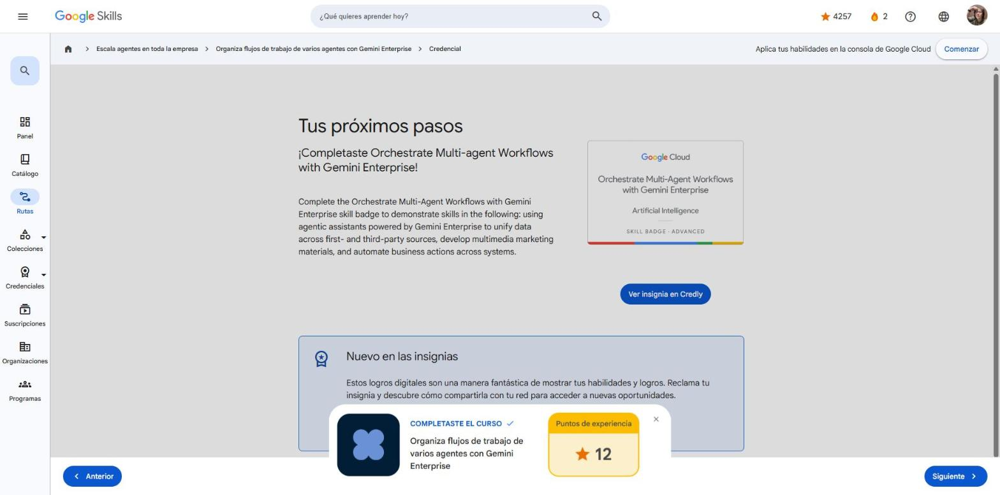

# 4. Organiza flujos de trabajo de varios agentes con Gemini Enterprise

Curso con **insignia de habilidad** de la ruta **GEAR: Escala agentes en toda la empresa** · 1 h · Introductorio.
Enlace: <https://www.skills.google/paths/3980/course_templates/1682>

---

## Organiza flujos de trabajo de varios agentes con Gemini Enterprise

El curso lleva los agentes a las operaciones diarias. Primero presenta casos por industria, luego una demostración en la consola de Gemini Enterprise y por último un lab simulado para practicar.

**Casos de uso de agentes con Gemini Enterprise:**

| Caso | Qué hacen los agentes |
|---|---|
| **Trabajadores de primera línea (retail)** | Consultan datos en tiempo real y ejecutan tareas de varios pasos: generar cotizaciones o reservar artículos |
| **Planta de fabricación autónoma** | Pasan del mantenimiento manual a una cadena de suministro que se recupera sola. Diagnostican la falla con manuales y bases internas y luego consultan la API del proveedor (disponibilidad y plazos de entrega) |
| **Hojas de ruta para tiendas** | Arman de forma autónoma un plan matutino priorizado para el gerente (estadísticas + acciones) |
| **Centro de contacto inteligente** | Analizan la conversación en tiempo real y dan sugerencias contextuales al agente humano |
| **Marketing multiagente** | Investigan y generan de forma autónoma una campaña de medios digitales |

!!! tip "Para recordar"
    - El **razonamiento de agentes** les permite *ejecutar* soluciones, no solo listar problemas.
    - Pista: un buen agente encadena diagnóstico → consulta de sistemas externos → acción, para reducir el tiempo de inactividad.

## Crea una campaña de marketing con varios agentes

Escenario: gerente de una tienda de ropa para exteriores que orquesta una campaña de extremo a extremo desde la consola de Gemini Enterprise.

1. **Deep Research (investigación exhaustiva).** Se le da una instrucción con el rol del usuario y preguntas concretas: qué marcas rindieron mejor, dónde invertir en marketing y qué productos tienen más potencial. Combina **datos propios** (ventas, campañas anteriores) con **datos de terceros** (tendencias de moda).
    - Antes de investigar, el agente propone un **plan de investigación**. Se puede ajustar con instrucciones de seguimiento en el chat y luego se elige **Iniciar investigación**.
    - El informe cita las fuentes internas y externas que usó.
2. **Recursos del catálogo.** Se le pide la lista de productos con los vínculos a sus imágenes.
3. **Agente de marketing.** Se invoca escribiendo **`@`** en el chat. Genera variantes del anuncio (la misma persona y chaqueta, con un atardecer de fondo) y entrega descripción, justificación y vínculo.
4. **AdGen Agent.** Convierte las imágenes en un **video corto**. Recibe marca, producto, ubicación, edad, género e intereses del público objetivo. Primero propone una historia (guion visual), que se revisa y confirma antes de generar los clips.
5. **The Analyst (agente analista).** Automatiza la acción de seguimiento: crea un **ticket en ServiceNow** con el resumen de la campaña para el equipo de comercialización.

Ventaja clave: todo el flujo (investigación → creativos → automatización) ocurre **en una sola plataforma**, lo que acelera los proyectos.

!!! tip "Para recordar"
    - `@NombreDelAgente` sirve para llamar a un agente especializado o cambiar de agente.
    - Para cambiar el enfoque de Deep Research, se envía una instrucción de seguimiento **antes** de iniciar la investigación.
    - Pista: Deep Research = investigar; Marketing = imágenes; AdGen = video; Analyst = acciones en sistemas externos (ServiceNow).

## Fundamentación y ADK en el flujo de agentes

- Las sugerencias contextuales (p. ej., un tema invernal en julio para una tienda del hemisferio sur) son posibles porque la instrucción se **fundamenta en datos en tiempo real**: ubicación geográfica y estacionalidad.
- El **Agent Development Kit (ADK)** sirve para convertir funciones de Python en **herramientas** que los agentes usan para pensar y actuar.

!!! tip "Para recordar"
    - Fundamentación = respuestas ancladas en datos reales y actuales.
    - Pista: ADK = funciones → herramientas del agente.

## Cuestionario e insignia

**Resultado: 100 %** (mínimo 80 %, 7 preguntas).

**Insignia de habilidad:** *Orchestrate Multi-Agent Workflows with Gemini Enterprise* (Skill Badge).

## Fuentes y aviso legal

- **Fuente:** cursos de la ruta GEAR de Google Cloud Skills Boost. Sitios oficiales: [cloudskillsboost.google](https://www.cloudskillsboost.google) · [cloud.google.com/docs](https://cloud.google.com/docs).
- **Uso:** apuntes personales de estudio, sin fines comerciales y con redacción propia. Las imágenes del curso son fragmentos breves citados con fines educativos; sus derechos son de sus titulares.
- **Sin afiliación:** sitio no oficial, no afiliado ni respaldado por Google. Las marcas pertenecen a sus dueños.
- Más detalles y cómo pedir el retiro de contenido en el [aviso legal](../../aviso-legal.md).
