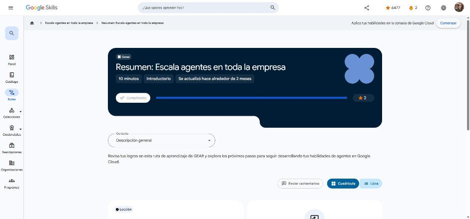

# 5. Resumen: Escala agentes en toda la empresa

Curso de cierre (10 min). Enlace: <https://www.skills.google/paths/3980/course_templates/1777>

## Conclusión

Repaso de la ruta:

1. **Agentes de IA generativa: transforma tu organización**: cómo las organizaciones usan agentes de IA generativa personalizados para retos de negocio concretos (modelos, bucles de razonamiento, herramientas, RAG, Vertex AI Search, Customer Engagement Suite, Gemini Enterprise y estrategia).
2. **IA centrada en los humanos**: distinguir entre **potenciación** y **automatización**, y equilibrar la eficiencia de la máquina con la intuición humana.
3. **Organiza flujos de trabajo de varios agentes con Gemini Enterprise**: el marco operativo de los asistentes de agentes frente a las herramientas de IA estándar, casos por industria y práctica de un flujo completo (Deep Research → creativos de imagen y video → acciones en plataformas externas).

**Siguiente ruta GEAR:** construir sistemas multiagente de alto rendimiento.

!!! tip "Para recordar"
    - Escalar agentes = casos de negocio claros + personas en el centro + orquestación multiagente en una sola plataforma.
    - Pista: Gemini Enterprise es el punto de entrada de los empleados a los agentes de la empresa.

*Figura: el curso aparece como completado en Google Skills.*
