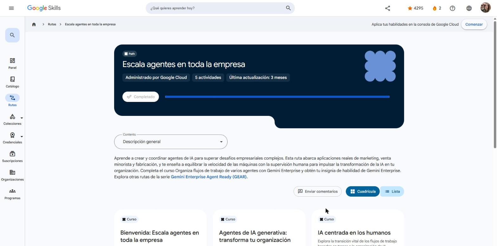

# Google Skills · GEAR: Escala agentes en toda la empresa

Programa **Google Cloud Career Launchpad – LatAm** (MinTIC) · Plataforma: Google Skills
Ruta: <https://www.skills.google/paths/3980> · Serie **Gemini Enterprise Agent Ready (GEAR)**, ruta 4 de 6.

Ruta para crear y coordinar agentes de IA que resuelvan desafíos empresariales en marketing, retail y manufactura, equilibrando la velocidad de las máquinas con la supervisión humana. Combina visión de liderazgo (agentes de IA generativa, IA centrada en las personas) con práctica en **Gemini Enterprise** (flujos de trabajo multiagente, insignia de habilidad).

## Actividades

| # | Actividad | Duración | Estado | Fecha | Resultado | Notas |
|---|---|---|---|---|---|---|
| 1 | [Bienvenida: Escala agentes en toda la empresa](https://www.skills.google/paths/3980/course_templates/1776) | 10 min | ✅ Completado | 2026-10-25 | — | [Notas](01-bienvenida.md) |
| 2 | [Agentes de IA generativa: transforma tu organización](https://www.skills.google/paths/3980/course_templates/1267) | 1 h 30 min | ✅ Completado | 2026-10-25 | 2 cuestionarios al 100 % · insignia *Gen AI Agents: Transform Your Organization* | [Notas](02-agentes-ia-generativa-transforma-tu-organizacion.md) |
| 3 | [IA centrada en los humanos](https://www.skills.google/paths/3980/course_templates/1643) | 15 min | ✅ Completado | 2026-10-25 | Cuestionario 100 % · insignia *Human-Centered AI* | [Notas](03-ia-centrada-en-humanos.md) |
| 4 | [Organiza flujos de trabajo de varios agentes con Gemini Enterprise](https://www.skills.google/paths/3980/course_templates/1682) (insignia de habilidad) | 1 h | ✅ Completado | 2026-10-25 | Cuestionario 100 % · insignia de habilidad *Orchestrate Multi-Agent Workflows with Gemini Enterprise* | [Notas](04-organiza-flujos-multiagente-gemini-enterprise.md) |
| 5 | [Resumen: Escala agentes en toda la empresa](https://www.skills.google/paths/3980/course_templates/1777) | 10 min | ✅ Completado | 2026-10-25 | — | [Notas](05-resumen.md) |

**Progreso de la ruta:** 5 de 5 actividades (100 %) · ruta ✅ Completado.

## Insignias obtenidas

- **Gen AI Agents: Transform Your Organization** (completion badge)
- **Human-Centered AI** (completion badge)
- **Orchestrate Multi-Agent Workflows with Gemini Enterprise** (skill badge)

## Evidencias

## Fuentes y aviso legal

- **Fuente:** cursos de la ruta GEAR de Google Cloud Skills Boost. Sitios oficiales: [cloudskillsboost.google](https://www.cloudskillsboost.google) · [cloud.google.com/docs](https://cloud.google.com/docs).
- **Uso:** apuntes personales de estudio, sin fines comerciales y con redacción propia. Las imágenes del curso son fragmentos breves citados con fines educativos; sus derechos son de sus titulares.
- **Sin afiliación:** sitio no oficial, no afiliado ni respaldado por Google. Las marcas pertenecen a sus dueños.
- Más detalles y cómo pedir el retiro de contenido en el [aviso legal](../../aviso-legal.md).
