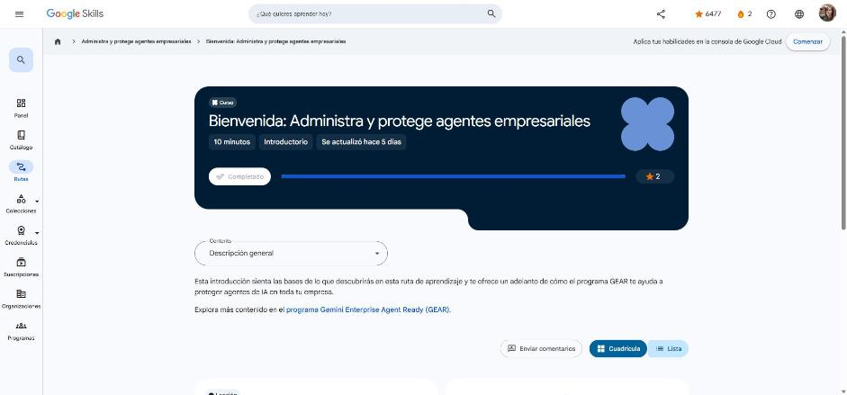

# 1. Bienvenida: Administra y protege agentes empresariales

Curso de bienvenida (10 min). Enlace: <https://www.skills.google/paths/4461/course_templates/1886>

## Te damos la bienvenida

Esta es la última ruta de la serie **GEAR**. Su meta es que los agentes estén listos para la empresa, con **seguridad y gobierno sólidos**:

- **Guardrails** sobre el acceso y el comportamiento de los agentes con *callbacks*.
- **Perímetros de infraestructura seguros** (IAM, VPC Service Controls).
- **Supervisión de la confianza operativa** para mantener la seguridad, la confiabilidad y el cumplimiento a escala.

Temas de la ruta:

1. Proteger la memoria de los agentes, aplicar controles de acceso estrictos y guardrails para despliegues seguros y conformes.
2. Arquitectura de **confianza cero** (*zero trust*) con Gemini Enterprise Agent Platform.
3. Riesgos de seguridad de los LLM y cómo **Model Armor** protege las aplicaciones de IA.
4. Enrutar el tráfico saliente de los agentes por **proxies regionales** (Agent Gateway), filtrar consultas contra **inyección de instrucciones** y usar extensiones de **Identity-Aware Proxy (IAP)** para inyectar credenciales de forma segura.

!!! tip "Para recordar"
    - Gobierno de agentes = identidad + perímetro + filtros de contenido + monitoreo.
    - Pista: Model Armor filtra lo que entra al modelo y lo que sale de él; Agent Gateway controla el tráfico saliente del agente.

*Figura: el curso aparece como completado en Google Skills.*
