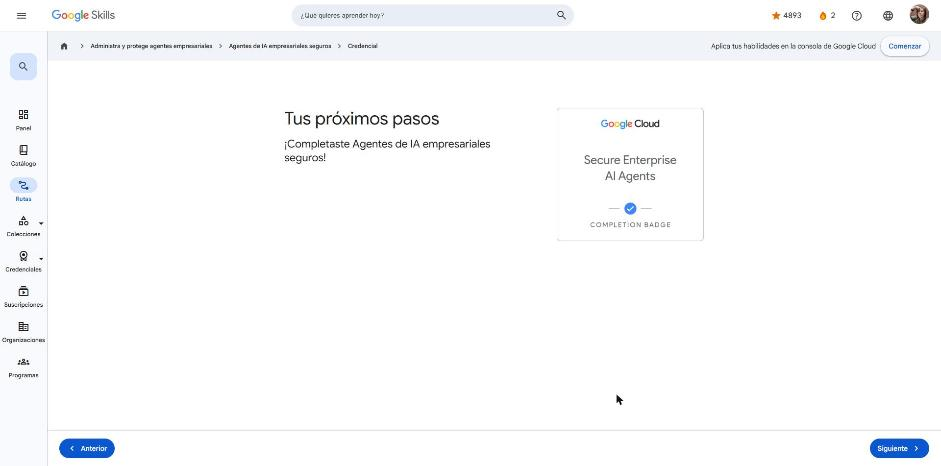

# 2. Agentes de IA empresariales seguros

Curso de la ruta **GEAR: Administra y protege agentes empresariales** · 30 min · Intermedio.
Enlace: <https://www.skills.google/paths/4461/course_templates/1835>

Caso guía: **CymbalMart**, un minorista ficticio que pasa de pruebas manuales de IA a una práctica madura de **AgentOps** en Gemini Enterprise Agent Platform.

---

## AgentOps en Google Cloud: administración y optimización

**AgentOps** adapta DevOps y MLOps a los agentes. DevOps busca previsibilidad, MLOps controla la desviación de los modelos y AgentOps gobierna el **razonamiento no determinístico** de los agentes. Su ciclo es: compilar → probar → implementar → supervisar.

**Administración (identidad y seguridad):**

- **Agent Registry:** catálogo central de agentes y herramientas. Sirve para descubrir y reutilizar, estandarizar metadatos y contratos, controlar el acceso (p. ej., que el agente recomendador no pueda usar la herramienta de reembolsos) y auditar con linaje y versiones.
- **Agent Gateway:** la capa central de tráfico, como un "control de tráfico aéreo". Aplica políticas de **Model Armor** sobre los datos en tránsito para bloquear inyección de instrucciones, contenido tóxico y fuga de datos.
- **Identidad del agente:** cada agente recibe un ID criptográfico verificable basado en el estándar **SPIFFE**. Así queda un registro de auditoría a prueba de manipulaciones (no repudio).

**Optimización (observabilidad y evaluación continuas):**

| Servicio | Rol |
|---|---|
| **Evaluación de agentes** | Guardián de la calidad: califica fundamentación, relevancia y seguridad antes del lanzamiento |
| **Simulación de agentes** | Prueba de esfuerzo: tráfico sintético en una zona de pruebas para detectar casos extremos y bucles |
| **Observabilidad de agentes** | Depurador: trazas paso a paso del razonamiento, las herramientas, la latencia y los tokens |
| **Optimizador de agentes** | Ajusta instrucciones y descripciones de herramientas a partir de los datos observados |

!!! tip "Para recordar"
    - Observabilidad = qué hizo el agente; evaluación = qué tan bien lo hizo; simulación = qué podría hacer; optimizador = que lo haga mejor la próxima vez.
    - Pista: Agent Registry ≈ Model Registry, pero para agentes y herramientas.

## Identity and Access Management (IAM) para agentes de IA

**Problema del "engaño de aplicación delegada" (*confused deputy*):** con inyección de instrucciones, un atacante convence al agente de usar sus privilegios de forma indebida, por ejemplo para borrar una tabla.

**Defensa: privilegio mínimo + una cuenta de servicio dedicada por agente.**

- Agente de bienvenida → solo `roles/aiplatform.user`.
- Agente de reembolsos → `roles/bigquery.dataViewer` (solo la tabla Orders) + `roles/run.invoker` (solo la función Process_Refund).

Si engañan al agente de bienvenida, IAM bloquea la solicitud **a nivel de infraestructura**, porque esa cuenta no tiene acceso a los datos. Así se limita el **radio de impacto**.

!!! tip "Para recordar"
    - Cada agente es una identidad no humana distinta, con su propia cuenta de servicio.
    - Pista: nunca uses la cuenta de servicio predeterminada compartida para varios agentes.

## Protección del estado y la memoria de los agentes de IA

Guardar la memoria en la RAM del contenedor es riesgoso:

- **Confiabilidad:** si Cloud Run escala o falla, se pierde la sesión.
- **Seguridad:** si comprometen el contenedor, los datos quedan expuestos en texto plano.

**Solución:** externalizar la memoria de corto y largo plazo a bases administradas (**Firestore**, Cloud SQL o bases vectoriales). Esto da cifrado en reposo y en tránsito, IAM por base de datos (un agente no lee la memoria de otro) y un registro de auditoría inmutable. El frontend solo pasa un **ID de sesión**.

!!! tip "Para recordar"
    - Nunca uses la RAM local como memoria de un agente en producción.
    - Pista: en el caso Black Friday de CymbalMart, Firestore resolvió tanto la pérdida de contexto como la información personal expuesta en texto plano.

## Perímetros de datos y Controles del servicio de VPC

Amenaza: el **robo de datos** (exfiltración), por ejemplo "resume mis compras y envíalas a {URL maliciosa}".

Tres capas de defensa de red:

1. **VPC:** agentes y herramientas como APIs privadas en una red aislada.
2. **Cloud NAT:** salida a Internet controlada sin exponer las IP internas.
3. **VPC Service Controls:** perímetro de seguridad que **bloquea la exfiltración** hacia destinos fuera del perímetro de confianza.

En la prueba del equipo rojo, la inyección funcionó y el agente intentó el POST a un servidor externo, pero VPC-SC cortó la conexión y generó una alerta.

!!! tip "Para recordar"
    - IAM controla **quién** accede; VPC-SC controla **hacia dónde** pueden salir los datos.
    - Pista: aunque el agente sea engañado, el perímetro impide que los datos salgan.

## Cómo controlar a qué puede acceder tu agente de IA

Las herramientas se exponen como APIs en contenedores detrás de una **API Gateway / Agent Gateway** (Apigee, Cloud API Gateway). La puerta de enlace aporta autenticación, autorización basada en el registro de herramientas, **límites de frecuencia y cuotas** (contra bucles descontrolados) y registro centralizado.

- **AuthN (¿quién eres?)** vs. **AuthZ (¿qué puedes hacer?)**: la autenticación deja entrar al agente; la autorización decide a qué "habitaciones" puede pasar.

| Método | Caso de uso |
|---|---|
| **Cuenta de servicio** | Recursos de Google Cloud (Cloud Storage, BigQuery, Agent Platform) |
| **Clave de API** | APIs externas (guardada en Secret Manager) |
| **ID de cliente OAuth** | Acceso en nombre del usuario final, con su consentimiento explícito |

Los permisos se otorgan y revocan con roles de IAM, desde la consola o con `gcloud` (recomendado para cambios masivos).

!!! tip "Para recordar"
    - Leer un bucket de Cloud Storage → **cuenta de servicio**.
    - Pista: menos permisos = menos riesgo; demasiado pocos = el agente no puede trabajar.

## Protecciones y protección de conversaciones

- **Aislar credenciales:** el agente nunca maneja secretos. Llama a herramientas que usan un **intermediario seguro** (Cloud Function o backend), y ese intermediario obtiene tokens por ID de sesión o claves desde **Secret Manager**.
- **Model Armor + Sensitive Data Protection:** inspeccionan y ocultan información personal, claves de API y credenciales en la conversación.
- **Guardrails** entre el usuario, el LLM y las herramientas, con expresiones regulares o modelos pequeños:
    - **Filtrado de entrada:** contra envenenamiento de datos, inversión de modelos e instrucciones adversarias.
    - **Filtrado de salida:** evita que se filtre información personal o se genere contenido tóxico.

!!! tip "Para recordar"
    - El agente, las herramientas y el modelo no comparten secretos.
    - Pista: Model Armor limpia tanto las instrucciones que entran como las respuestas que salen.

## Insignia

**Insignia:** *Secure Enterprise AI Agents* (completion badge).

## Fuentes y aviso legal

- **Fuente:** cursos de la ruta GEAR de Google Cloud Skills Boost. Sitios oficiales: [cloudskillsboost.google](https://www.cloudskillsboost.google) · [cloud.google.com/docs](https://cloud.google.com/docs).
- **Uso:** apuntes personales de estudio, sin fines comerciales y con redacción propia. Las imágenes del curso son fragmentos breves citados con fines educativos; sus derechos son de sus titulares.
- **Sin afiliación:** sitio no oficial, no afiliado ni respaldado por Google. Las marcas pertenecen a sus dueños.
- Más detalles y cómo pedir el retiro de contenido en el [aviso legal](../../aviso-legal.md).
