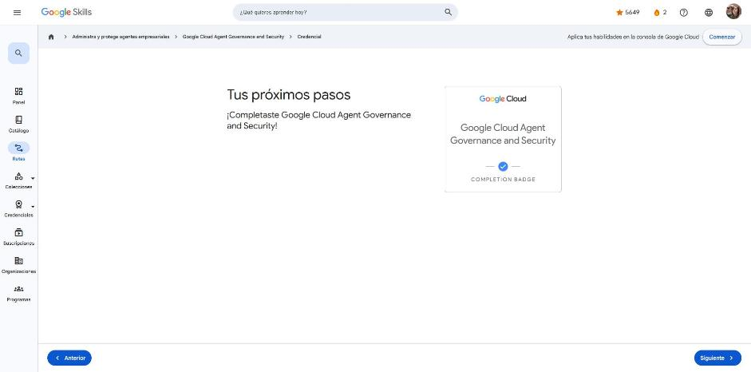

# 3. Google Cloud Agent Governance and Security

Curso de la ruta **GEAR: Administra y protege agentes empresariales** · 2 h 45 min · Avanzado (en inglés).
Enlace: <https://www.skills.google/paths/4461/course_templates/1843>

Caso guía: **Project VaultKeeper** de Cymbal Banking, un sistema multiagente de préstamos con cuatro agentes: Ingestion, Underwriting, Valuation y Dispatcher. Una auditoría del equipo rojo logró una inyección de instrucciones escondida en un PDF de impuestos. Como los agentes tenían demasiados privilegios y no estaban aislados en la red, se exfiltraron datos de BigQuery. El curso corrige esto en **cuatro puntos de control de seguridad** con una arquitectura de **confianza cero**.

---

## Introduction · Agent security fundamentals

**Por qué cambia la seguridad:** el modelo tradicional (perímetro de red + ACL + "si está autenticado, es legítimo") no sirve cuando un agente planifica, consulta datos y llama APIs por su cuenta. Se necesita una postura **centrada en identidad y de confianza cero**, con evaluación en tiempo real.

**Mitos comunes:**

- *¿Usar las credenciales del usuario para el agente?* No: si secuestran al agente, el atacante hereda todos los permisos del usuario. Cada agente necesita su **propia identidad de máquina** con privilegio mínimo.
- *¿Basta un firewall?* No: los firewalls L3/L4 no entienden la **intención semántica** de una solicitud a un LLM.
- *¿RBAC sirve?* Sí, pero no alcanza. Además de "¿puede hacerlo?", hay que preguntar "¿**debería** hacerlo ahora?".

**Términos clave:**

| Término | Qué es |
|---|---|
| **Agent Principal** | Identificador IAM único basado en **SPIFFE**, ligado criptográficamente al runtime del agente |
| **Agent Gateway** | Punto de aplicación de políticas (PEP) para el tráfico de entrada y salida del agente en una región |
| **Model Armor** | Filtro que inspecciona prompts y respuestas: inyecciones, *jailbreaks* y fuga de datos |
| **Semantic Governance** | Verificación en el gateway que valida las llamadas a herramientas propuestas |
| **Agent Registry** | Catálogo central de agentes, herramientas, endpoints y servidores MCP |

!!! tip "Para recordar"
    - Confianza cero = cada agente tiene identidad propia y cada acción se evalúa.
    - Pista: el firewall no lee la intención; Model Armor y Semantic Governance sí.

## Agent Gateway and separation patterns (punto de control 1)

1. **Separar entrada y salida:** proxy de ingress (cliente → agente) y **Agent Gateway como egress proxy** (agente → modelos, herramientas y bases de datos).
2. **Agent Identity Auth Manager:** las credenciales (secretos OAuth, claves de API, tokens) se guardan en una bóveda administrada por Google. El gateway intercepta la llamada a la herramienta, obtiene la credencial e **inyecta los encabezados "por el cable"**. El contenedor del agente **nunca ve las claves**, así que la inyección de instrucciones no puede robarlas. Con OAuth de 3 patas, el agente solo maneja un `session_id`.
3. **En código (ADK):** `pip install "google-adk[agent-identity]"`, registrar `GcpAuthProvider` y asociar un `GcpAuthProviderScheme` al `McpToolset`.
4. **Aprovisionar el egress gateway** (`gcloud alpha network-services agent-gateways import ...`) y desplegar el agente en Agent Runtime con `agent_gateway_config` e `identity_type=AGENT_IDENTITY`.

Detalles: en modo ingress, el gateway solo gobierna `query` y `streamQuery`. Todos los agentes del mismo proyecto y región comparten el mismo egress gateway.

!!! tip "Para recordar"
    - Credenciales en la bóveda + inyección en el gateway = el agente nunca toca secretos.
    - Pista: si las claves están en variables de entorno, una inyección de instrucciones puede exfiltrarlas.

## Agent registry and Apigee tool federation

- **Agent Registry** separa la lectura (descubrimiento: `search_agents`, `get_mcp_server`…) de la escritura administrativa (`create_binding`, `update_service`…). Tiene tres tipos de recursos: agente, servidor MCP y endpoint.
- **Federación de APIs heredadas con Apigee:**
    - **Endpoints** registrados.
    - **Spec boost**: la IA enriquece las especificaciones OpenAPI para dejarlas listas para agentes.
    - **Apigee MCP proxy**: traduce JSON-RPC de MCP (`tools/call`) a REST.
- **Asegurar la ejecución:** Apigee lee el JSON-RPC (`method`, `params.name`) para autorizar con detalle. Por ejemplo, permite `tools/list` al agente Ingestion, pero bloquea `tools/call` sobre la herramienta de suscripción de crédito.
- **Sincronización API Hub → Agent Registry:** se activa el add-on y las APIs se etiquetan con estilo MCP.

!!! tip "Para recordar"
    - Apigee = puente MCP↔REST + autorización por herramienta.
    - Pista: en un entorno gobernado, el egress gateway bloquea endpoints que no están en el registro.

## Service Extensions and interception architecture (punto de control 2)

Las **Service Extensions** conectan el Agent Gateway con Model Armor (y con Semantic Governance). El gateway pausa el tráfico, envía el payload por gRPC, recibe un veredicto y reenvía el tráfico o lo bloquea con **403**.

- **Modo de aplicación:** *Inspect only* (auditoría, solo registra) o *Inspect and block* (defensa activa).
- **Perfiles:** `REQUEST_AUTHZ` revisa solo encabezados (p. ej., para delegar en IAP). `CONTENT_AUTHZ` revisa todo el payload (para Model Armor).
- `failOpen`: si es `true` y Model Armor no responde, el tráfico pasa. En sistemas financieros se usa `false`.

!!! tip "Para recordar"
    - `CONTENT_AUTHZ` es el perfil que permite a Model Armor ver el cuerpo de la solicitud y de la respuesta.
    - Pista: primero se audita (*inspect only*) y después se bloquea.

## Semantic protections and safety templates

- **Entrada (prompts):** filtro de inyección y *jailbreak* con confianza alta, y filtro de URL maliciosas (hasta 40 por payload).
- **Salida (respuestas):** **Sensitive Data Protection**. El modo básico bloquea, y el **avanzado** usa plantillas DLP de inspección y desidentificación para **enmascarar** datos personales o de salud sin bloquear la transacción.
- Plantillas con `gcloud beta model-armor templates create ...` y códigos de error corporativos personalizados.

!!! tip "Para recordar"
    - Para redactar datos personales en la salida sin bloquear: `CONTENT_AUTHZ` + SDP avanzado con plantillas DLP.
    - Pista: si las plantillas DLP están en otro proyecto, la cuenta de servicio de Model Armor necesita `dlp.user` y `dlp.reader`.

## Semantic governance policy (SGP) and guardrails

Model Armor no detecta una secuencia "benigna" de llamadas que viola una política, como leer una cuenta y luego transferir USD 50 000 al exterior. La **SGP** resuelve ese caso:

- Las políticas se escriben en **lenguaje natural** (p. ej., "No transferir más de USD 1000 a cuentas externas"). Un LLM evalúa cada llamada propuesta contra la intención del usuario y la regla, y devuelve **ALLOW/DENY** con su justificación.
- Sirve para límites de gasto, **combinaciones tóxicas de herramientas** (exportar clientes → enviar correo externo) y reglas de negocio contextuales.
- Modos: `DRY_RUN` (solo registra) y `ENFORCE` (bloquea, quitando la llamada antes de que el agente la reciba).
- Componentes: motor SGP (conectado por Private Service Connect), política ligada a un agente del registro y una extensión `CONTENT_AUTHZ` en el gateway.
- Orden en el gateway: Model Armor filtra el prompt y luego la SGP evalúa las llamadas a herramientas propuestas.

!!! tip "Para recordar"
    - Model Armor = contenido; SGP = comportamiento (qué herramienta, con qué parámetros).
    - Pista: no uses la SGP para detectar datos personales; eso le corresponde a Model Armor con SDP.

## Agentic IAM and cryptographic identities (punto de control 3)

Las cuentas de servicio compartidas generan exceso de permisos, claves JSON robables y falta de atribución.

| | Cuenta de servicio | **Agent Identity** |
|---|---|---|
| Tipo | Identidad general | Identidad de máquina **SPIFFE**, atestiguada criptográficamente |
| Compartible | Sí | No, ligada a un solo agente desplegado |
| Claves | JSON exportables de larga vida | Efímeras, rotan cada 24 h y no se pueden exportar |
| Aislamiento | Débil | Fuerte |

- Despliegue con `identity_type=AGENT_IDENTITY`. Los roles se otorgan al **principal URI** (`principal://agents.global.org-…/…/reasoningEngines/ID`), por gcloud o Terraform.
- **URN** = nombre lógico en el registro (`urn:agent:…`). **URI de principal** = identidad de seguridad para IAM.
- Los tokens quedan ligados al certificado del agente (DPoP), así que no se pueden reutilizar si los roban.

!!! tip "Para recordar"
    - Un agente, una identidad SPIFFE, roles mínimos sobre su principal.
    - Pista: URN para el catálogo; URI de principal para IAM.

## Cryptographic handshakes

- **mTLS** en la entrada del gateway: el token presentado debe coincidir con el certificado del cliente.
- **DPoP (RFC 9449)** en la salida: el gateway firma una prueba JWT con una clave efímera y la API de destino la valida. Así se evita la reutilización de tokens exfiltrados.
- mTLS protege el canal (capa de transporte) y termina en el gateway. DPoP protege el token (capa de aplicación) de extremo a extremo.

!!! tip "Para recordar"
    - mTLS = canal autenticado; DPoP = token ligado a quien lo envía.
    - Pista: el error `use_dpop_nonce` se resuelve reintentando con el nonce nuevo (el ADK lo hace solo).

## Tool authorization via registry bindings

Un **registry binding** asocia 1 a 1 un URN de agente con un URN de servidor de herramientas. Sin binding, el gateway bloquea la ejecución.

```bash
gcloud alpha agent-registry bindings create binding-underwriter-to-credit \
  --source-identifier=urn:agent:cymbal:vaultkeeper:underwriter-agent \
  --target-identifier=urn:mcp:cymbal:financial-apis:credit-mcp-server
```

Se puede extender con un **auth provider** y *scopes* para OAuth delegado por el usuario (p. ej., Plaid). Ejecución directa (sin registro) = sin control; ejecución gobernada = binding + inyección de credenciales + auditoría.

!!! tip "Para recordar"
    - Binding = la "lista de invitados" de herramientas por agente.
    - Pista: un binding hacia un endpoint de grupo autoriza todas las herramientas de ese grupo.

## Network isolation and VPC Service Controls (punto de control 4)

Un agente secuestrado puede copiar una tabla de BigQuery a un bucket del atacante usando APIs públicas de Google. Los firewalls e IAM no lo impiden. **VPC Service Controls** encierra en un perímetro los servicios administrados (`aiplatform.googleapis.com`, `bigquery.googleapis.com`) y **deniega por defecto** cualquier movimiento de datos hacia fuera, aunque los permisos IAM sean amplios.

- IAM responde "¿quién y qué?"; VPC-SC responde "¿desde dónde y hacia dónde?".
- Conviene empezar en **modo dry-run** (bloque `spec`) y crear *access levels* para los desarrolladores.
- VPC-SC no bloquea APIs de terceros en Internet. Eso lo controlan Cloud NAT o un proxy de salida.

!!! tip "Para recordar"
    - Exfiltración por APIs de Google → perímetro VPC-SC alrededor de Agent Runtime y BigQuery.
    - Pista: defensa en profundidad = IAM + VPC-SC.

## Audit logging and telemetry sinks

- Campos clave del log de Model Armor: `sanitizationResult.verdict` (BLOCKED), `details[].category` (PROMPT_INJECTION…) y `resource.labels.agent_id`.
- **Logs Explorer** para investigar a mano. **Sink a Pub/Sub** para enviar en tiempo real a un SIEM/SOAR (Splunk, CrowdStrike).
- La cuenta `writer_identity` del sink necesita `roles/pubsub.publisher` sobre el tema.

!!! tip "Para recordar"
    - Seguridad sin telemetría es ciega: hay que filtrar los bloqueos y llevarlos al SIEM.
    - Pista: si el sink no publica, casi siempre falta el permiso de publicador.

## Summary

Arquitectura final: ALB de entrada → perímetro VPC-SC → Agent Runtime con identidad SPIFFE → Agent Gateway (mTLS/DPoP, PEP) → Model Armor + Semantic Governance → Registry y auth manager → pipeline de telemetría hacia el SIEM.

**Tres reglas de confianza cero:**

1. Nunca expongas credenciales crudas.
2. Verifica la integridad semántica (entrada y salida).
3. Contén el entorno de ejecución, porque IAM solo no basta.

!!! tip "Para recordar"
    - Identidad + gateway + filtros semánticos + perímetro + telemetría.
    - Pista: cada punto de control resolvió una falla concreta de la auditoría del equipo rojo.

## Cuestionarios

Cuatro cuestionarios de módulo aprobados al **100 %**:

- Inyectar credenciales → bóveda + interceptación en el Agent Gateway + inyección "por el cable".
- Enmascarar datos personales en la salida → `CONTENT_AUTHZ` + SDP avanzado con plantillas DLP.
- Mínimo privilegio → `AGENT_IDENTITY` (SPIFFE) + rol `bigquery.dataViewer` sobre el principal del agente.
- Exfiltración por googleapis.com → perímetro VPC Service Controls.

**Insignia:** *Google Cloud Agent Governance and Security* (completion badge).



## Fuentes y aviso legal

- **Fuente:** cursos de la ruta GEAR de Google Cloud Skills Boost. Sitios oficiales: [cloudskillsboost.google](https://www.cloudskillsboost.google) · [cloud.google.com/docs](https://cloud.google.com/docs).
- **Uso:** apuntes personales de estudio, sin fines comerciales y con redacción propia. Las imágenes del curso son fragmentos breves citados con fines educativos; sus derechos son de sus titulares.
- **Sin afiliación:** sitio no oficial, no afiliado ni respaldado por Google. Las marcas pertenecen a sus dueños.
- Más detalles y cómo pedir el retiro de contenido en el [aviso legal](../../aviso-legal.md).
