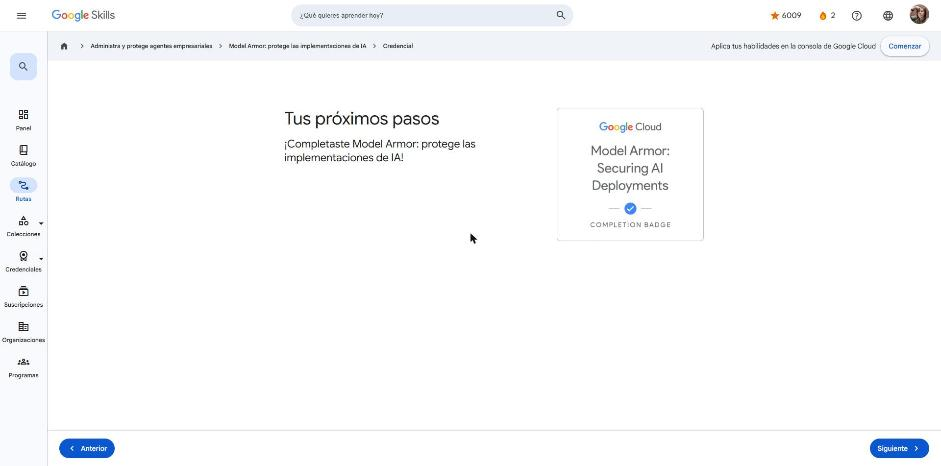

# 4. Model Armor: protege las implementaciones de IA

Curso de la ruta **GEAR: Administra y protege agentes empresariales** · 2 h 30 min · Introductorio.
Enlace: <https://www.skills.google/paths/4461/course_templates/1385>

**Módulos:** Descripción general · Personaliza Model Armor · Usa Model Armor · Combina todas las opciones · Conclusión.

---

## ¿Cuáles son los beneficios?

Un LLM y sus datos son un activo valioso y, por lo mismo, un blanco atractivo. **Model Armor** funciona como un "control de seguridad de aeropuerto" para el modelo: revisa cada **instrucción que entra** y cada **respuesta que sale**.

Al terminar el curso podrás explicar su propósito, definir sus protecciones, configurar la API, ubicar las infracciones y entender cómo trata instrucciones y respuestas.

!!! tip "Para recordar"
    - Model Armor es un servicio de **filtrado (screening)** para LLM: no genera ni entrena modelos.
    - Pista: inspecciona tanto lo que entra al modelo como lo que sale de él.

## Acerca de Model Armor

Analiza prompts y respuestas según la configuración que elijas, y marca:

- Contenido contra la **IA responsable** (odio, acoso, contenido peligroso o sexual).
- **Inyección de instrucciones y *jailbreak*** (p. ej., "Ignora las instrucciones anteriores…", incluso disfrazado dentro de código).
- **URL maliciosas**, comparadas con bases de datos de phishing y malware.
- **Datos sensibles** en la entrada (alguien comparte su número de seguridad social) o en la salida (el modelo devuelve una tarjeta). Con desidentificación puede, por ejemplo, enmascarar todo menos los últimos 4 dígitos.

!!! tip "Para recordar"
    - Model Armor analiza instrucciones y respuestas en busca de inyección, fuga de datos y contenido malicioso.
    - Pista: también puede revisar PDF y texto extraído de documentos.

## Riesgos de seguridad de los LLM

El **OWASP Top 10 para LLM** es la lista de referencia de vulnerabilidades. Model Armor mitiga cuatro de ellas:

| Amenaza | Protección de Model Armor |
|---|---|
| Archivos maliciosos y URL inseguras | Detección de URL maliciosas y análisis de PDF |
| Inyección de instrucciones y *jailbreaks* | Detección de inyección y *jailbreak* |
| Divulgación de datos sensibles | **Sensitive Data Protection** (DLP con infoTypes) |
| Material ofensivo | Filtros de seguridad y de **IA responsable** |

!!! tip "Para recordar"
    - De OWASP, Model Armor aborda sobre todo la **inyección de instrucciones** y la **divulgación de datos sensibles**.
    - Pista: no cubre el robo de modelos, la cadena de suministro ni el envenenamiento de datos de entrenamiento.

## Acerca de la personalización

No existe una configuración única para todos. Model Armor se personaliza con dos piezas:

- **Configuración de límites (*floor settings*)**: los mínimos de seguridad que toda plantilla debe cumplir.
- **Plantillas**: el panel de control que define cómo se examinan instrucciones y respuestas.

!!! tip "Para recordar"
    - Primero los límites y después las plantillas, como primero los cimientos y después las paredes.
    - Pista: los límites son el piso; la plantilla es la configuración concreta.

## Configuración de límites

- Se definen a nivel de **organización, carpeta o proyecto** y se heredan hacia abajo.
- Cubren los filtros de IA responsable, inyección y *jailbreak*, URL maliciosas y protección de datos sensibles, con **umbrales mínimos de confianza**.
- Si una plantilla es menos estricta que el límite, Model Armor **muestra un error y no la guarda**. El intento también queda en el Explorador de registros.
- Con los permisos adecuados, un administrador puede romper la herencia para un proyecto especial.

!!! tip "Para recordar"
    - Requisitos mínimos para todas las plantillas → **configuración de límites**.
    - Pista: una plantilla nunca puede ser más laxa que el piso.

## Protecciones y niveles de confianza

El **nivel de confianza** indica qué tan seguro debe estar Model Armor antes de marcar una infracción. Es un equilibrio entre detectar verdaderos positivos y evitar falsos positivos.

| Nivel | Comportamiento |
|---|---|
| Bajo y superior | Lo más sensible: marca casi todo |
| **Medio y superior** | Punto de partida recomendado |
| Alto y superior | Solo marca con alta certeza |

Solo la **detección de inyección y *jailbreak*** y los **filtros de IA responsable** tienen nivel de confianza. Las URL maliciosas y los datos sensibles no lo tienen.

!!! tip "Para recordar"
    - "Bajo y superior" = más estricto; "alto" = más permisivo.
    - Pista: empieza con "medio" y ajusta según los registros.

## Plantillas

Una plantilla tiene tres partes: **información general** (ID, región, etiquetas de recurso), **detecciones** e **IA responsable**. Se crean desde la página de Model Armor en **Security Command Center** o con la API.

- **Protección de datos sensibles básica:** infoTypes predefinidos (tarjetas de crédito, cuentas financieras, credenciales de cuentas de servicio y claves de API de Google Cloud, contraseñas en texto plano; en EE.UU. también SSN e ITIN). Solo marca, no desidentifica.
- **Avanzada (con costo):** plantillas de **inspección** (qué buscar, incluidos detectores personalizados) y de **desidentificación** (enmascarar, ocultar, tokenizar).
- Las plantillas se pueden crear en una región o en multirregión.

!!! tip "Para recordar"
    - Un "ID de empleado" no está entre los infoTypes básicos.
    - Pista: la plantilla define las protecciones y la API las aplica al examinar cada instrucción y respuesta.

## Acerca de la configuración y configuración de la API

- **Habilitar:** desde la página de Model Armor en Security Command Center (consola) o con **gcloud CLI**.
- **Para trabajar con la API:** roles IAM correctos, gcloud autenticado con el ID del proyecto, bibliotecas cliente y Python (cliente de Model Armor). Las plantillas también se pueden probar con **REST/curl**.

!!! tip "Para recordar"
    - Opciones para crear plantillas: gcloud, Python y REST con curl.
    - Pista: no se habilita con Gemini ni desde Monitoring.

## Infracciones marcadas

- **Registros de auditoría de actividad del administrador:** operaciones sobre plantillas y límites (crear, leer, actualizar, borrar). Filtro: `protoPayload.serviceName="modelarmor.googleapis.com"`.
- **Registros de acceso a los datos:** operaciones de filtrado (qué plantilla, qué texto, qué resultado). Filtro: `protoPayload.methodName="...ModelArmor.SanitizeUserPrompt"`.
- Se buscan en el **Explorador de registros**. `matchState: MATCH_FOUND` indica que hubo una infracción. Los registros se habilitan en la plantilla al trabajar con la API (Python o curl).

!!! tip "Para recordar"
    - Los resultados de las evaluaciones se revisan en el **Explorador de registros**.
    - Pista: auditoría = cambios en la configuración; acceso a datos = el filtrado en sí.

## Instrucciones y respuestas · Código de la aplicación

Las pruebas se hacen desde un notebook en Vertex AI Workbench, enviando con `curl` instrucciones de prueba:

- Una con contenido no responsable → coincidencia en el filtro de acoso.
- Una con URL de prueba de Safe Browsing → URI maliciosa.
- Una con un SSN de ejemplo → dato sensible en la entrada.
- Una respuesta del modelo con una tarjeta de prueba → dato sensible en la salida.

Un buen caso de prueba debe **provocar** la detección. "¿Cómo está el clima hoy?" no sirve para probar verdaderos positivos.

!!! tip "Para recordar"
    - Prueba cada filtro con un ejemplo que debería dispararlo.
    - Pista: `sanitizeUserPrompt` revisa la entrada; `sanitizeModelResponse` revisa la salida.

## Cuestionarios e insignia

Cuatro cuestionarios aprobados al **100 %** (mínimos de 66–75 %).

**Insignia:** *Model Armor: Securing AI Deployments* (completion badge).

