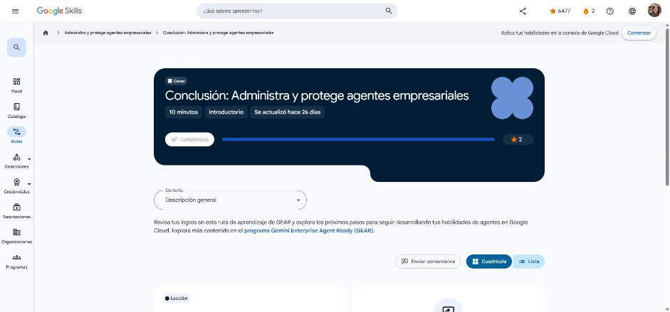

# 6. Conclusión: Administra y protege agentes empresariales

Curso de cierre (10 min). Enlace: <https://www.skills.google/paths/4461/course_templates/1887>

## Conclusión

Repaso de la ruta, la última de la serie GEAR:

1. **Agentes de IA empresariales seguros**: AgentOps (Agent Registry, Agent Gateway, identidad del agente, evaluación y observabilidad), IAM con privilegio mínimo y una cuenta de servicio por agente, memoria en bases administradas, VPC Service Controls y aislamiento de credenciales.
2. **Google Cloud Agent Governance and Security**: arquitectura de confianza cero para Project VaultKeeper en cuatro puntos de control:
    - gateway y registro;
    - guardrails semánticos (Model Armor + Semantic Governance Policy);
    - IAM de agentes (SPIFFE, mTLS, DPoP, registry bindings);
    - perímetro VPC-SC y telemetría hacia el SIEM.
3. **Model Armor**: filtrado de instrucciones y respuestas, configuración de límites, plantillas, niveles de confianza, Sensitive Data Protection y registros.
4. **Protege la salida de agentes con Agent Gateway y Model Armor**: aplicación práctica en un lab de desafío (insignia de habilidad).

**Siguiente paso:** explorar otras rutas GEAR y la certificación en Google Cloud.

!!! tip "Para recordar"
    - Agentes listos para la empresa = identidad + gateway + filtros semánticos + perímetro + observabilidad.
    - Pista: nunca expongas credenciales, verifica la entrada y la salida, y contén el entorno de ejecución.

*Figura: el curso aparece como completado en Google Skills.*

## Fuentes y aviso legal

- **Fuente:** cursos de la ruta GEAR de Google Cloud Skills Boost. Sitios oficiales: [cloudskillsboost.google](https://www.cloudskillsboost.google) · [cloud.google.com/docs](https://cloud.google.com/docs).
- **Uso:** apuntes personales de estudio, sin fines comerciales y con redacción propia. Las imágenes del curso son fragmentos breves citados con fines educativos; sus derechos son de sus titulares.
- **Sin afiliación:** sitio no oficial, no afiliado ni respaldado por Google. Las marcas pertenecen a sus dueños.
- Más detalles y cómo pedir el retiro de contenido en el [aviso legal](../../aviso-legal.md).
