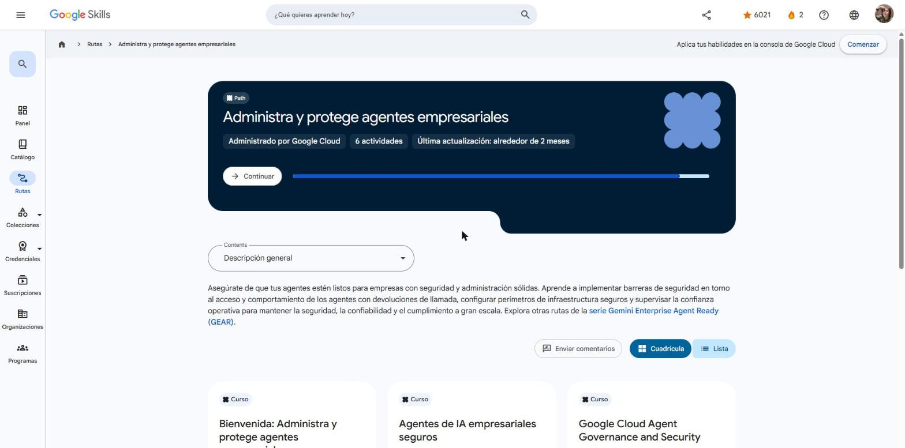

# Google Skills · GEAR: Administra y protege agentes empresariales

Programa **Google Cloud Career Launchpad – LatAm** (MinTIC) · Plataforma: Google Skills
Ruta: <https://www.skills.google/paths/4461> · Serie **Gemini Enterprise Agent Ready (GEAR)**, ruta 6 de 6.

Esta ruta prepara a los agentes para la empresa con seguridad y gobierno sólidos. Cubre:

- AgentOps e identidad de agentes (SPIFFE, Agent Registry).
- Agent Gateway con Model Armor y Semantic Governance.
- IAM de mínimo privilegio, mTLS/DPoP y perímetros de VPC Service Controls.
- Telemetría de seguridad hacia el SIEM.

## Actividades

| # | Actividad | Duración | Estado | Fecha | Resultado | Notas |
|---|---|---|---|---|---|---|
| 1 | [Bienvenida: Administra y protege agentes empresariales](https://www.skills.google/paths/4461/course_templates/1886) | 10 min | ✅ Completado | 2026-10-25 | — | [Notas](01-bienvenida.md) |
| 2 | [Agentes de IA empresariales seguros](https://www.skills.google/paths/4461/course_templates/1835) | 30 min | ✅ Completado | 2026-10-25 | Insignia *Secure Enterprise AI Agents* | [Notas](02-agentes-ia-empresariales-seguros.md) |
| 3 | [Google Cloud Agent Governance and Security](https://www.skills.google/paths/4461/course_templates/1843) | 2 h 45 min | ✅ Completado | 2026-10-25 | 4 cuestionarios al 100 % · insignia *Google Cloud Agent Governance and Security* | [Notas](03-agent-governance-and-security.md) |
| 4 | [Model Armor: protege las implementaciones de IA](https://www.skills.google/paths/4461/course_templates/1385) | 2 h 30 min | ✅ Completado | 2026-10-25 | 4 cuestionarios al 100 % · insignia *Model Armor: Securing AI Deployments* | [Notas](04-model-armor.md) |
| 5 | [Protege la salida de agentes con Agent Gateway y Model Armor](https://www.skills.google/paths/4461/course_templates/1841) (insignia de habilidad) | 1 h | Pendiente | — | — | — |
| 6 | [Conclusión: Administra y protege agentes empresariales](https://www.skills.google/paths/4461/course_templates/1887) | 10 min | ✅ Completado | 2026-10-25 | — | [Notas](06-conclusion.md) |

**Progreso de la ruta:** 5 de 6 actividades.

## Insignias obtenidas

- **Secure Enterprise AI Agents** (completion badge)
- **Google Cloud Agent Governance and Security** (completion badge)
- **Model Armor: Securing AI Deployments** (completion badge)

## Evidencias

## Fuentes y aviso legal

- **Fuente:** cursos de la ruta GEAR de Google Cloud Skills Boost. Sitios oficiales: [cloudskillsboost.google](https://www.cloudskillsboost.google) · [cloud.google.com/docs](https://cloud.google.com/docs).
- **Uso:** apuntes personales de estudio, sin fines comerciales y con redacción propia. Las imágenes del curso son fragmentos breves citados con fines educativos; sus derechos son de sus titulares.
- **Sin afiliación:** sitio no oficial, no afiliado ni respaldado por Google. Las marcas pertenecen a sus dueños.
- Más detalles y cómo pedir el retiro de contenido en el [aviso legal](../../aviso-legal.md).
