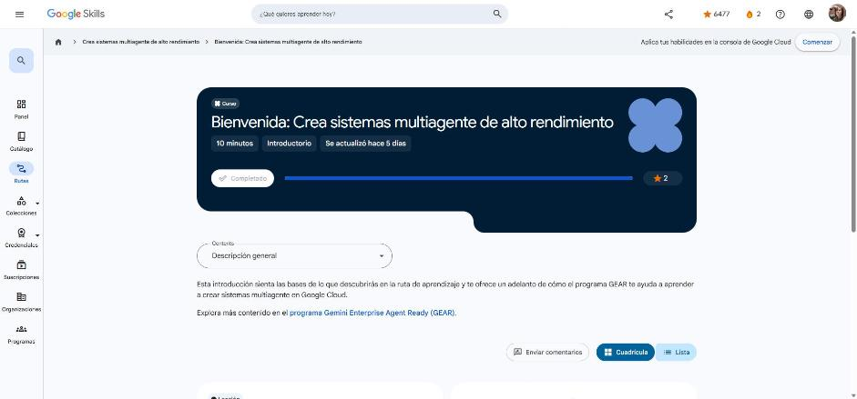

# 1. Bienvenida: Crea sistemas multiagente de alto rendimiento

Curso de bienvenida (10 min). Enlace: <https://www.skills.google/paths/4459/course_templates/1888>

## Te damos la bienvenida

**GEAR (Gemini Enterprise Agent Ready)** es el programa de Google para que desarrolladores, líderes técnicos y profesionales de TI diseñen, prueben e implementen agentes de IA de nivel empresarial. Busca que vayas más allá del prototipo y construyas flujos de automatización seguros y listos para producción con Google Cloud y Gemini Enterprise.

Esta ruta pasa del diseño de **una sola instrucción** a la **orquestación de sistemas multiagente de extremo a extremo**:

- Coordinar agentes con el **Agent Development Kit (ADK)**: relaciones agente superior → subagentes.
- Conectar herramientas externas con el **Model Context Protocol (MCP)**.
- Automatizar flujos entre agentes con el protocolo **Agent-to-Agent (A2A)**.
- Diseñar **enrutamiento basado en flujos de trabajo** e implementar con **Agent Runtime**.
- Crear **Agent Skills** personalizadas, desde el andamiaje y las pruebas locales hasta escalarlas y compartirlas en la empresa.
- Construir un sistema multiagente **distribuido** en el que colaboran microservicios especializados.

!!! tip "Para recordar"
    - ADK = construir y coordinar agentes; MCP = conectar agentes con herramientas y datos; A2A = conectar agentes entre sí.
    - Pista: los créditos del curso exigen aprobar los cuestionarios con calificación.

*Figura: el curso aparece como completado en Google Skills.*

## Fuentes y aviso legal

- **Fuente:** cursos de la ruta GEAR de Google Cloud Skills Boost. Sitios oficiales: [cloudskillsboost.google](https://www.cloudskillsboost.google) · [cloud.google.com/docs](https://cloud.google.com/docs).
- **Uso:** apuntes personales de estudio, sin fines comerciales y con redacción propia. Las imágenes del curso son fragmentos breves citados con fines educativos; sus derechos son de sus titulares.
- **Sin afiliación:** sitio no oficial, no afiliado ni respaldado por Google. Las marcas pertenecen a sus dueños.
- Más detalles y cómo pedir el retiro de contenido en el [aviso legal](../../aviso-legal.md).
