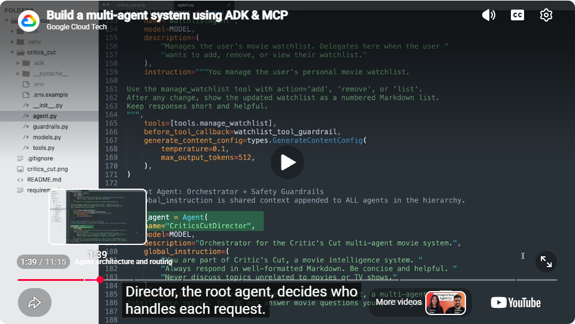
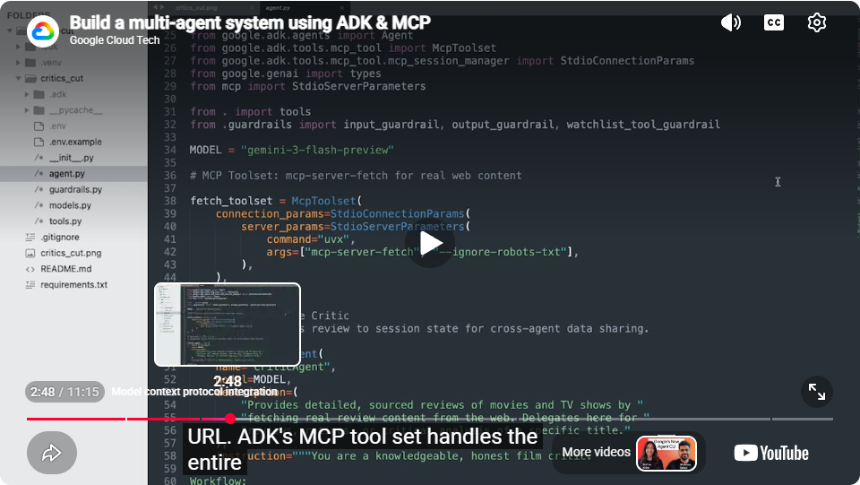
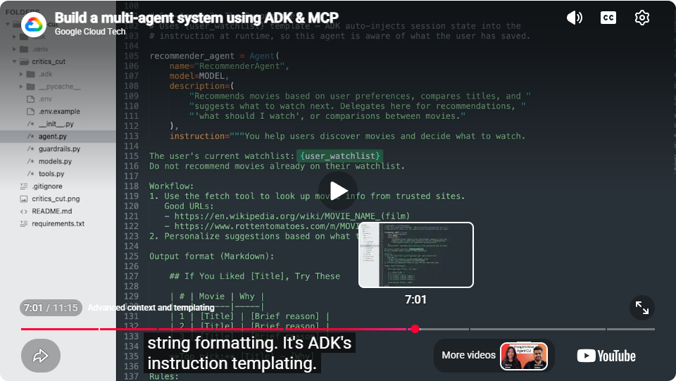
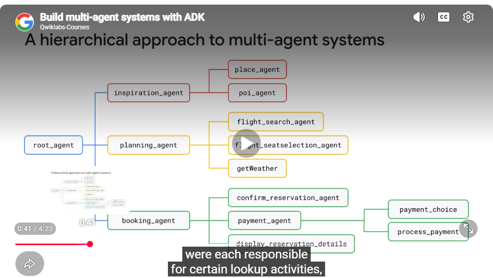
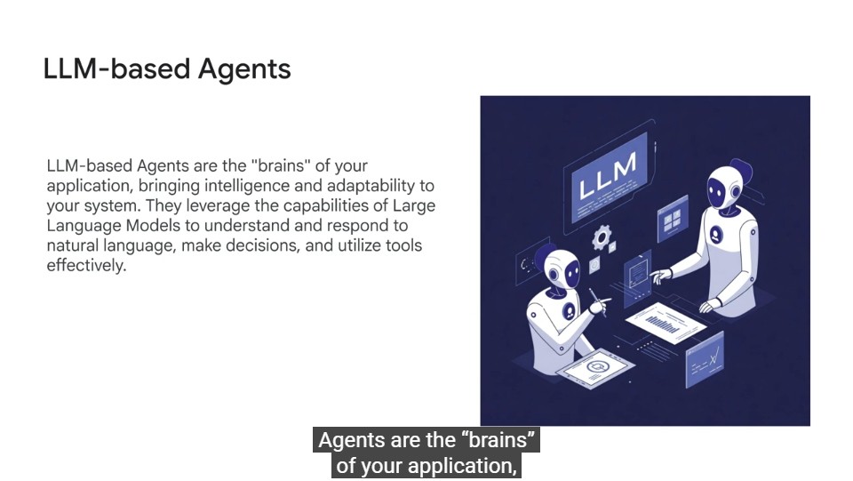
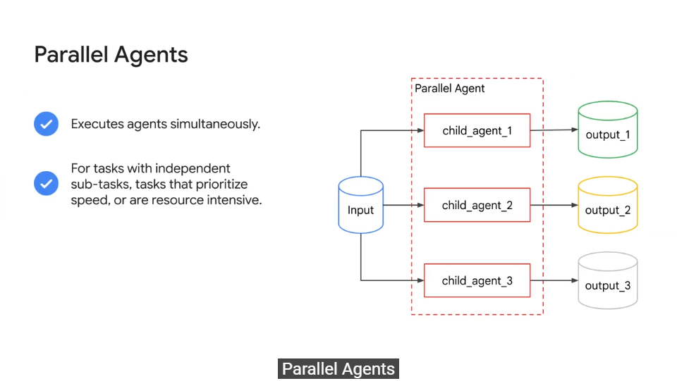
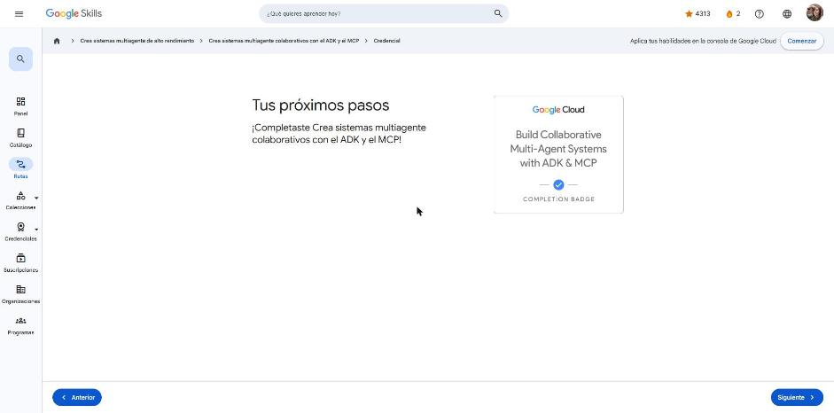

# 2. Crea sistemas multiagente colaborativos con el ADK y el MCP

Curso de la ruta **GEAR: Crea sistemas multiagente de alto rendimiento** · 30 min · Introductorio.
Enlace: <https://www.skills.google/paths/4459/course_templates/1833>

El curso enseña a diseñar, coordinar e implementar sistemas multiagente con el **Agent Development Kit (ADK)** y el **Model Context Protocol (MCP)**.

---

## Crea un sistema multiagente con el ADK y el MCP

Video de demostración: **Critic's Cut**, un sistema multilingüe de "inteligencia de películas" hecho con ADK y MCP y potenciado por Gemini 3 Flash.

**Arquitectura y enrutamiento.** Un **agente raíz** (`CriticsCutDirector`) actúa como orquestador y decide qué subagente atiende cada solicitud. Sus subagentes son:

- `CriticAgent`: reseñas con fuentes reales.
- `RecommenderAgent`: recomendaciones y comparaciones.
- `WatchlistAgent`: gestiona la lista de pendientes.

La **`global_instruction`** del agente raíz es contexto compartido que se agrega a **todos** los agentes de la jerarquía (p. ej., "responde siempre en Markdown" o "no hables de temas ajenos al cine").

*Figura: el agente raíz `CriticsCutDirector` con `global_instruction`; arriba, un subagente con su herramienta y un `before_tool_callback`.*

**Integración con MCP.** Con `McpToolset` + `StdioConnectionParams`, el agente lanza un servidor MCP (`mcp-server-fetch`, ejecutado con `uvx`) y obtiene **acceso real a la web**. El toolset del ADK se encarga de toda la conexión con el servidor.

*Figura: `fetch_toolset = McpToolset(...)` conecta el agente a un servidor MCP para leer páginas web.*

**Herramientas personalizadas y estado de sesión.** Las herramientas propias (p. ej., `manage_watchlist`) devuelven **modelos Pydantic** estructurados (estado, título, lista y mensaje legible). La reseña se guarda en el **estado de sesión** para compartir datos entre agentes.

**Seguridad por capas (callbacks).** Se usan guardrails de entrada, de salida y de herramienta (`before_tool_callback`). Las validaciones con **regex** son deterministas, rápidas y no gastan tokens.

**Contexto y plantillas de instrucciones.** Con `{user_watchlist}` dentro de la instrucción, el ADK **inyecta el estado de sesión en tiempo de ejecución**, de modo que el recomendador no sugiere películas que ya están en la lista.

*Figura: la instrucción del `RecommenderAgent` usa `{user_watchlist}`, que el ADK reemplaza con el estado de la sesión.*

!!! tip "Para recordar"
    - Agente raíz = enrutador; los subagentes se especializan por tarea.
    - `global_instruction` aplica a toda la jerarquía; `instruction` solo a un agente.
    - Pista: `McpToolset` conecta herramientas externas vía MCP; `{clave}` en la instrucción lee del estado de sesión.

## Crea sistemas multiagente con el ADK

**Enfoque jerárquico.** Ejemplo de asistente de viajes: `root_agent` delega en `inspiration_agent`, `planning_agent` y `booking_agent`, y cada uno tiene sus propios subagentes. Solo actúa el agente responsable de esa parte de la tarea.

*Figura: árbol de agentes del asistente de viajes (inspiración, planificación y reservas).*

**Tipos de agentes en el ADK:**

| Tipo | Rol |
|---|---|
| **Agentes basados en LLM** | Son el "cerebro": entienden lenguaje natural, deciden y usan herramientas |
| **Agentes de flujo de trabajo** | No usan un LLM para su función principal; dirigen el orden y las condiciones de ejecución |
| `SequentialAgent` | Ejecuta subagentes en orden; la salida de uno alimenta al siguiente |
| `ParallelAgent` | Ejecuta subagentes a la vez; sirve para subtareas independientes, para priorizar velocidad o para tareas pesadas |
| `LoopAgent` | Repite subagentes hasta que se cumple una condición; sirve para iterar, monitorear o negociar |

*Figura: los agentes basados en LLM aportan la inteligencia y la adaptabilidad del sistema.*

*Figura: un `ParallelAgent` ejecuta subagentes al mismo tiempo, y cada uno produce su propia salida.*

!!! tip "Para recordar"
    - La relación superior → subagente se define con `sub_agents=[...]`; el LLM del superior decide a quién transferir.
    - Pista: orden fijo → Sequential; en paralelo → Parallel; hasta una condición → Loop.

## Insignia

**Insignia:** *Build Collaborative Multi-Agent Systems with ADK & MCP* (completion badge).

