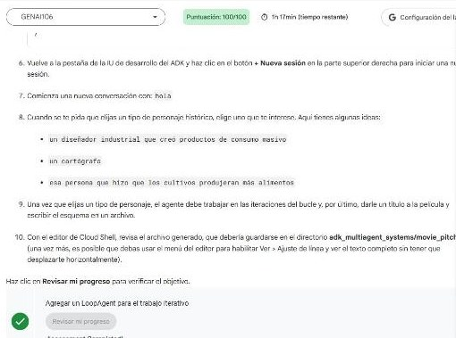

# 3. Crea sistemas multiagente con el ADK (lab GENAI106)

Lab de la ruta **GEAR: Crea sistemas multiagente de alto rendimiento** · 1 h 30 min.

**Estado:** ✅ **100/100** (2026-10-31).

## Qué se construye

Dos sistemas, uno por cada forma de coordinar agentes en el ADK:

| Sistema | Forma de coordinar | Quién decide el siguiente paso |
|---|---|---|
| **Planificador de viajes** (`parent_and_subagents`) | **Transferencia** entre agente padre y subagentes | El **modelo**, leyendo la `description` de cada subagente |
| **Equipo de guion** (`workflow_agents`) | **Agentes de flujo**: `SequentialAgent`, `LoopAgent` y `ParallelAgent` | El **código**, con un orden fijo |

```
steering ──► travel_brainstormer   (ayuda a elegir país)
         └─► attractions_planner   (guarda atracciones en el estado)

greeter ──► film_concept_team  SequentialAgent
              ├─ writers_room  LoopAgent (máx. 5)
              │    researcher → screenwriter → critic (exit_loop o feedback)
              ├─ preproduction_team  ParallelAgent
              │    box_office_researcher ║ casting_agent
              └─ file_writer → movie_pitches/<título>.txt
```

## Resultado

| Tarea | Puntos | Qué se verificó |
|---|---|---|
| 1. Transferencias entre padre, subagentes y pares | 25/25 | El raíz deriva a `travel_brainstormer` o a `attractions_planner` según la intención |
| 2. Estado de la sesión | 25/25 | La herramienta guarda «The Great Sphinx of Giza» y la lista se recupera con `{ attractions? }` |
| 3. SequentialAgent | 25/25 | Investigación → guion → archivo `.txt` |
| 4. LoopAgent | 25/25 | Bucle escritor–crítico con salida por `exit_loop`, más el equipo paralelo de preproducción |


*Las 4 verificaciones aprobadas.*

El sistema generó dos propuestas de película completas: ***Poetical Science*** (Ada Lovelace) y ***RADIANT*** (Marie Curie). Cada una trae logline, estructura en tres actos, informe de taquilla y propuesta de reparto.

## Cómo lo resolvimos

### Transferencia: la `description` es el enrutador

```python
root_agent = Agent(
    name="steering",
    instruction="""Ask the user if they know where they'd like to travel or if they need help deciding.
    If they need help deciding, send them to 'travel_brainstormer'.
    If they know what country they'd like to visit, send them to the 'attractions_planner'.""",
    generate_content_config=types.GenerateContentConfig(temperature=0),
    sub_agents=[travel_brainstormer, attractions_planner],
)
```

Con `sub_agents`, el ADK le da al modelo la opción de **transferir**. La regla explícita en la instrucción y `temperature=0` hacen que la derivación sea predecible.

### Estado: la herramienta escribe y la instrucción lee

```python
def save_attractions_to_state(tool_context: ToolContext, attractions: List[str]) -> dict[str, str]:
    existing = tool_context.state.get("attractions", [])
    tool_context.state["attractions"] = existing + attractions   # reasignar = evento de estado
    return {"status": "success"}
```

En la instrucción del planificador, `{ attractions? }` inserta la lista guardada. El `?` evita el error cuando todavía está vacía.

### Flujo: bucle, paralelo y secuencia

```python
critic = Agent(name="critic", ..., tools=[append_to_state, exit_loop])
writers_room = LoopAgent(name="writers_room",
                         sub_agents=[researcher, screenwriter, critic], max_iterations=5)
preproduction_team = ParallelAgent(name="preproduction_team",
                                   sub_agents=[box_office_researcher, casting_agent])
film_concept_team = SequentialAgent(name="film_concept_team",
                                    sub_agents=[writers_room, preproduction_team, file_writer])
```

- El **crítico** decide: si el guion cumple, llama a `exit_loop`; si no, deja `CRITICAL_FEEDBACK` en el estado y la siguiente vuelta lo usa.
- Las ramas **paralelas** no se ven entre sí. Cada una guarda su resultado con `output_key` (`box_office_report`, `casting_report`) y `file_writer` los une.

### Lo que mostró la traza

En la corrida de Ada Lovelace, el orden de los eventos fue `researcher → screenwriter → critic → casting_agent → box_office_researcher → file_writer`. Se ven dos cosas:

- El crítico aprobó en la **primera vuelta**, así que el bucle no gastó iteraciones de más.
- `casting_agent` terminó **antes** que `box_office_researcher` aunque está segundo en la lista, porque en un `ParallelAgent` el orden de llegada no está garantizado.

## Análisis de la sesión

### Cómo leímos el problema

- El lab enseña **dos ejes de control**: dejar que el LLM enrute (flexible, para conversación) o fijar el flujo en código (reproducible, para pipelines). El segundo sistema **combina los dos**: un `greeter` conversacional guarda la petición en el estado y transfiere a un pipeline fijo.
- El crítico con `exit_loop` es la versión «ligera» del patrón generador–verificador del lab GSP541. Allí la salida dependía de un `EscalationChecker` determinista que leía un veredicto Pydantic. Aquí la decisión queda en el LLM: es más simple, pero menos auditable.

### Decisiones y por qué

| Decisión | Razón |
|---|---|
| Bajar los `agent.py`, editarlos en local y subirlos empaquetados | Escribir bloques largos de Python en una terminal web es lento y propenso a errores de indentación; en local hay validación de sintaxis (`ast.parse`) |
| Script de parcheo con `assert` en cada reemplazo | Si el original no coincide con lo esperado, falla en voz alta en lugar de dejar el archivo a medias |
| Probar con entradas por tubería en lugar de la UI web | Las pruebas son repetibles y la salida queda en un archivo que se puede revisar |
| Dos terminales en Cloud Shell | Una corre el flujo largo de guion y la otra repite pruebas cortas al mismo tiempo |

### Fallos reales convertidos en lecciones

| Síntoma | Causa | Arreglo | Lección |
|---|---|---|---|
| La prueba de estado funcionó (la lista mostraba la Esfinge), pero la tarea 2 no aprobó | `adk run` terminó apenas se acabó la entrada y el log de Cloud Logging no alcanzó a enviarse: `CloudLoggingHandler shutting down... Failed to send 2 pending logs` | Mantener vivo el proceso: `(printf '...'; sleep 90; echo exit) \| adk run ...` | **El verificador mira los logs, no la pantalla.** Si algo «funciona» pero no aparece, revisar primero si los datos de observabilidad llegaron |
| Lo mismo en la tarea 4 (bucle) | La misma causa, en el flujo largo | `sleep 300` antes de `exit` y la salida a un archivo | Aplicar el arreglo a **todas** las pruebas una vez identificado el patrón |
| El primer intento de parcheo falló con `unexpected EOF while looking for matching '` | Un heredoc de bash con comillas triples de Python dentro | Escribir el script como archivo y ejecutarlo con `python -I` | Código con comillas mezcladas → archivo, no línea de comandos |

### Qué haríamos distinto

- Usar desde el inicio la prueba con `sleep` al final: habría evitado dos verificaciones fallidas.
- Pasar el `exit_loop` a un verificador con salida estructurada cuando el resultado importe (producción), como en GSP541.

### Lo que nos llevamos

- El código original y el resuelto, los dos guiones generados y la traza quedaron guardados como proyecto de referencia.
- Con lo aprendido refinamos la skill de **ADK multiagente** (transferencias frente a flujos, `exit_loop`, fan-out/gather) y creamos dos más:
    - **agente ADK base:** herramientas, estado, callbacks y pruebas;
    - **labs de Google Skills:** procedimiento para resolverlos en Cloud Shell sin perder puntos.

!!! tip "Para recordar"
    - **Transferencia** = el LLM elige con base en las `description`. **Agentes de flujo** = el código elige.
    - Herramienta con `ToolContext` para **escribir** el estado; `{ clave? }` en la instrucción para **leerlo**.
    - `LoopAgent` necesita una salida: `exit_loop` (la decide el LLM) o `escalate=True` (la decide el código), y siempre `max_iterations`.
    - `ParallelAgent`: cada rama con su `output_key`, y un agente posterior que las une.
    - Sin logs no hay evidencia: deja que el proceso los envíe antes de cerrarse.

## Fuentes y aviso legal

- **Fuente:** lab GENAI106 «Crea sistemas multiagente con el ADK» de Google Skills (programa GEAR). Sitios oficiales: [skills.google](https://www.skills.google) · [google.github.io/adk-docs](https://google.github.io/adk-docs/).
- **Uso:** apuntes personales de estudio, sin fines comerciales y con redacción propia. Los fragmentos de código son breves y se citan con fines educativos.
- **Sin afiliación:** sitio no oficial, no afiliado ni respaldado por Google. Las marcas pertenecen a sus dueños.
- Más detalles y cómo pedir el retiro de contenido en el [aviso legal](../../aviso-legal.md).
