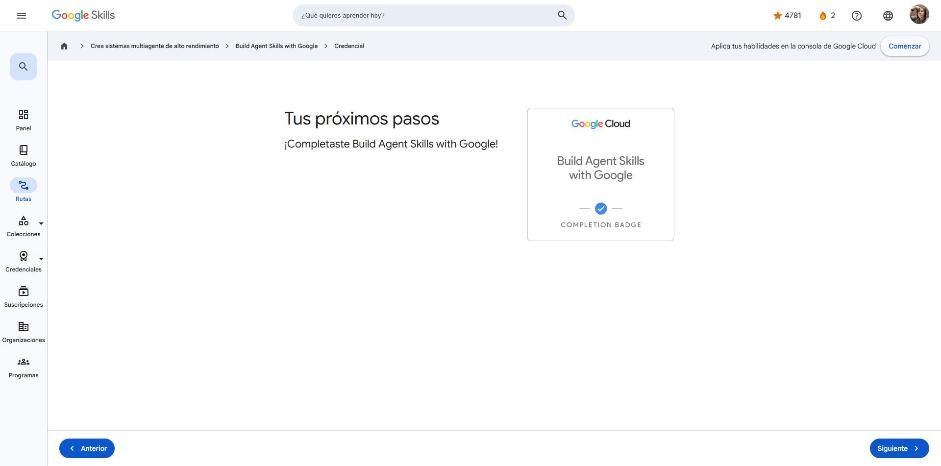

# 4. Build Agent Skills with Google

Curso de la ruta **GEAR: Crea sistemas multiagente de alto rendimiento** · 2 h 15 min · Intermedio (en inglés).
Enlace: <https://www.skills.google/paths/4459/course_templates/1832>

**Módulos:** Explore Agent Skills · Build custom skills · Leverage built-in skills · Course summary · Quiz.

Caso guía: **Cymbal Outdoor** (retail de equipo de aventura). Tomo, el líder técnico, debe triplicar la producción de promociones sin perder el tono de marca y cumpliendo normas (SMS ≤ 160 caracteres, pie "Reply STOP to opt out.", sin emojis). Clara, consultora de Google, lo acompaña.

---

## Build Agent Skills with Google (introducción)

Analogía: un empleado brillante que olvida todo cada noche y debe releer el manual cada mañana. Repetir contexto, reglas y restricciones en cada sesión **gasta tokens** y da resultados impredecibles.

Una **skill** es un "manual portátil" en Markdown que agrupa instrucciones, referencias y flujos de trabajo. El agente la carga **solo cuando la necesita** (*progressive disclosure*).

!!! tip "Para recordar"
    - Skill = conocimiento de dominio empaquetado y reutilizable.
    - Pista: el reto no es escribir una skill, sino escalarla, compartirla y mantenerla en la empresa.

## Meet Agent Skills

- **Chatbot vs. agente:** el chatbot conversa; el agente **actúa** de forma autónoma y orientada a objetivos.
- **Google Antigravity:** plataforma *agent-first* para construir, monitorear y orquestar agentes (app de escritorio, CLI y SDK). Funciona como un agente de programación de propósito general.
- Sin skill, la primera promoción falló: emojis, tono exagerado, SMS demasiado largo y sin pie de baja.
- **Agent Skills:** formato abierto y ligero para dar al agente conocimiento de dominio, flujos estructurados y *guardrails*. Se cargan bajo demanda.

**¿Cuándo crear una skill?** Cuando repites el mismo contexto, necesitas un flujo de varios pasos, debes aplicar reglas de la empresa (marca, cumplimiento) o quieres resultados consistentes en cada sesión.

!!! tip "Para recordar"
    - Si repites contexto o corriges siempre los mismos errores, no necesitas un mejor prompt: necesitas una skill.
    - Pista: las skills ahorran tokens porque se cargan solo cuando aplican.

## Skill building blocks

Una skill es una **carpeta** con un `SKILL.md` obligatorio:

```text
my-skill/
├── SKILL.md      # Obligatorio: metadatos + instrucciones
├── references/   # Opcional: documentación
├── scripts/      # Opcional: código ejecutable
└── assets/       # Opcional: plantillas, recursos
```

**Tres niveles (tiers):**

| Nivel | Qué es | Claves |
|---|---|---|
| 1. **Frontmatter** (el disparador) | YAML entre `---` con `name` y `description` | Es lo **único** que lee el agente para decidir si usa la skill |
| 2. **Cuerpo** (instrucciones) | Markdown bajo el frontmatter | < 500 líneas, pasos numerados, prohibiciones explícitas, enlaces relativos y comandos exactos |
| 3. **Recursos** (extras) | `references/`, `scripts/`, `assets/` | Referencias enfocadas; scripts que devuelven 0 = PASS y ≠0 = FAIL con mensajes accionables |

- **`name`:** solo minúsculas, números y guiones (`promo-writer`), igual que el nombre de la carpeta.
- **`description`:** el campo más crítico. Formato: *"[acción]. Use when [disparadores]"*. Se escribe en tercera persona y con palabras clave o sinónimos (usa `>-` para descripciones largas).

!!! tip "Para recordar"
    - El agente activa la skill **solo** por el texto de `description`.
    - Pista: una validación exacta (contar caracteres, cuadrar cifras) va en un **script** dentro de `scripts/`, no en texto.

## Demo: Step-by-step skill building

Ciclo de mejora en Antigravity: **Prompt → Inspect → Verify → Observe**, usando siempre el mismo prompt base.

1. **Solo `SKILL.md`:** se agregan reglas de estructura (email con asunto, SMS < 160 y pie de baja). Mejoran el formato y el cumplimiento, pero el tono sigue exagerado.
2. **`references/`:** `brand-voice.md` (tono amable y outdoor, sin emojis ni mayúsculas gritonas) y `email-template.txt`. El tono queda alineado, pero el LLM **no cuenta caracteres de forma fiable** porque procesa tokens.
3. **`scripts/`:** `check-compliance.py` valida longitud y pie, y el agente itera hasta que pasa. `mock-dispatch.py` envía la campaña **solo** si la validación devolvió 0.

Resultado: un agente que redacta, se audita, se corrige y ejecuta. Es un ciclo autónomo y seguro.

!!! tip "Para recordar"
    - `SKILL.md` = qué hacer; `references/` = conocimiento bajo demanda; `scripts/` = lógica exacta y acciones.
    - Pista: combinar un script de validación con uno de ejecución impide que salga una campaña defectuosa.

## Skill runtime mechanics

**Progressive disclosure** en tres etapas:

1. **Discovery:** al iniciar, el agente carga **solo el frontmatter** (nombre y descripción) de todas las skills.
2. **Activation:** si la intención coincide, carga el cuerpo de `SKILL.md`.
3. **Extension:** lee referencias o ejecuta scripts solo cuando hacen falta.

Sin este mecanismo, el agente cargaría todo de entrada: muchos tokens, lentitud y alucinaciones por reglas en conflicto.

Descripción débil: *"Helps with promotional campaigns"*. Descripción fuerte: *"Generates structured retail promotional emails and SMS blasts. Use when asked to write product launch campaign copy…"*.

!!! tip "Para recordar"
    - Con 20 skills, en Discovery solo entra el YAML frontmatter de las 20.
    - Pista: la descripción funciona como el índice del manual.

## Scale and share

**Ciclo de vida empresarial en 5 fases:** Create → Test → Save → Share → Maintain. Las skills se tratan como código: control de versiones, pruebas y revisión por pares.

**Skill Registry (Google Cloud):** catálogo corporativo privado con descubrimiento centralizado, seguridad de paquetes y **revisiones versionadas inmutables**.

```bash
agents-cli skill publish ./promo-writer --project=cymbal-retail-prod
agents-cli skill grant promo-writer --role=roles/skills.user --member=group:marketing-team@cymbal.com
agents-cli skill pull projects/.../skills/promo-writer/revisions/v1
agents-cli run --skill=promo-writer "Draft an alpine tent promo email"
```

!!! tip "Para recordar"
    - Nunca compartas skills de producción por correo o unidad compartida: usa el Skill Registry.
    - Pista: Registry = versiones inmutables + permisos IAM + carga bajo demanda.

## Leverage built-in skills · Meet Agents CLI

**¿Por qué agentes independientes?** Con solo skills, alguien tiene que escribir el prompt: el flujo es reactivo y manual. Un **agente independiente** vigila disparadores, carga skills y trabaja 24/7.

**Agents CLI (`agents-cli`):** conjunto de skills de Google para ingeniería de agentes, construido sobre el **ADK**. Ventajas: evita semanas de código repetitivo, usa progressive disclosure y aplica seguridad desde el inicio.

| Fase | Comando | Qué hace |
|---|---|---|
| Scaffold | `agents-cli init` | Crea `app/agent.py`, `CONTEXT.md` (guardrails del proyecto) y `skills/` |
| Evaluate | `agents-cli playground` / `agents-cli eval run` | UI local para revisión cualitativa / benchmarks cuantitativos contra datasets |
| Manage | `agents-cli manage` | Orquesta el razonamiento y carga skills y herramientas bajo demanda |
| Deploy | `agents-cli deploy` | Empaqueta en Docker, publica en **Cloud Run** y conecta **Eventarc/Pub/Sub** |

!!! tip "Para recordar"
    - Ciclo: Scaffold → Evaluate → Manage → Deploy.
    - Pista: playground = revisión humana; eval = métricas automáticas.

## Demo: Step-by-step agent deployment

1. `agents-cli init cymbol-promo-agent --yes` genera un agente ADK con `SkillToolset(directory="./skills")`.
2. Se copia la carpeta `promo-writer` a `skills/` **sin cambiar una sola línea** (formato abierto y portátil).
3. Se prueba con `agents-cli playground` y se mide con `agents-cli eval run`.
4. `agents-cli deploy --target cloud-run` usa Cloud Build, Artifact Registry y Cloud Run, y crea un trigger de Eventarc desde un tema de Pub/Sub del inventario. Cuando llega mercancía nueva, el agente redacta y envía la promoción solo.

!!! tip "Para recordar"
    - Las skills son portátiles: de Antigravity a un agente en la nube sin modificarlas.
    - Pista: Eventarc + Pub/Sub permiten que el agente "despierte" con eventos.

## Quiz

**Resultado: 100 %** (mínimo 80 %, 5 preguntas). Además, se aprobaron las comprobaciones de conocimiento de cada lección.

- Manual de 50 páginas en cada prompt → empaquetarlo como skill con progressive disclosure.
- La skill nunca se activa → falta palabras clave en el `description` del frontmatter, o el campo no existe.
- Llevar la skill a un agente en Cloud Run → no hace falta modificarla.
- Revisión de tono + regresión sobre 50 casos → `playground` + `eval run`.
- Tabla de precios en `references/`, cálculo en `scripts/` e instrucciones en `SKILL.md`.

**Insignia:** *Build Agent Skills with Google* (completion badge).



## Fuentes y aviso legal

- **Fuente:** cursos de la ruta GEAR de Google Cloud Skills Boost. Sitios oficiales: [cloudskillsboost.google](https://www.cloudskillsboost.google) · [cloud.google.com/docs](https://cloud.google.com/docs).
- **Uso:** apuntes personales de estudio, sin fines comerciales y con redacción propia. Las imágenes del curso son fragmentos breves citados con fines educativos; sus derechos son de sus titulares.
- **Sin afiliación:** sitio no oficial, no afiliado ni respaldado por Google. Las marcas pertenecen a sus dueños.
- Más detalles y cómo pedir el retiro de contenido en el [aviso legal](../../aviso-legal.md).
