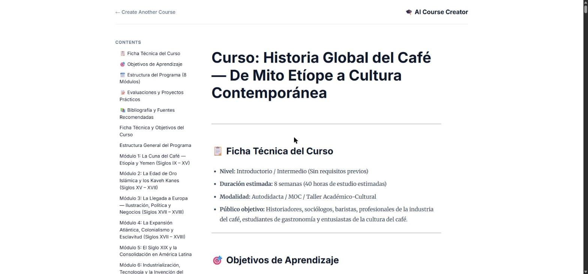
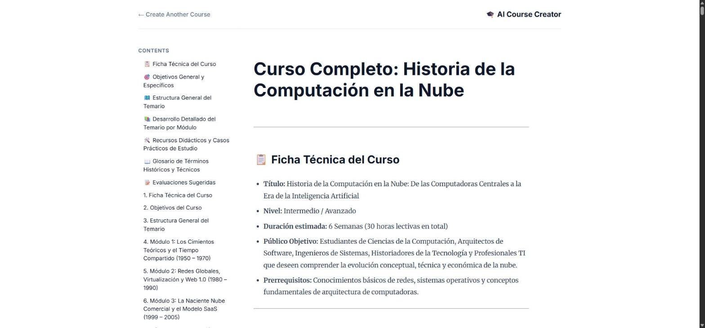

# 5. Usa habilidades de agentes con sistemas multiagente

Curso con insignia de habilidad de la ruta **GEAR: Crea sistemas multiagente de alto rendimiento** · 1 h 45 min · Avanzado.
Enlace: <https://www.skills.google/paths/4459/course_templates/1842>

**Estado:** Lab de desafío **GSP541** superado con **100/100** (2026-10-31).

## El desafío

Cymbal Group quiere un sistema que **cree cursos automáticamente**. En lugar de una sola instrucción enorme y difícil de mantener, se reparte el trabajo entre microservicios especializados que colaboran:

| Agente | Qué hace | Pieza clave |
|---|---|---|
| **Investigador** | Busca información actual sobre el tema | Herramienta de Búsqueda de Google + skill propia (`SKILL.md`) |
| **Evaluador** | Critica la investigación: ¿está completa y es exacta? | Salida estructurada con un esquema **Pydantic** (`status`, `feedback`) |
| **Creador de contenido** | Convierte la investigación aprobada en un módulo de curso | Skill con un script de validación de formato (`check_format`) |
| **Organizador** | Coordina a los demás | `LoopAgent` + `SequentialAgent`, conectado a los otros por **A2A** sobre HTTP |

Cada especialista se despliega como servicio independiente en **Cloud Run**, y hay un frontend web para probar la canalización de punta a punta.

## Las 6 tareas

1. **Agente con herramientas:** completar el `SKILL.md` del investigador y darle su `researcher_toolset`.
2. **Salida estructurada:** `output_schema=JudgeFeedback` en el evaluador, y prohibirle transferir el control al padre o a sus pares (`disallow_transfer_to_parent` y `disallow_transfer_to_peers` en `True`).
3. **Creador de contenido:** el script `check_format.py` devuelve `{"success": bool, "message": str}`. La skill le ordena ejecutarlo antes de entregar.
4. **Flujo del organizador:**
    - guardar la salida del evaluador con un *callback* (`create_save_output_callback("judge_feedback")`);
    - **escalar** (`EventActions(escalate=True)`) cuando la investigación aprueba, para salir del bucle;
    - `research_loop = [researcher, judge, escalation_checker]` y `root_agent = [research_loop, content_builder]`.
5. **Prueba local:** los 4 servicios en los puertos 8001 a 8004, y cada agente encuentra a los demás por su **tarjeta de agente** (`/.well-known/agent-card.json`).
6. **Despliegue en Cloud Run:** primero los especialistas, luego el organizador con sus URLs y al final el frontend.

## Resultado

| Tarea | Puntos | Qué se verificó |
|---|---|---|
| 1. Agente con herramientas (investigador) | 15/15 | Skill con reglas + `tools=[researcher_toolset]` |
| 2. Salida estructurada (evaluador) | 15/15 | `output_schema=JudgeFeedback` y transferencias bloqueadas |
| 3. Creador de contenido | 15/15 | Script `check_format` + skill que obliga a usarlo |
| 4. Conexiones remotas y flujo | 15/15 | Callback, escalamiento, `LoopAgent` y `SequentialAgent` |
| 5. Prueba local | 20/20 | Curso generado de punta a punta en `localhost` |
| 6. Despliegue en Cloud Run | 20/20 | 5 servicios desplegados y curso generado desde el frontend en la nube |


*Prueba local: «La historia del café» → el sistema produjo un curso de 8 módulos.*


*Prueba en la nube: «La historia de la computación en la nube», con los 5 servicios en Cloud Run.*

## Cómo lo resolvimos

### El validador de formato (tarea 3)

```python
def check_format(text: str) -> dict:
    has_h1 = text.strip().startswith("# ")
    has_h2 = "## " in text
    if has_h1 and has_h2:
        return {"success": True, "message": "Format OK: H1 and H2 present."}
    missing = [h for h, ok in (("H1 (# )", has_h1), ("H2 (## )", has_h2)) if not ok]
    return {"success": False, "message": "Missing headings: " + ", ".join(missing)}
```

Lo probamos con dos casos antes de subirlo: `"# T\n## S"` → éxito; `"hola"` → falla y nombra los dos encabezados que faltan. El mensaje dice **qué** falta, para que el agente pueda corregirse solo.

### El organizador (tarea 4)

```python
judge = RemoteA2aAgent("judge", agent_card=JUDGE_URL,
                       httpx_client=create_authenticated_client(JUDGE_URL),
                       after_agent_callback=create_save_output_callback("judge_feedback"))

class EscalationChecker(BaseAgent):
    async def _run_async_impl(self, ctx):
        ...
        if is_pass:
            yield Event(author=self.name, actions=EventActions(escalate=True))
        else:
            yield Event(author=self.name)

research_loop = LoopAgent(name="research_loop",
                          sub_agents=[researcher, judge, escalation_checker], max_iterations=3)
root_agent = SequentialAgent(name="course_creation_pipeline",
                             sub_agents=[research_loop, content_builder])
```

Un `RemoteA2aAgent` se usa dentro de `LoopAgent` y `SequentialAgent` igual que un agente local. La red queda escondida detrás de la *agent card*.

### Lo que mostraron los logs

En la prueba local la traza confirmó el diseño: el organizador pidió la tarjeta del evaluador (`GET :8002/.well-known/agent-card.json`), le envió la investigación (`POST :8002/a2a/agent`) y, tras el veredicto, pasó al creador de contenido (`:8003`). Este cargó su skill (`load_skill`) y ejecutó el script (`run_skill_script`).

## Análisis de la sesión

### Cómo leímos el problema

- **Es el patrón generador–verificador** del curso de Anthropic *AI Capabilities and Limitations*, llevado a arquitectura: el investigador genera, el evaluador verifica, y el bucle se repite hasta que pasa. La misma idea en dos ecosistemas distintos confirma que es un patrón durable.
- **La salida del bucle es la pieza delicada.** Un `LoopAgent` no sabe cuándo parar: alguien tiene que *escalar*. Por eso existe el `EscalationChecker`, que lee el `status` estructurado del evaluador. Sin el esquema Pydantic, ese `status` sería texto libre y la condición de salida dejaría de ser fiable.
- **Orden de los agentes:** el bucle va **antes** del creador de contenido dentro del `SequentialAgent`. Así solo llega al creador una investigación aprobada.
- **El evaluador no debe «pasarle la pelota» a otros:** con las transferencias deshabilitadas, su único trabajo es emitir el veredicto. Esto evita que el flujo se desvíe.

### Decisiones y por qué

| Decisión | Razón |
|---|---|
| Skills en `SKILL.md` en vez de un prompt largo | Se cargan solo cuando hacen falta (*progressive disclosure*), se versionan y se reutilizan |
| Validación con un script, no con «revísalo tú» | Lo verificable se verifica con código; el modelo puede creer que cumplió el formato sin cumplirlo |
| A2A en lugar de importar los agentes en un solo proceso | Cada especialista escala, se despliega y se actualiza por separado |
| Probar local antes de Cloud Run | Un error de conexión entre agentes es más barato de encontrar en `localhost` que con 4 servicios desplegados |

### Puntos de riesgo que anticipamos (antes de empezar)

- **Runtime local limpio:** el cargador del ADK puede confundir las carpetas de skills con agentes hermanos. Por eso el lab pide ejecutar la simulación desde un directorio temporal.
- **URLs de las tarjetas de agente:** si el organizador apunta a una URL equivocada, el sistema arranca pero el flujo falla en silencio en el primer salto A2A.
- **Orden del despliegue:** el organizador necesita las URLs reales de los especialistas, así que se despliega después de ellos.

### Fallos reales convertidos en lecciones

| Síntoma | Causa | Arreglo | Lección |
|---|---|---|---|
| El frontend local mostró `404 NOT_FOUND: Publisher model .../us-central1/.../gemini-3.6-flash was not found` | El modelo más reciente solo está publicado en la ubicación **`global`** | Un script de 10 líneas probó cada par modelo/región y confirmó que `global` funciona; cambiamos `GOOGLE_CLOUD_LOCATION` | Disponibilidad de modelos ≠ región del proyecto. **Probar con una llamada mínima antes de culpar al código** |
| El organizador no arrancó en Cloud Run: `container failed to start ... PORT=8080` | En los logs: `failed to load /app/run.sh: permission denied`. El script perdió el permiso de ejecución al copiarse desde un bucket | `chmod +x run.sh` y volver a desplegar | El mensaje de Cloud Run es genérico; **la causa está en los logs de la revisión** |
| El frontend cayó con `AGENT_SERVER_URL environment variable not set` | **Fallo en cascada:** como el organizador no existía, su URL salió vacía | Redesplegar el frontend solo si la URL no está vacía (`[ -n "$URL" ] && deploy`) | En despliegues encadenados, **validar cada dato que pasa de un paso al siguiente** |

### Qué haríamos distinto

- Verificar el modelo y la región con una llamada mínima **antes** de la prueba de punta a punta.
- Agregar `chmod +x` (o `CMD ["sh","run.sh"]` en el Dockerfile) como paso fijo del despliegue.
- Desplegar los 3 especialistas **en paralelo**, porque cada `--source` tarda unos 5 minutos en Cloud Build.

### Lo que nos llevamos

- El código final quedó guardado como proyecto de referencia, con el README del lab.
- Con todo lo aprendido armamos una **skill reutilizable de ADK multiagente**: patrones, código base, checklist y la tabla de errores de esta sesión.

!!! tip "Para recordar"
    - **Generador + verificador + bucle con salida estructurada** = calidad controlada.
    - `LoopAgent` itera; `SequentialAgent` encadena; **escalar** es la forma de salir del bucle.
    - Pydantic convierte la opinión del evaluador en un dato que el código puede leer.
    - A2A: cada agente se presenta con su **agent card**, y los demás lo llaman por HTTP.
    - Primero local, luego la nube: los errores de integración son más baratos en `localhost`.

## Fuentes y aviso legal

- **Fuente:** lab de desafío GSP541 y curso «Use Agent Skills with Multi-Agent Systems» de Google Skills (programa GEAR). Sitios oficiales: [skills.google](https://www.skills.google) · [google.github.io/adk-docs](https://google.github.io/adk-docs/).
- **Uso:** apuntes personales de estudio, sin fines comerciales y con redacción propia.
- **Sin afiliación:** sitio no oficial, no afiliado ni respaldado por Google. Las marcas pertenecen a sus dueños.
- Más detalles y cómo pedir el retiro de contenido en el [aviso legal](../../aviso-legal.md).
