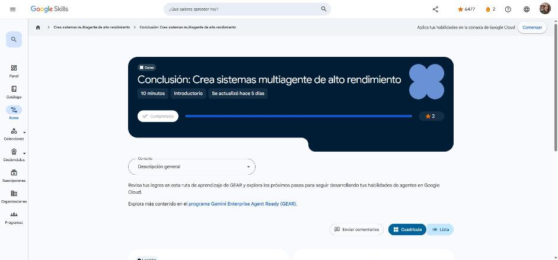

# 6. Conclusión: Crea sistemas multiagente de alto rendimiento

Curso de cierre (10 min). Enlace: <https://www.skills.google/paths/4459/course_templates/1885>

## Conclusión

Repaso de la ruta:

1. **Crea sistemas multiagente colaborativos con el ADK y el MCP**: diseñar, coordinar e implementar sistemas multiagente con el ADK y conectar herramientas externas mediante MCP.
2. **Crea sistemas multiagente con el ADK** (lab): crear varios agentes y conectarlos con relaciones agente superior → subagente.
3. **Build Agent Skills with Google**: el ciclo de vida completo de las skills personalizadas, desde el andamiaje y las pruebas locales hasta el Skill Registry y Agents CLI.
4. **Usa habilidades de agentes con sistemas multiagente** (lab de desafío): un sistema multiagente distribuido en el que microservicios especializados colaboran mediante A2A en Cloud Run.

**Siguiente ruta GEAR:** gobernar y proteger agentes empresariales.

!!! tip "Para recordar"
    - Alto rendimiento = jerarquía clara de agentes + herramientas vía MCP + skills portátiles + colaboración A2A.
    - Pista: ADK construye, MCP conecta herramientas, A2A conecta agentes y Agents CLI despliega.

*Figura: el curso aparece como completado en Google Skills.*

## Fuentes y aviso legal

- **Fuente:** cursos de la ruta GEAR de Google Cloud Skills Boost. Sitios oficiales: [cloudskillsboost.google](https://www.cloudskillsboost.google) · [cloud.google.com/docs](https://cloud.google.com/docs).
- **Uso:** apuntes personales de estudio, sin fines comerciales y con redacción propia. Las imágenes del curso son fragmentos breves citados con fines educativos; sus derechos son de sus titulares.
- **Sin afiliación:** sitio no oficial, no afiliado ni respaldado por Google. Las marcas pertenecen a sus dueños.
- Más detalles y cómo pedir el retiro de contenido en el [aviso legal](../../aviso-legal.md).
