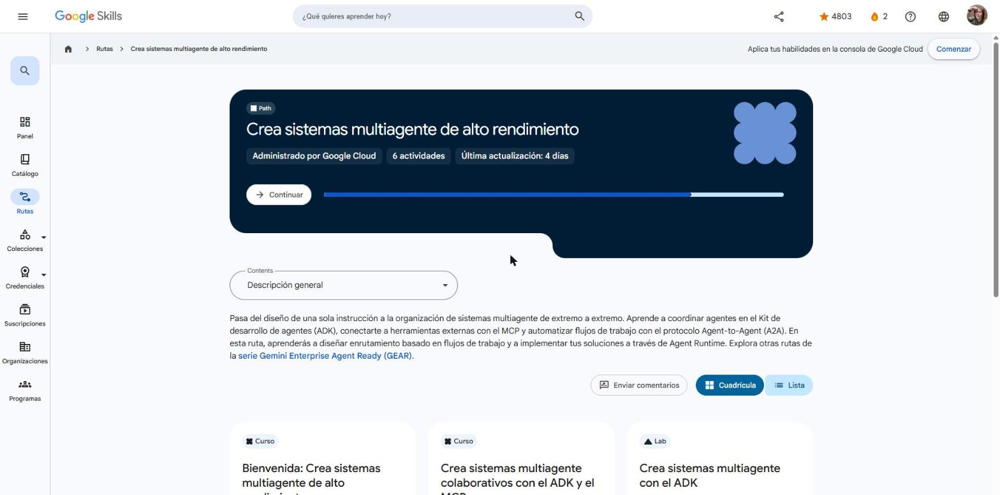

# Google Skills · GEAR: Crea sistemas multiagente de alto rendimiento

Programa **Google Cloud Career Launchpad – LatAm** (MinTIC) · Plataforma: Google Skills
Ruta: <https://www.skills.google/paths/4459> · Serie **Gemini Enterprise Agent Ready (GEAR)**, ruta 5 de 6.

Esta ruta va del diseño de una sola instrucción a la orquestación de sistemas multiagente de extremo a extremo. Cubre la coordinación de agentes con el **ADK**, la conexión de herramientas externas con **MCP** y la colaboración entre agentes con **A2A**. También incluye la creación y el escalado de **Agent Skills** (Antigravity, Skill Registry y Agents CLI) y el despliegue en Cloud Run y Agent Runtime.

## Actividades

| # | Actividad | Duración | Estado | Fecha | Resultado | Notas |
|---|---|---|---|---|---|---|
| 1 | [Bienvenida: Crea sistemas multiagente de alto rendimiento](https://www.skills.google/paths/4459/course_templates/1888) | 10 min | ✅ Completado | 2026-10-25 | — | [Notas](01-bienvenida.md) |
| 2 | [Crea sistemas multiagente colaborativos con el ADK y el MCP](https://www.skills.google/paths/4459/course_templates/1833) | 30 min | ✅ Completado | 2026-10-25 | Insignia *Build Collaborative Multi-Agent Systems with ADK & MCP* | [Notas](02-sistemas-multiagente-colaborativos-adk-mcp.md) |
| 3 | Crea sistemas multiagente con el ADK (lab GENAI106) | 1 h 30 min | ✅ Completado | 2026-10-31 | Lab: **100/100** | [Notas](03-crea-sistemas-multiagente-adk.md) |
| 4 | [Build Agent Skills with Google](https://www.skills.google/paths/4459/course_templates/1832) | 2 h 15 min | ✅ Completado | 2026-10-25 | Quiz 100 % · insignia *Build Agent Skills with Google* | [Notas](04-build-agent-skills-with-google.md) |
| 5 | [Usa habilidades de agentes con sistemas multiagente](https://www.skills.google/paths/4459/course_templates/1842) (insignia de habilidad) | 1 h 45 min | ✅ Completado | 2026-10-31 | Lab de desafío GSP541: **100/100** | [Notas](05-usa-habilidades-multiagente.md) |
| 6 | [Conclusión: Crea sistemas multiagente de alto rendimiento](https://www.skills.google/paths/4459/course_templates/1885) | 10 min | ✅ Completado | 2026-10-25 | — | [Notas](06-conclusion.md) |

**Progreso de la ruta:** 6 de 6 actividades. ✅ Ruta completa.

## Insignias obtenidas

- **Build Collaborative Multi-Agent Systems with ADK & MCP** (completion badge)
- **Build Agent Skills with Google** (completion badge)

## Evidencias

## Fuentes y aviso legal

- **Fuente:** cursos de la ruta GEAR de Google Cloud Skills Boost. Sitios oficiales: [cloudskillsboost.google](https://www.cloudskillsboost.google) · [cloud.google.com/docs](https://cloud.google.com/docs).
- **Uso:** apuntes personales de estudio, sin fines comerciales y con redacción propia. Las imágenes del curso son fragmentos breves citados con fines educativos; sus derechos son de sus titulares.
- **Sin afiliación:** sitio no oficial, no afiliado ni respaldado por Google. Las marcas pertenecen a sus dueños.
- Más detalles y cómo pedir el retiro de contenido en el [aviso legal](../../aviso-legal.md).
