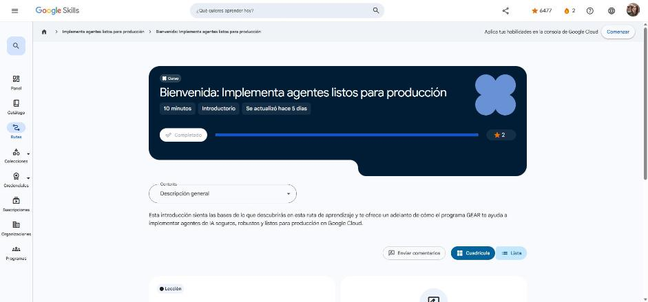

# 1. Bienvenida: Implementa agentes listos para producción

Curso de bienvenida (10 min). Enlace: <https://www.skills.google/paths/3802/course_templates/1770>

## Te damos la bienvenida

Tercera ruta de la serie **GEAR**. Objetivo: pasar los agentes del **localhost a producción** con el ADK en Google Cloud.

Temas de la ruta:

- Arquitectura de sistemas multiagente con el ADK: **árboles jerárquicos** (superior → secundarios) y **agentes de flujo de trabajo determinísticos**.
- Elegir el entorno de hosting: **Agent Runtime / Agent Engine** (Gemini Enterprise Agent Platform), **Cloud Run** o **GKE**.
- Conectividad empresarial con **MCP** y el protocolo **Agent2Agent (A2A)**.
- Continuidad de conversaciones de varios turnos escribiendo y leyendo el **estado de la sesión**, y transferencias directas entre agentes con agentes de flujo de trabajo.
- Insignia de habilidad avanzada *Implementa arquitecturas de múltiples agentes*.

!!! tip "Para recordar"
    - Producción = arquitectura multiagente bien jerarquizada + hosting adecuado + estado de sesión + protocolos abiertos (MCP, A2A).
    - Pista: las rutas GEAR son colecciones curadas de cursos sobre un tema de agentes.

*Figura: el curso aparece como completado en Google Skills.*
