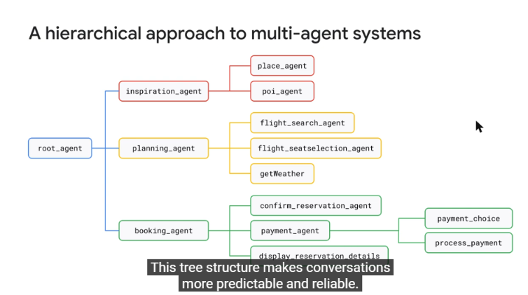
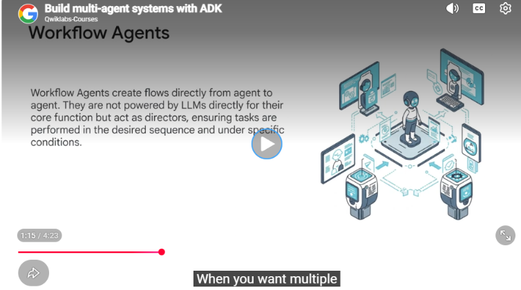
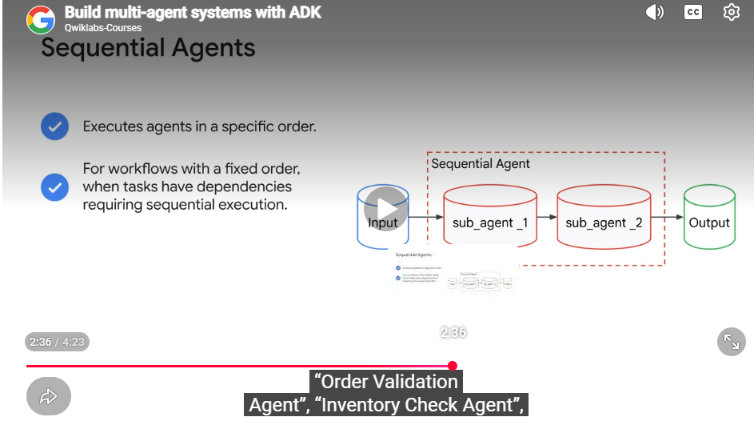
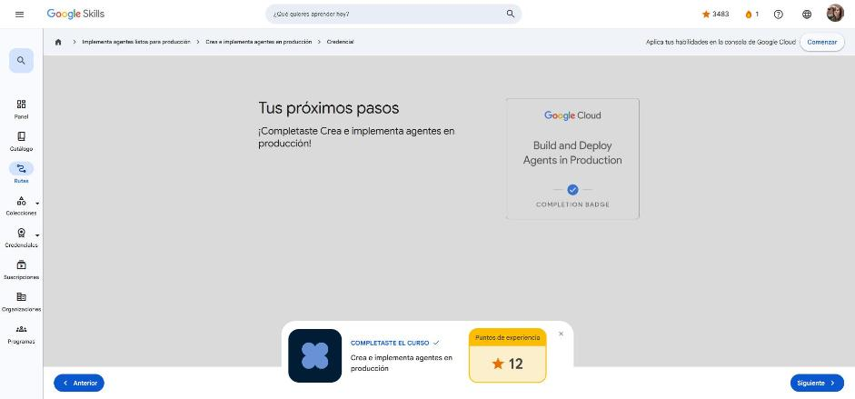

# 2. Crea e implementa agentes en producción

Curso de la ruta **GEAR: Implementa agentes listos para producción** · 45 min · Introductorio.
Enlace: <https://www.skills.google/paths/3802/course_templates/1633>

**Lecciones:** Crea sistemas multiagente con el ADK (video) · Implementación y administración de agentes de IA en producción · Cuestionario.

---

## Crea sistemas multiagente con el ADK

**Árbol jerárquico de agentes.** En el ADK los agentes forman un árbol de **superiores y secundarios** (como un organigrama: el `root_agent` es el director y cada secundario tiene un único superior). Un agente solo puede transferir la conversación a sus **secundarios**, a sus **pares** (mismo superior) o devolverla a su **superior**; la transferencia a pares se puede desactivar por agente. Esto hace la conversación más predecible: si cualquier agente pudiera llamar a cualquiera, sería fácil invocar al de búsqueda equivocado.

*Figura: enfoque jerárquico para sistemas multiagente.*

**Tipos de agentes del ADK**

| Tipo | Rol | Característica |
|---|---|---|
| **Agente LLM** | El "cerebro" | Entiende lenguaje natural, decide y elige herramientas; suele alternar turnos con el usuario |
| **Agentes de flujo de trabajo** | El "gerente/director" | No usan LLM para su lógica; controlan el orden y el paso de contexto entre secundarios → ejecución **determinística** |
| **Agentes personalizados** | El "especialista" | Heredan de `BaseAgent` para escribir cualquier lógica de orquestación en Python |

*Figura: los agentes de flujo de trabajo crean flujos directos entre agentes sin esperar al usuario.*

Agentes de flujo de trabajo:

- **SequentialAgent**: ejecuta secundarios uno tras otro (validar pedido → inventario → pago → confirmación).
- **LoopAgent**: repite un conjunto de agentes hasta cumplir una condición o un máximo de iteraciones (refinamiento iterativo, investigación que busca más datos, negociación).
- **ParallelAgent**: ejecuta secundarios **a la vez** cuando las subtareas son independientes y no comparten estado (p. ej., informes por región, consultas a varias fuentes).

*Figura: un agente secuencial ejecuta sus secundarios en orden fijo.*

!!! tip "Para recordar"
    - Árbol: transferencias solo a secundarios, pares o al superior → conversaciones predecibles.
    - LLM agent = decide; workflow agents = orquestan sin LLM (Sequential, Loop, Parallel); custom = lógica propia.
    - Pista: "refinar hasta acordar o máx. 5 rondas" → **LoopAgent**; tareas independientes simultáneas → **ParallelAgent**.

## Implementación y administración de agentes de IA en producción

Contenido del curso *Comprende los agentes de Google Cloud* (caso Cymbal Labs) con foco en llevar agentes a producción.

**Orquestación híbrida en el ADK.** Separar lo **no determinístico** (agente LLM: entender pedidos ambiguos, generar contenido, planificar y elegir herramientas) de lo **determinístico** (agentes de flujo de trabajo y código Python probado para transacciones, escrituras en BD, cumplimiento normativo). El ADK se integra con LangChain, LangGraph, CrewAI y LlamaIndex (encapsulando herramientas con `AgentTool`) y con estándares abiertos: **A2A** (agentes de distintos frameworks colaboran) y **MCP** (acceso estandarizado a datos y herramientas).

**Conectividad empresarial (Agent Builder).** Grounding con datos públicos (Google Search, Maps) y empresariales (documentos, BD, agentes de datos de BigQuery) vía **RAG**; más de 100 conectores prediseñados (Salesforce, SAP…) y APIs propias gestionadas en Apigee; modelos Gemini y Model Garden.

**Autenticación y autorización**

- **AuthN** = ¿quién eres? (cuenta de servicio, clave de API, OAuth). **AuthZ** = ¿qué puedes hacer? (roles de IAM).
- Un agente en Agent Engine corre con el agente de servicio *AI Platform Reasoning Engine Service Agent* (`roles/aiplatform.reasoningEngineServiceAgent`) o, mejor, con una **cuenta de servicio personalizada** y **privilegio mínimo**.
- Cuenta de servicio → recursos de Google Cloud (Storage, BigQuery); clave de API (guardada en Secret Manager) → APIs externas; OAuth → actuar en nombre del usuario final con su consentimiento.

**¿Dónde alojar el agente?**

| Plataforma | Cuándo |
|---|---|
| **Vertex AI Agent Engine / Agent Runtime** | Agentes ADK: runtime administrado, escalado, sesiones y memoria incluidas, despliegue con un comando, soporte A2A |
| **Cloud Run** | Contenedor sin servidor, control del entorno (CPU/GPU), escala a cero, expone UI web, API REST o A2A |
| **GKE** | Muchas instancias, hardware especializado, control total de red/almacenamiento, autoescalado con reconocimiento de IA |
| **App Engine** | Backend de agentes de Agentes conversacionales (Dialogflow Messenger) |
| **Compute Engine** | VMs con requisitos de SO/kernel muy específicos o cargas heredadas; máxima responsabilidad operativa |

**Seguridad en producción:** IAM (quién habla con el agente y qué puede hacer el agente), **VPC Service Controls** (perímetro contra exfiltración de datos), credenciales con alcance limitado para herramientas.

**Observabilidad:** Cloud Logging (cada interacción, herramienta y error), Cloud Trace (latencia por LLM, herramientas y memoria), Cloud Monitoring (QPS, errores, latencia) y métricas propias del agente (escalamientos, resultados, fallos de herramientas).

**Ciclo de vida:** versionado (instantáneas de código, modelo y configuración), entornos de staging/pruebas con *red teaming* antes de producción y **rollback** rápido (crítico por el comportamiento no determinístico).

!!! tip "Para recordar"
    - Lo crítico va en código determinístico; el LLM solo interpreta y enruta.
    - Privilegio mínimo con cuenta de servicio personalizada; VPC-SC para el perímetro de datos.
    - Pista: agente ADK sin administrar infraestructura → **Agent Engine**; contenedor flexible con escala a cero → **Cloud Run**.

## Cuestionario

Resultado: **100 %** (mínimo 50 %).

| Pregunta | Respuesta |
|---|---|
| Herramienta para crear un perímetro de datos contra robo de información | Controles del servicio de VPC |
| Agente que refina una oferta iterativamente (máx. 5 rondas) | LoopAgent |

**Insignia:** *Build and Deploy Agents in Production* (completion badge).

## Fuentes y aviso legal

- **Fuente:** cursos de la ruta GEAR de Google Cloud Skills Boost. Sitios oficiales: [cloudskillsboost.google](https://www.cloudskillsboost.google) · [cloud.google.com/docs](https://cloud.google.com/docs).
- **Uso:** apuntes personales de estudio, sin fines comerciales y con redacción propia. Las imágenes del curso son fragmentos breves citados con fines educativos; sus derechos son de sus titulares.
- **Sin afiliación:** sitio no oficial, no afiliado ni respaldado por Google. Las marcas pertenecen a sus dueños.
- Más detalles y cómo pedir el retiro de contenido en el [aviso legal](../../aviso-legal.md).
