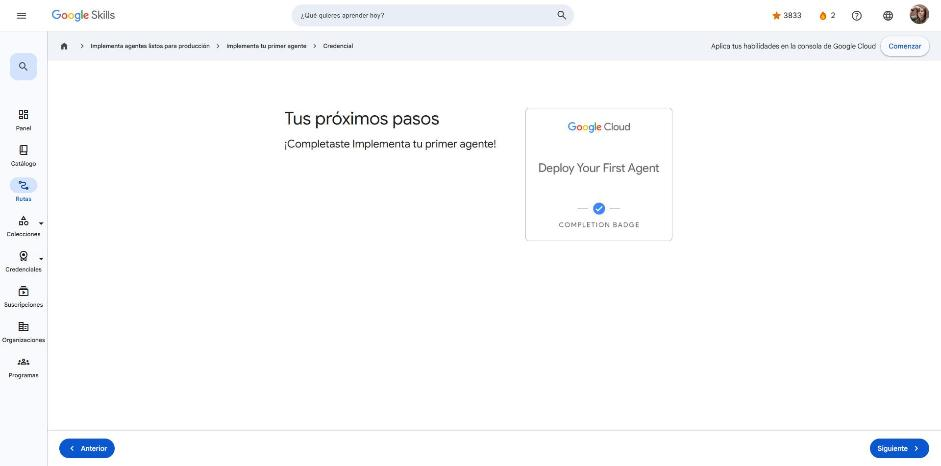

# 3. Implementa tu primer agente

Curso de la ruta **GEAR: Implementa agentes listos para producción** · 1 h 15 min · Avanzado.
Enlace: <https://www.skills.google/paths/3802/course_templates/1639>

**Módulos:** Información sobre la implementación · Implementa en Vertex AI Agent Engine · Memoria de producción (Memory Bank) · Implementa en Cloud Run.

---

## Información sobre la implementación

**Problema.** Un agente que corre con `adk web` en `http://localhost:8000` solo existe en tu máquina: nadie más puede usarlo, se apaga con la terminal o la suspensión, no escala y usa `InMemorySessionService` (las sesiones se pierden al reiniciar).

**Solución: dos plataformas de despliegue del ADK.**

| Factor | Local (`adk web`) | Nube |
|---|---|---|
| Acceso | Solo tu equipo | URL pública global |
| Disponibilidad | Mientras la terminal esté abierta | 24/7 |
| Escalado | Una instancia | Automático |
| Sesión | `InMemorySessionService` | `VertexAiSessionService` (persistente) |
| Uso | Desarrollo y pruebas | Producción y colaboración |

```bash
# Vertex AI Agent Engine
adk deploy agent_engine --project=mi-proyecto --region=us-central1 \
  --staging_bucket=gs://mi-bucket --display_name="Mi agente" ./ruta/agente

# Cloud Run
adk deploy cloud_run --project=mi-proyecto --region=us-central1 \
  --service_name=mi-agente --with_ui ./ruta/agente
```

**Requisitos previos:** proyecto de Google Cloud con facturación, APIs de Vertex AI y/o Cloud Run habilitadas, `gcloud` autenticado (`gcloud auth login`, `gcloud config set project ...`) y el SDK `google-cloud-aiplatform[adk,agent_engines]`.

| | Agent Engine | Cloud Run |
|---|---|---|
| Facilidad | La más alta (un comando, nativo ADK) | Moderada (contenedores) |
| Lenguajes | Python | Python, Go y Java |
| Sesiones | `VertexAiSessionService` automático | Configuración manual |
| Memory Bank | Integrado | Requiere una instancia de Agent Engine |
| UI | Consola de Cloud | Puede incluir UI web (`--with_ui`) |
| Ideal para | Agentes ADK estándar | Contenedores propios, varios lenguajes, UI web, infraestructura Cloud Run existente |

!!! tip "Para recordar"
    - `localhost` no es accesible desde Internet: para compartir hay que desplegar.
    - Regla: **Agent Engine por defecto**; Cloud Run cuando necesites UI web, contenedor personalizado u otro lenguaje.
    - Pista: Agent Engine = totalmente administrado para ADK; Cloud Run = más flexibilidad de contenedor.

## Implementa en Vertex AI Agent Engine

**Problema.** Desplegar a mano exige Docker, infraestructura, persistencia de sesiones y escalado.

**Solución.** Agent Engine es un servicio **completamente administrado** (por ahora solo Python) para desplegar, administrar y escalar agentes ADK.

Qué ocurre con `adk deploy agent_engine`:

1. Empaqueta `agent.py` y `requirements.txt`.
2. Sube el código al **bucket de staging** en Cloud Storage.
3. Construye la imagen de contenedor automáticamente.
4. Despliega en Vertex AI.
5. Devuelve el recurso `projects/{PROJECT}/locations/{LOCATION}/reasoningEngines/{ID}` (5–10 min la primera vez).

Parámetros: obligatorios `--project`, `--region`, `--staging_bucket`, `--display_name` y la ruta con `root_agent`; opcionales `--requirements`, `--enable_tracing`, `--description`.

Beneficios: sin conocimientos de Docker, sesiones persistentes con `VertexAiSessionService` (siguen funcionando los prefijos `temp:`, sesión, `user:` y `app:`), escalado automático y pago por uso, Cloud Logging, historial de ejecución y métricas. **No** se despliega la UI de `adk web`.

Pruebas del agente desplegado: **SDK de Python** (Vertex AI), **consola de Cloud** y **API REST** (`curl` con token de `gcloud auth print-access-token` contra `...reasoningEngines/ID:query`).

!!! tip "Para recordar"
    - Agent Engine gestiona contenedor, sesiones e infraestructura por ti.
    - Pista: tras desplegar, las sesiones pasan de `InMemorySessionService` a **`VertexAiSessionService`** automáticamente.

## Memoria de producción (Memory Bank)

**La brecha.** El estado de sesión solo vive dentro de una conversación: si el lunes el usuario dice "prefiero correo a SMS", el viernes en otra conversación el agente ya no lo sabe.

| | Estado de sesión | Memory Bank |
|---|---|---|
| Alcance | Conversación actual | Todas las conversaciones |
| Persistencia | Hasta que termina la sesión | Indefinida |
| Uso | Flujo de la conversación (`temp:current_topic`, `request_count`) | Aprendizaje a largo plazo (preferencias, historial, intereses) |
| Acceso | Directo con `{variable}` | Mediante una herramienta (búsqueda semántica) |

Ciclo de vida: el usuario conversa → la sesión se guarda en Memory Bank (callback automático tras cada turno) → el **LLM extrae** lo relevante → en otra conversación el agente **busca recuerdos** → responde con contexto histórico.

Componentes: **`VertexAiMemoryBankService`** (servicio administrado, extracción con LLM, búsqueda semántica) y **`PreloadMemoryTool`** (recupera automáticamente los recuerdos relevantes para fundamentar respuestas). Se guarda con un callback que llama a `memory_service.add_session_to_memory(session)`.

!!! tip "Para recordar"
    - Estado = "¿qué pasa en ESTA conversación?"; Memory Bank = "¿qué aprendí en TODAS?".
    - Pista: preferencias del usuario entre conversaciones → **Memory Bank**.

## Implementa en Cloud Run

Cloud Run es la alternativa cuando necesitas **UI web** (`--with_ui`), un **contenedor personalizado**, otros lenguajes o ya tienes infraestructura en Cloud Run. Obtienes URL HTTPS pública, disponibilidad 24/7, escalado automático (incluso a cero, pago por uso) y API REST; el servicio de sesiones se configura manualmente.

!!! tip "Para recordar"
    - `--with_ui` despliega una interfaz web para probar el agente desde el navegador.
    - Pista: la ventaja de Agent Engine para agentes ADK estándar es que configura las sesiones solo y es más simple.

## Ejemplo práctico: agente meteorológico en Cloud Run

1. **Crear el agente.** Crea la carpeta `weather_agent_cloud_run/`, define en `agent.py` un `LlmAgent` (modelo Flash, nombre, descripción e instrucción) y en `__init__.py` pon `from .agent import root_agent`.
2. **Implementar:**

    ```bash
    export GOOGLE_CLOUD_PROJECT="mi-proyecto"
    export GOOGLE_CLOUD_LOCATION="us-central1"
    adk deploy cloud_run --project=$GOOGLE_CLOUD_PROJECT --region=$GOOGLE_CLOUD_LOCATION \
      --service_name=weather-agent --with_ui weather_agent_cloud_run/
    ```

    El comando construye el contenedor, lo despliega y devuelve una URL `https://weather-agent-….run.app`.

3. **Probar:**
    - Con `--with_ui`, la URL abre una interfaz de chat parecida a `adk web` que se puede compartir con el equipo.
    - Por API: `POST $SERVICE_URL/api/query` con `{"input": "..."}`, usando `curl` o `requests` en Python.

**Sesiones:** Cloud Run **no** configura el servicio de sesiones automáticamente, a diferencia de Agent Engine. Para que persistan en producción hay que crear `VertexAiSessionService(project=..., location=...)` en el agente.

**El mismo código sirve en ambas plataformas;** solo cambia el comando de despliegue.

!!! tip "Para recordar"
    - Cloud Run conviene para UI web, contenedores propios o infraestructura Cloud Run existente; Agent Engine, para agentes ADK estándar con sesiones y memoria automáticas.
    - Pista: en Cloud Run, la persistencia de sesiones se configura a mano con `VertexAiSessionService`.

## Cuestionarios

Cuatro cuestionarios de módulo: **100 %** en todos (mínimo 50 %).

| Módulo | Respuesta clave |
|---|---|
| Implementación | localhost solo es accesible en tu máquina · Agent Engine administrado vs. Cloud Run flexible |
| Agent Engine | Usa `VertexAiSessionService` automáticamente · crea contenedor, persistencia e infraestructura por ti |
| Memory Bank | Recordar preferencias entre conversaciones · sesión = una conversación, Memory Bank = entre sesiones |
| Cloud Run | `--with_ui` = interfaz web de pruebas · Agent Engine configura sesiones y es más simple |

**Insignia:** *Deploy Your First Agent* (completion badge).



## Fuentes y aviso legal

- **Fuente:** cursos de la ruta GEAR de Google Cloud Skills Boost. Sitios oficiales: [cloudskillsboost.google](https://www.cloudskillsboost.google) · [cloud.google.com/docs](https://cloud.google.com/docs).
- **Uso:** apuntes personales de estudio, sin fines comerciales y con redacción propia. Las imágenes del curso son fragmentos breves citados con fines educativos; sus derechos son de sus titulares.
- **Sin afiliación:** sitio no oficial, no afiliado ni respaldado por Google. Las marcas pertenecen a sus dueños.
- Más detalles y cómo pedir el retiro de contenido en el [aviso legal](../../aviso-legal.md).
