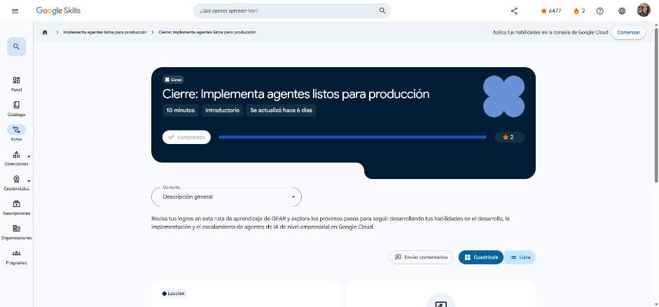

# 5. Cierre: Implementa agentes listos para producción

Curso de cierre (10 min). Enlace: <https://www.skills.google/paths/3802/course_templates/1773>

## Conclusión

Repaso de la ruta:

1. **Crea e implementa agentes en producción**: árboles jerárquicos de agentes, agentes de flujo de trabajo determinísticos (Sequential, Parallel, Loop) y cómo elegir el entorno de hosting (Agent Engine, Cloud Run, GKE…), con seguridad (IAM, VPC-SC) y observabilidad.
2. **Implementa tu primer agente**: llevar un agente de `localhost` a producción con `adk deploy` en Agent Engine o Cloud Run, sesiones persistentes y Memory Bank.
3. **Implementa arquitecturas de múltiples agentes**: relaciones superior–secundario, continuidad de varios turnos escribiendo/leyendo el estado de la sesión, transferencias directas con agentes de flujo de trabajo, A2A y MCP.

**Siguiente ruta GEAR:** *Scale Agents Across the Enterprise*.

!!! tip "Para recordar"
    - Producción = arquitectura multiagente clara + despliegue administrado + estado/memoria persistentes + seguridad y observabilidad.
    - Pista: A2A conecta agentes entre sí; MCP conecta agentes con herramientas y datos.

*Figura: el curso aparece como completado en Google Skills.*
