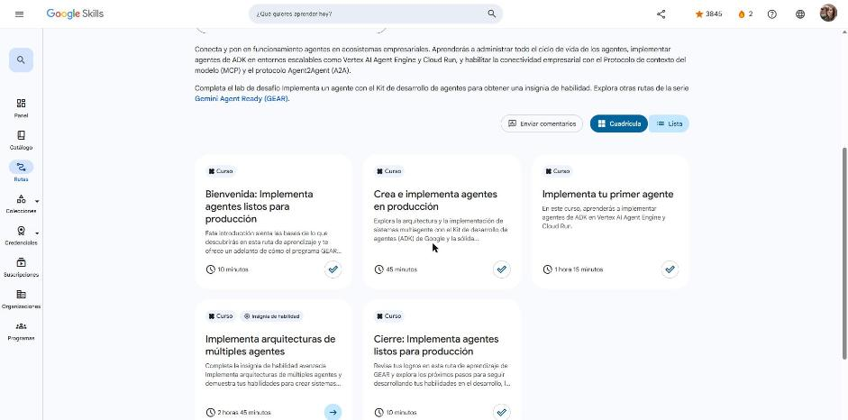

# Google Skills · GEAR: Implementa agentes listos para producción

Programa **Google Cloud Career Launchpad – LatAm** (MinTIC) · Plataforma: Google Skills
Ruta: <https://www.skills.google/paths/3802> · Serie **Gemini Enterprise Agent Ready (GEAR)**, ruta 3 de 6.

Ruta para llevar agentes del ADK de `localhost` a producción en Google Cloud: arquitecturas multiagente jerárquicas, agentes de flujo de trabajo determinísticos, despliegue en Vertex AI Agent Engine y Cloud Run, sesiones persistentes y Memory Bank, seguridad (IAM, VPC Service Controls), observabilidad y conectividad con MCP y A2A.

## Actividades

| # | Actividad | Duración | Estado | Fecha | Resultado | Notas |
|---|---|---|---|---|---|---|
| 1 | [Bienvenida: Implementa agentes listos para producción](https://www.skills.google/paths/3802/course_templates/1770) | 10 min | ✅ Completado | 2026-10-25 | — | [Notas](01-bienvenida.md) |
| 2 | [Crea e implementa agentes en producción](https://www.skills.google/paths/3802/course_templates/1633) | 45 min | ✅ Completado | 2026-10-25 | Cuestionario 100 % · insignia *Build and Deploy Agents in Production* | [Notas](02-crea-e-implementa-agentes-en-produccion.md) |
| 3 | [Implementa tu primer agente](https://www.skills.google/paths/3802/course_templates/1639) | 1 h 15 min | ✅ Completado | 2026-10-25 | 4 cuestionarios al 100 % · insignia *Deploy Your First Agent* | [Notas](03-implementa-tu-primer-agente.md) |
| 4 | [Implementa arquitecturas de múltiples agentes](https://www.skills.google/paths/3802/course_templates/1445) (insignia de habilidad) | 2 h 45 min | Pendiente | — | — | — |
| 5 | [Cierre: Implementa agentes listos para producción](https://www.skills.google/paths/3802/course_templates/1773) | 10 min | ✅ Completado | 2026-10-25 | — | [Notas](05-cierre.md) |

**Progreso de la ruta:** 4 de 5 actividades (80 %).

## Insignias obtenidas

- **Build and Deploy Agents in Production**
- **Deploy Your First Agent**

## Evidencias

## Fuentes y aviso legal

- **Fuente:** cursos de la ruta GEAR de Google Cloud Skills Boost. Sitios oficiales: [cloudskillsboost.google](https://www.cloudskillsboost.google) · [cloud.google.com/docs](https://cloud.google.com/docs).
- **Uso:** apuntes personales de estudio, sin fines comerciales y con redacción propia. Las imágenes del curso son fragmentos breves citados con fines educativos; sus derechos son de sus titulares.
- **Sin afiliación:** sitio no oficial, no afiliado ni respaldado por Google. Las marcas pertenecen a sus dueños.
- Más detalles y cómo pedir el retiro de contenido en el [aviso legal](../../aviso-legal.md).
