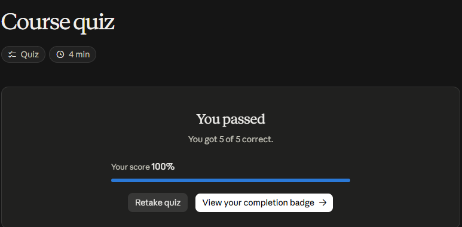

# Claude Academy · Building Effective Human-Agent Teams

Es un curso de Anthropic (beta) de 5 lecciones y un quiz. Trata sobre cómo pasar de usar la IA cada uno por su lado a trabajar en equipos donde personas y agentes comparten espacio, contexto y objetivos.

**Estado:** Completado · Quiz 5/5 (100 %) · [Insignia](https://academy.claude.com/badges/8a0bd08e-1e81-4efa-a652-1e713ee11519)

## 1. Por qué importa la IA «multijugador»

**IA individual («un solo jugador»):** es como un **supertraje**. Hace más rápida a cada persona, pero **aísla la información**: cada quien pregunta lo mismo y recibe respuestas distintas.

**IA multijugador:** personas y agentes trabajan en un **espacio compartido**.

- Si alguien pide el resumen de una reunión, todos lo ven.
- Ese resumen se convierte en conocimiento que el equipo reutiliza.
- **Cuanto más crece el equipo, más cuesta el contexto aislado.**
- Con el contexto compartido, el agente puede ser **proactivo** y más personalizado.

## 2. Qué hace distinto a un agente multijugador

Tiene tres capacidades:

| Capacidad | Agente individual | Agente multijugador |
|---|---|---|
| **Identidad** | Es una extensión mía: usa mis credenciales y sabe lo que yo sé | Actúa **como sí mismo**. El equipo decide a qué accede y qué herramientas usa |
| **Memoria** | Empieza de cero o recuerda solo lo mío | **Crece con cada persona** que trabaja con él |
| **Contexto** | Solo lo que yo le pego | Lee lo que el equipo escribe en los espacios compartidos |

## 3. Cómo es un equipo fuerte

- **Trabajar en público:** para un agente, **lo que no está escrito y accesible no existe**.
- **Roles definidos:**
    - cada persona y cada agente tiene un rol y las herramientas adecuadas;
    - hay una sola lista de roles, un solo conjunto de documentos y un solo espacio de trabajo;
    - las decisiones importantes quedan en manos de personas.
- **Una estrella polar escrita:** la fijan **siempre las personas**. Un agente que conoce la meta puede aportar trabajo útil sin que se lo pidan.
- **Confianza gradual:** se da autonomía en proporción a la confiabilidad demostrada, y se amplía de forma deliberada.

**Por qué importa más con agentes:** el equipo completa tareas más rápido, así que un error de alineación cuesta más.

## 4. Lista de preparación de la organización

Cinco preguntas antes de sumar agentes al equipo:

1. **¿Lo que necesitan personas y agentes está abierto y se puede buscar?** Si vive en documentos privados y mensajes directos, el agente se queda desactualizado.
2. **¿Está escrito quién es dueño de qué, agentes incluidos?** Sin roles claros, el trabajo se duplica.
3. **¿Cada integrante tiene las herramientas que necesita?** Un agente sin acceso hace trabajo superficial, adivina o se equivoca.
4. **¿Hay una revisión antes de que una persona vea el trabajo?** Puede ser una rúbrica, una prueba o un segundo agente.
5. **¿Hay una estrella polar escrita que todos puedan señalar?**

## 5. Cómo empezar (primeras dos semanas)

1. **Empezar pequeño:** un espacio, de 3 a 5 personas con confianza entre ellas y un agente, configurado por ejemplo con Claude Tag o con Claude Managed Agents.
2. **Hacer todo abierto por defecto:** si se decide algo en una reunión o en un mensaje directo, se publica el mismo día.
3. **Escribir la lista de roles con agentes incluidos:** una persona responsable por cada tarea recurrente. El agente propone la lista y las personas deciden.
4. **Fijar la estrella polar** donde el agente la pueda leer.
5. **Darle al agente un primer trabajo visible,** por ejemplo un resumen matutino para todo el equipo. Durante unos días lo revisa una persona.
6. **Darle rúbricas:** para cada tarea, qué significa «aprobado».
7. **Ampliar la confianza paso a paso y por tipo de tarea:** después de varias entregas buenas seguidas.
8. **Convertir en instrucciones escritas** (skills) lo que se explica dos veces.
9. **Hacer una retro semanal** con personas y agentes, y guardar lo aprendido.

## Práctica: este mismo sitio como equipo humano-agente

Apliqué las cinco preguntas a la forma en que trabajo con Claude Code en estos apuntes:

| Pregunta | Cómo se cumple aquí |
|---|---|
| ¿Abierto y se puede buscar? | Los apuntes están publicados en el sitio y el agente lee el repositorio completo |
| ¿Dueños claros? | Yo decido qué se publica y qué se envía. El agente redacta, captura evidencias y compila el sitio |
| ¿Herramientas adecuadas? | El agente tiene el navegador, Python y git. Las contraseñas las escribo siempre yo |
| ¿Revisión antes de que yo lo vea? | La compilación de MkDocs debe pasar sin errores, y los quizzes y la evidencia confirman lo aprendido |
| ¿Estrella polar escrita? | «Todos los cursos asignados con certificado, apuntes y evidencia publicados» |

**La memoria del agente cumple el papel de las «instrucciones del canal».** Ahí quedan escritas las reglas que se repitieron más de una vez:

- no publicar errores;
- cerrar cada página con «Fuentes y aviso legal»;
- ocultar datos personales en los certificados.

## Evaluación (5/5)

1. El agente sigue planeando una función que se descartó en un mensaje directo → **la decisión nunca se escribió donde el agente la pudiera leer**.
2. Lo que distingue a un agente multijugador de un chatbot → **identidad y credenciales propias, memoria compartida y contexto compartido**.
3. Cuatro personas piden a su asistente privado el resumen de la misma reunión → **cuatro resúmenes algo distintos, y nadie con la misma versión**.
4. La primera semana con una tarea nueva (borradores de respuesta a clientes) → **una persona revisa cada borrador y anota cuáles necesitaron su criterio**.
5. La mejor estrella polar → **«80 % de los usuarios nuevos completa el onboarding»**: es medible.

## Evidencia

{ width="480" }

{ width="420" }

!!! tip "Para recordar"
    - Si no está escrito y accesible, para el agente no existe.
    - Las personas fijan la estrella polar; los agentes trabajan hacia ella.
    - La confianza se amplía por tipo de tarea, después de demostrar confiabilidad.
    - Lo que se explica dos veces se convierte en instrucción escrita.

## Fuentes y aviso legal

- **Fuente:** curso «Building effective human-agent teams» de Anthropic Academy (Claude Academy). Sitios oficiales: [anthropic.com/learn](https://www.anthropic.com/learn) · [docs.anthropic.com](https://docs.anthropic.com).
- **Uso:** apuntes personales de estudio, sin fines comerciales y con redacción propia. Las imágenes son fragmentos breves citados con fines educativos; sus derechos son de sus titulares.
- **Sin afiliación:** sitio no oficial, no afiliado ni respaldado por Anthropic. Las marcas pertenecen a sus dueños.
- Más detalles y cómo pedir el retiro de contenido en el [aviso legal](../../aviso-legal.md).
