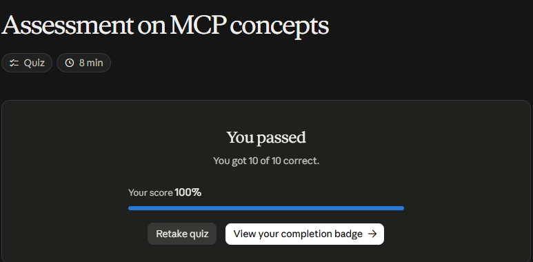

# Claude Academy · Model Context Protocol: Advanced Topics

Curso de Anthropic (11 lecciones, ~1,5 h y un quiz) sobre MCP avanzado: sampling, logging y notificaciones de progreso, roots, tipos de mensajes JSON y transportes (stdio y Streamable HTTP), con estado y sin estado.

**Estado:** Completado · Quiz final 10/10 (100 %) · [Insignia](https://academy.claude.com/badges/f3770dcb-f1cf-4dcc-9640-a3a94b3410cc)

!!! note "Versión de la especificación"
    El curso enseña MCP como funcionaba antes de la revisión **2026-07-28**, que deprecia sampling, logging y roots y elimina el handshake `initialize` y los IDs de sesión. Todo sigue funcionando en la versión 1 del SDK de Python.

## Sampling

- El **servidor le pide al cliente** que llame al modelo por él (`ctx.session.create_message(...)`); el cliente responde con un `sampling_callback` que usa su propia conexión a Claude.
- Ventajas: el servidor no necesita llave de API ni integración con el modelo y **el costo lo paga el cliente**. Ideal para **servidores públicos**.

## Logging y progreso

- Con el `Context` del tool: `await context.info("...")` y `await context.report_progress(70, 100)`.
- En el cliente: `logging_callback` al crear la sesión y `progress_callback` en cada `call_tool`. Cómo se muestran (terminal, WebSockets/SSE, barra de progreso) lo decide la app.

## Roots

- Indican al servidor **qué carpetas puede tocar**: Claude lista las roots, busca el archivo y llama la herramienta con la ruta completa, sin que el usuario la escriba.
- El SDK **no** las hace cumplir solo: hay que implementar algo como `is_path_allowed()` antes de cada operación con archivos.

## Mensajes y transportes

- Todo es JSON: pares **request → result** (`CallTool`, `ListPrompts`, `ReadResource`, `Initialize`) y **notificaciones** sin respuesta (progreso, logging, cambios en la lista de herramientas, recursos actualizados). El protocolo es **bidireccional**: el servidor también inicia mensajes.
- **stdio:** el cliente lanza el servidor como subproceso; stdin/stdout en ambos sentidos; solo en la misma máquina. Handshake: `Initialize Request` → `Initialize Result` → `Initialized Notification`.
- **Streamable HTTP:** para servidores remotos. Como HTTP no deja al servidor iniciar peticiones, usa **SSE**: una conexión GET de larga duración para mensajes del servidor y una conexión SSE por cada llamada a herramienta (logs y resultado). El `mcp-session-id` va en todas las peticiones tras inicializar.

| Bandera | Qué hace | Qué se pierde |
|---------|----------|---------------|
| `stateless_http=True` | Sin sesión; permite escalar horizontalmente detrás de un balanceador; no exige inicialización | Peticiones del servidor al cliente, sampling, progreso, suscripciones |
| `json_response=True` | Respuestas POST como JSON plano, sin streaming | Mensajes intermedios de progreso y logs |

!!! tip "Para recordar"
    - **Sampling** traslada el costo del modelo al cliente: clave para servidores públicos.
    - Las roots ayudan a encontrar archivos, pero **la restricción de acceso la implementa uno**.
    - Si funciona en stdio y falla al desplegar en HTTP, revisar `stateless_http` y `json_response`.
    - Probar con **el mismo transporte que se usará en producción**.

## Práctica: progreso y logging

Uso el servidor de apuntes de la [práctica del curso de introducción](../mcp-intro/index.md#practica-mi-propio-servidor-mcp). Ahí, la herramienta `buscar_notas` recibe un `Context`. Emite un log al empezar y una notificación de progreso por cada nota revisada:

```python
@mcp.tool(name="buscar_notas", description="Busca una palabra en los apuntes...")
async def buscar_notas(texto: str = Field(description="Palabra o frase a buscar"), ctx: Context = None) -> list[str]:
    await ctx.info(f"Buscando '{texto}' en {len(notas)} notas")
    for i, (clave, contenido) in enumerate(notas.items(), start=1):
        await ctx.report_progress(i, len(notas))
        ...
```

**Del lado del cliente:**

- `logging_callback`, definido en la sesión, recibe los logs;
- `progress_callback`, pasado a `call_tool`, recibe el progreso.

```text
1. Conectado a ApuntesMCP (protocolo 2025-11-25)
  [log del servidor] info: Buscando 'cliente' en 4 notas
  [progreso] 1/4
  [progreso] 2/4
  [progreso] 3/4
  [progreso] 4/4
```

**Lo que se ve en la práctica:**

- **El handshake:** `initialize` → resultado → `initialized`.
- **El patrón petición-resultado** de `call_tool`, con notificaciones intercaladas que no esperan respuesta.
- **Logging está deprecado:** con la versión 2.2 del SDK, `ctx.info` emite un `MCPDeprecationWarning`, porque la revisión 2026-07-28 lo deprecó (ver la nota de arriba). Sigue funcionando, pero para código nuevo conviene revisar la guía de migración.

## Evaluación (10/10)

1. Claude no sabe dónde está `video.mp4` → **roots**.
2. Cómo hace StreamableHTTP para que el servidor envíe mensajes → **abre conexiones Server-Sent Events (SSE)**.
3. Qué son los roots → **lo que le indica al servidor a qué archivos y carpetas puede acceder**.
4. Respuestas HTTP simples, solo con el JSON final → **`json_response=True`**.
5. Que el servidor use Claude sin asumir el costo de la API → **sampling**.
6. El transporte que exige cliente y servidor en el mismo equipo → **stdio**.
7. Un `CallToolRequest` que espera resultado → **un mensaje de petición-resultado**.
8. La secuencia de inicio → **Initialize Request → Initialize Result → Initialized Notification**.
9. Qué es sampling → **la forma en que el servidor accede al modelo a través del cliente conectado**.
10. El transporte más simple para probar en local → **stdio**.

## Evidencia

{ width="480" }

{ width="420" }

## Fuentes y aviso legal

- **Fuente:** cursos de Model Context Protocol de Anthropic Academy. Sitios oficiales: [anthropic.com/learn](https://www.anthropic.com/learn) · [modelcontextprotocol.io](https://modelcontextprotocol.io).
- **Uso:** apuntes personales de estudio, sin fines comerciales y con redacción propia. Las imágenes del curso son fragmentos breves citados con fines educativos; sus derechos son de sus titulares.
- **Sin afiliación:** sitio no oficial, no afiliado ni respaldado por Anthropic. Las marcas pertenecen a sus dueños.
- Más detalles y cómo pedir el retiro de contenido en el [aviso legal](../../aviso-legal.md).
