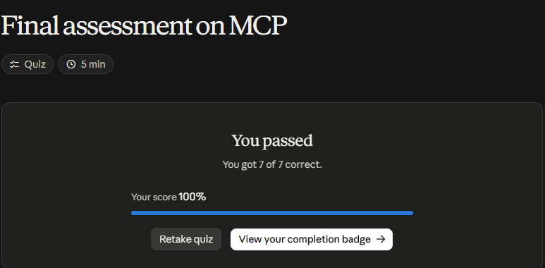

# Claude Academy · Introduction to Model Context Protocol

Curso de Anthropic (10 lecciones, ~1 h y un quiz) para construir un servidor y un cliente MCP con el SDK de Python: herramientas, el inspector, recursos y prompts, sobre un chatbot de línea de comandos que gestiona documentos.

**Estado:** Completado · Quiz final 7/7 (100 %) · [Insignia](https://academy.claude.com/badges/4cf85cb9-0c5d-469f-a968-ddb0f3f68c6c)

## Qué resuelve MCP

- Una **capa de comunicación** que mueve la definición y ejecución de herramientas desde mi servidor a **servidores MCP especializados**. Ejemplo: en vez de escribir decenas de esquemas para la API de GitHub, me conecto al servidor MCP de GitHub.
- Cualquiera puede publicar un servidor; a menudo lo hace el propio proveedor (p. ej. AWS).
- **MCP no es lo mismo que tool use:** MCP entrega herramientas ya implementadas; tool use es cómo Claude las llama.

## Cliente y transporte

- El **cliente MCP** es el puente entre mi servidor y los servidores MCP. Es agnóstico del transporte: stdio (mismo equipo, lo más común), HTTP, WebSockets.
- Mensajes clave: `ListToolsRequest/Result` y `CallToolRequest/Result`.
- Flujo completo: el usuario pregunta → listo las herramientas vía el cliente → envío pregunta + herramientas a Claude → Claude pide una herramienta → el cliente la ejecuta en el servidor MCP (que llama a la API externa) → el resultado vuelve a Claude → respuesta final.

## Servidor con el SDK de Python

```python
from mcp.server.fastmcp import FastMCP
from pydantic import Field

mcp = FastMCP("DocumentMCP", log_level="ERROR")

@mcp.tool(name="read_doc_contents",
          description="Read the contents of a document and return it as a string.")
def read_document(doc_id: str = Field(description="Id of the document to read")):
    if doc_id not in docs:
        raise ValueError(f"Doc with id {doc_id} not found")
    return docs[doc_id]
```

- Decoradores en lugar de JSON Schema a mano; las anotaciones de tipo validan y `Field` describe cada argumento.
- **Inspector:** `mcp dev mcp_server.py` abre una UI local (Connect → Tools → List Tools → Run Tool) que conserva el estado entre llamadas.

## Cliente

- Una clase propia que envuelve la `ClientSession` del SDK y libera los recursos al cerrar.
- `list_tools()` → `session.list_tools()`; `call_tool(nombre, input)` → `session.call_tool(...)`.
- En la práctica se implementa **o** un cliente **o** un servidor; el curso hace ambos para ver cómo encajan.

## Recursos y prompts

- **Recursos** = datos de solo lectura, como un GET. **Directos** (`docs://documents`) o **con plantilla** (`docs://documents/{doc_id}`, el SDK pasa los parámetros como argumentos). `mime_type` indica cómo interpretar la respuesta. Útiles para menciones `@documento`: el contenido entra al prompt sin llamar herramientas.
- **Prompts** = instrucciones probadas y reutilizables que el servidor ofrece (p. ej. `/format doc_id` para pasar un documento a Markdown). Se definen con `@mcp.prompt` y devuelven una lista de mensajes; el cliente los obtiene con `get_prompt(nombre, args)`.

| Primitivo | Lo controla | Para qué |
|-----------|-------------|----------|
| **Tools** | El **modelo** | Darle a Claude nuevas capacidades que usa por su cuenta |
| **Resources** | La **app** | Llevar datos a la UI o al contexto (autocompletar, adjuntar de Drive) |
| **Prompts** | El **usuario** | Flujos predefinidos que el usuario dispara (botones, slash commands) |

!!! tip "Para recordar"
    - MCP traslada el trabajo de integración a quien mejor conoce el servicio.
    - **Tools sirven al modelo, resources a la app, prompts al usuario.**
    - Probar el servidor con el **Inspector** antes de conectarlo a una app.
    - Descripciones claras en herramientas y argumentos: es lo que Claude lee para decidir.

## Práctica: mi propio servidor MCP

Para comprobar lo aprendido construí un servidor de **apuntes de estudio** con el SDK de Python. Uso la versión 2, en la que `FastMCP` pasó a llamarse `MCPServer`. También escribí un cliente por stdio que lo recorre de punta a punta.

El servidor tiene los tres primitivos:

- dos herramientas;
- un recurso directo y otro con plantilla;
- un prompt.

??? example "server.py"
    ```python
    """Servidor MCP de práctica: apuntes de estudio.

    Ejercita lo visto en los cursos de MCP de Claude Academy:
    herramientas (tools), recursos directos y con plantilla (resources),
    prompts, y desde el curso avanzado: logging y notificaciones de progreso.
    """
    from pydantic import Field
    from mcp.server.mcpserver import MCPServer, Context
    from mcp.server.mcpserver.exceptions import ToolError

    mcp = MCPServer("ApuntesMCP")

    notas = {
        "mcp": "MCP conecta modelos con herramientas, recursos y prompts de servidores externos.",
        "primitivos": "Tools las controla el modelo, resources la app y prompts el usuario.",
        "transporte": "stdio para el mismo equipo; StreamableHTTP con SSE para servidores remotos.",
        "sampling": "El servidor pide al cliente que llame al modelo; el costo lo asume el cliente.",
    }


    @mcp.tool(name="buscar_notas", description="Busca una palabra en los apuntes y devuelve las notas que la contienen.")
    async def buscar_notas(texto: str = Field(description="Palabra o frase a buscar"), ctx: Context = None) -> list[str]:
        await ctx.info(f"Buscando '{texto}' en {len(notas)} notas")
        hallazgos = []
        for i, (clave, contenido) in enumerate(notas.items(), start=1):
            await ctx.report_progress(i, len(notas))
            if texto.lower() in contenido.lower():
                hallazgos.append(f"{clave}: {contenido}")
        return hallazgos


    @mcp.tool(name="editar_nota", description="Reemplaza un texto dentro de una nota existente.")
    def editar_nota(
        nota_id: str = Field(description="Id de la nota"),
        viejo: str = Field(description="Texto a reemplazar"),
        nuevo: str = Field(description="Texto nuevo"),
    ) -> str:
        if nota_id not in notas:
            # ToolError devuelve un mensaje claro al modelo en lugar de un fallo inesperado
            raise ToolError(f"No existe la nota {nota_id}")
        notas[nota_id] = notas[nota_id].replace(viejo, nuevo)
        return notas[nota_id]


    @mcp.resource("notas://lista", mime_type="application/json")
    def lista_notas() -> list[str]:
        return list(notas)


    @mcp.resource("notas://lista/{nota_id}", mime_type="text/plain")
    def leer_nota(nota_id: str) -> str:
        if nota_id not in notas:
            raise ValueError(f"No existe la nota {nota_id}")
        return notas[nota_id]


    @mcp.prompt(name="tarjeta", description="Convierte una nota en una tarjeta de estudio pregunta/respuesta.")
    def tarjeta(nota_id: str = Field(description="Id de la nota")) -> str:
        return (
            f"Lee la nota <nota>{notas.get(nota_id, '')}</nota> y escribe una tarjeta de estudio: "
            "una pregunta corta en el anverso y la respuesta en una frase en el reverso."
        )


    if __name__ == "__main__":
        mcp.run(transport="stdio")
    ```

El cliente usa `ClientSession` y `stdio_client`. En orden, hace esto:

1. inicializa la conexión;
2. lista todo lo que ofrece el servidor;
3. llama a las herramientas;
4. lee el recurso con plantilla;
5. pide el prompt.

Esta es la traza real:

```text
1. Conectado a ApuntesMCP (protocolo 2025-11-25)
2. Herramientas: ['buscar_notas', 'editar_nota']
3. Recursos: ['notas://lista'] | plantillas: ['notas://lista/{nota_id}']
4. Prompts: ['tarjeta']
  [log del servidor] info: Buscando 'cliente' en 4 notas
  [progreso] 1/4
  [progreso] 2/4
  [progreso] 3/4
  [progreso] 4/4
5. buscar_notas('cliente') -> ['sampling: El servidor pide al cliente que llame al modelo; el costo lo asume el cliente.']
6. editar_nota -> stdio para el mismo equipo; StreamableHTTP con SSE para servidores remotos o en la nube.
7. recurso con plantilla notas://lista/transporte -> stdio para el mismo equipo; StreamableHTTP con SSE para servidores remotos o en la nube.
8. error controlado -> True Error executing tool editar_nota: No existe la nota no-existe
9. prompt 'tarjeta' -> user : Lee la nota <nota>Tools las controla el modelo, resources la app y prompts el usuario.</nota> y escribe una tarjeta de estudio: una pregunta corta en el anverso y la respuesta en una frase en el reverso.
```

**Lo que confirma la práctica:**

- **El decorador basta:** el SDK genera el esquema JSON a partir de las anotaciones de tipo y de `Field`.
- **`notas://lista/{nota_id}` aparece como plantilla**, no como recurso. El parámetro llega como argumento de la función.
- **El estado vive en el servidor:** el paso 7 lee el cambio hecho en el paso 6.
- **Errores:** un `ValueError` se reporta como fallo inesperado. Con `ToolError` el modelo recibe un mensaje útil (paso 8).

## Evaluación (7/7)

1. Saber qué herramientas ofrece un servidor → **`ListToolsRequest`**.
2. Las dos piezas de un cliente MCP → **una clase cliente propia y la `ClientSession`**.
3. La forma más fácil de definir una herramienta en Python → **el decorador `@mcp.tool()`**.
4. Un botón «resumir documento» que el usuario dispara → **un prompt**, porque lo controla el usuario.
5. El problema de integrar GitHub sin MCP → **escribir y mantener yo todo el código de las herramientas**.
6. Probar el servidor antes de conectarlo → **el Inspector, con `mcp dev mcp_server.py`**.
7. Leer documentos por ID (`docs://documents/report.pdf`) → **un recurso con plantilla**.

## Evidencia

{ width="480" }

{ width="420" }

## Fuentes y aviso legal

- **Fuente:** cursos de Model Context Protocol de Anthropic Academy. Sitios oficiales: [anthropic.com/learn](https://www.anthropic.com/learn) · [modelcontextprotocol.io](https://modelcontextprotocol.io).
- **Uso:** apuntes personales de estudio, sin fines comerciales y con redacción propia. Las imágenes del curso son fragmentos breves citados con fines educativos; sus derechos son de sus titulares.
- **Sin afiliación:** sitio no oficial, no afiliado ni respaldado por Anthropic. Las marcas pertenecen a sus dueños.
- Más detalles y cómo pedir el retiro de contenido en el [aviso legal](../../aviso-legal.md).
