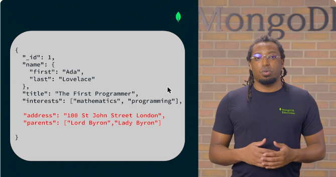
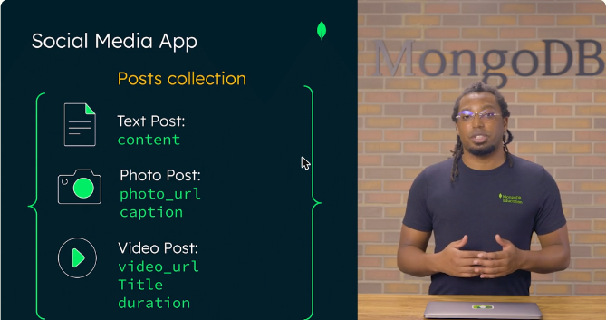
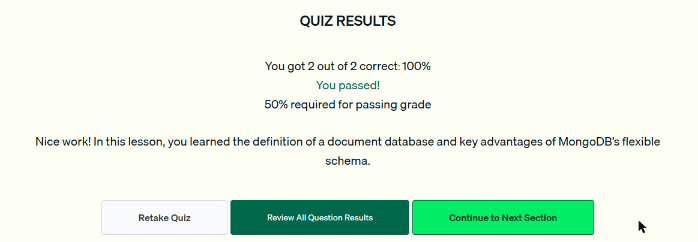

# 01 · Fundamentos de MongoDB

Primera lección de la unidad *Getting Started with MongoDB Atlas* de MongoDB University. Explica por qué MongoDB es una base de datos **distribuida**, cómo es el **modelo de documentos** y qué significa tener un **esquema flexible**.

## Base de datos distribuida

- En una base de datos distribuida los datos se reparten entre **varias máquinas (nodos)**, que pueden estar en ubicaciones geográficas distintas.
- **Redundancia:** si un nodo falla, el sistema sigue funcionando porque otros nodos tienen copia de los datos.
- **Menor latencia:** los datos pueden guardarse cerca de donde se generan o se consultan, y eso mejora la experiencia del usuario.

## Modelo de documentos

MongoDB guarda los datos en **documentos tipo JSON** (JavaScript Object Notation). Internamente usa BSON, la versión binaria de JSON. Un documento representa una entidad completa con pares **campo: valor**.

```json
{
  "_id": 1,
  "name": { "first": "Ada", "last": "Lovelace" },
  "title": "The First Programmer",
  "interests": ["mathematics", "programming"],
  "address": "100 St John Street London"
}
```

- Un **documento** puede tener objetos anidados (`name`) y arreglos (`interests`).
- Casi toda la información de una entidad (un usuario, un producto) cabe en **un solo documento**.
- Un grupo de documentos forma una **colección**. Por ejemplo, la colección `users`.



*Figura: un documento puede crecer con campos nuevos (en rojo: `address` y `parents`) sin tener que migrar un esquema.*

## Datos polimórficos y esquema flexible

- **Datos polimórficos:** datos que pueden tomar varias formas dentro de la misma estructura.
- **Esquema flexible:** cada documento de una colección puede tener **su propia estructura**, con campos y tipos distintos.
- Sirve para datos **no estructurados o semiestructurados** que no encajan bien en una tabla.

Ejemplo: una app social con una colección `posts`.

| Tipo de post | Campos comunes | Campos propios |
|---|---|---|
| Texto | `user_id`, `timestamp`, `likes` | `content` |
| Foto | `user_id`, `timestamp`, `likes` | `photo_url`, `caption` |
| Video | `user_id`, `timestamp`, `likes` | `video_url`, `title`, `duration` |

Si la app agrega un tipo nuevo (por ejemplo, transmisiones en vivo), basta con guardar documentos con la nueva forma en la **misma colección**, sin crear colecciones nuevas ni modelos complejos.



*Figura: tres tipos de post conviven en una sola colección gracias al esquema flexible.*

## Casos de uso

IoT, apps móviles, gestión de contenidos, videojuegos e **IA generativa**. El modelo de documentos maneja bien los datos no estructurados y permite guardar **vector embeddings** para aplicaciones de GenAI.

!!! tip "Para recordar"
    - Base de datos documental = datos en **documentos tipo JSON**, flexibles y polimórficos. Una base de filas y columnas es **relacional**.
    - Documento → colección → base de datos.
    - Esquema flexible: cada documento puede tener una estructura distinta, sirve para datos semiestructurados y permite cambiar el esquema **sin estructuras predefinidas**.
    - Pista para el examen: «documento» en MongoDB **no** significa archivos PDF u hojas de cálculo. Es la unidad básica de datos con pares campo-valor.

## Cuestionario

Resultado: **2/2 correctas (100 %)**. Se necesitaba el 50 % para aprobar. Las preguntas trataron qué define a una base documental y las ventajas del esquema flexible.



*Figura: cuestionario de la lección 1 aprobado.*
