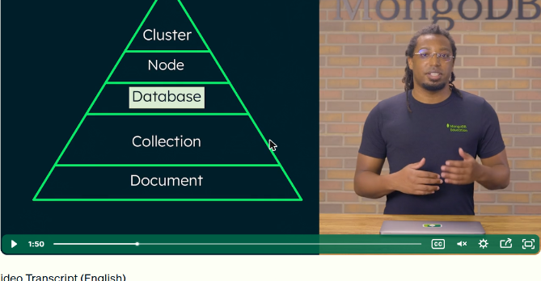
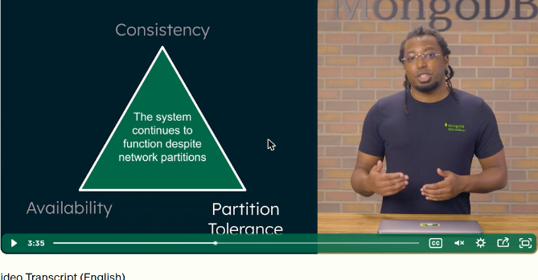
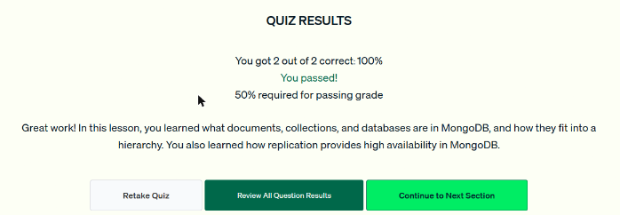

# 02 · Arquitectura de MongoDB

Lección sobre cómo MongoDB organiza los datos y cómo maneja, como sistema distribuido, la **disponibilidad** (replicación), la **consistencia** (read y write concerns) y la **escala** (sharding).

## Jerarquía de organización

De abajo hacia arriba:

| Nivel | Qué es |
|---|---|
| **Documento** | Unidad mínima de datos. Pares campo-valor con tipos como strings, números, fechas, arreglos u objetos |
| **Colección** | Grupo de documentos, normalmente una entidad del modelo de datos (puede mezclar formas distintas) |
| **Base de datos** | Grupo de colecciones. En la arquitectura de MongoDB «base de datos» no es el DBMS, sino este contenedor |
| **Nodo** | Una instancia individual de MongoDB, en una máquina física, una VM o un contenedor |
| **Cluster** | Grupo de nodos. Hay dos tipos: **replica sets** y **sharded clusters** |

*Figura: documento → colección → base de datos → nodo → cluster.*

## Teorema CAP

En un sistema distribuido no se pueden garantizar las tres cosas a la vez:

- **Consistencia (C):** cada lectura devuelve el dato de la escritura más reciente, o un error.
- **Disponibilidad (A):** toda petición recibe respuesta, aunque el dato no sea el más reciente.
- **Tolerancia a particiones (P):** el sistema sigue funcionando aunque se corte la comunicación entre nodos.

MongoDB garantiza **tolerancia a particiones** con replicación y sharding. El usuario decide el **equilibrio entre consistencia y disponibilidad**.

*Figura: el triángulo CAP. MongoDB fija la P y permite ajustar C frente a A.*

## Replicación (alta disponibilidad)

- **Replicación:** guardar varias copias sincronizadas de los datos en varios nodos. Si un nodo cae, la base sigue funcionando.
- **Replica set:** grupo de instancias `mongod` que mantienen el **mismo conjunto de datos**.
- **`mongod`:** el proceso *daemon* principal de MongoDB. Atiende las peticiones de datos, gestiona el acceso y hace las tareas de mantenimiento en segundo plano.

*Figura: un replica set es un grupo de procesos mongod con los mismos datos.*

## Read concern y write concern (consistencia)

| Ajuste | Qué controla | Valor por defecto |
|---|---|---|
| **Read concern** | Consistencia y aislamiento de lo que se lee en replica sets o clusters fragmentados | `local`: responde con los datos del nodo que atiende la consulta, sin esperar confirmación de los demás. Da baja latencia y alta disponibilidad, pero no garantiza consistencia. `majority` prioriza la consistencia |
| **Write concern** | Cuántos miembros del replica set deben confirmar una escritura para darla por exitosa | `majority` |

Con los dos se equilibran rendimiento, disponibilidad y consistencia según la aplicación.

## Sharding (escalabilidad horizontal)

- **Sharding:** repartir (particionar) los datos entre varios nodos. Cada **shard** guarda un subconjunto y todos juntos forman una sola base lógica: el **sharded cluster**.
- Da **escalabilidad horizontal**: cuando los datos crecen se agregan shards, en vez de comprar una máquina más grande.
- Exige planeación. Un cluster mal balanceado desperdicia recursos y empeora las consultas. No siempre hace falta.

*Figura: con sharding se agregan shards para distribuir datos y carga.*

!!! tip "Para recordar"
    - **Colección = grupo de documentos; base de datos = grupo de colecciones.**
    - **Replicación → disponibilidad. Sharding → escala horizontal. Read y write concerns → consistencia.**
    - Read concern por defecto: `local`. Write concern por defecto: `majority`.
    - Pista para el examen: «distribuir datos entre shards» o «escalar horizontalmente» es **sharding**, no replicación. La replicación guarda **copias** y mantiene la base operativa si falla un nodo.

## Cuestionario

Resultado: **2/2 correctas (100 %)**. Las preguntas cubrieron la relación entre documentos, colecciones y bases de datos, y cómo la replicación da alta disponibilidad.

*Figura: cuestionario de la lección 2 aprobado.*
