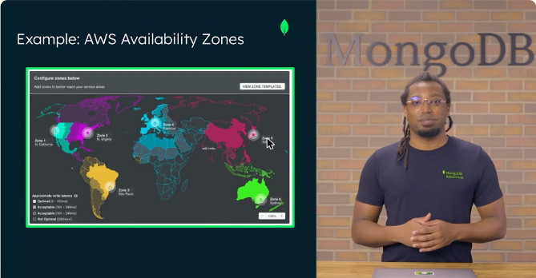
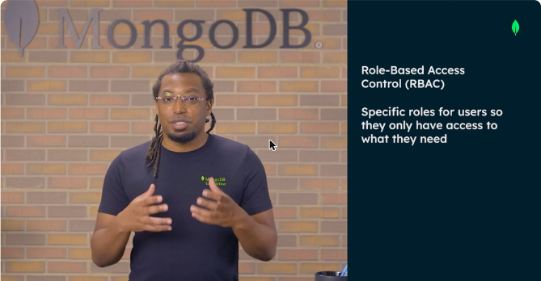
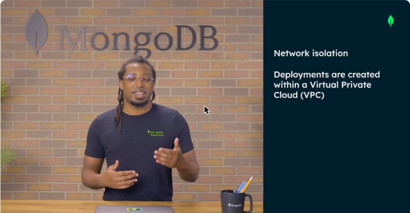
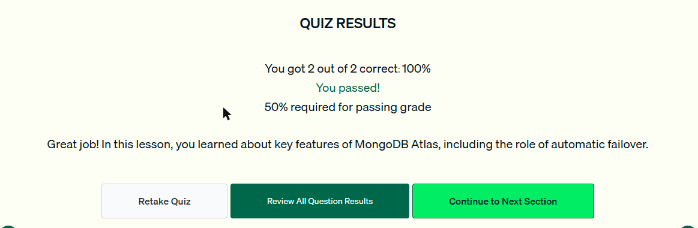

# 03 · Visión general de MongoDB Atlas

Atlas es la **base de datos como servicio (DBaaS)** de MongoDB. Esta lección lo compara con las opciones autogestionadas y explica su infraestructura en la nube y su seguridad.

## Autogestionado frente a Atlas

| Opción | Quién opera la infraestructura | Idea clave |
|---|---|---|
| **MongoDB Community Edition** | El usuario descarga, instala y configura en nodos propios o alquilados | Gratis, mucho control, todo el trabajo operativo es tuyo |
| **MongoDB Enterprise Advanced** | El usuario (autogestionado) | Versión comercial con funciones empresariales |
| **MongoDB Atlas** | MongoDB, totalmente gestionado en la nube | Quita casi toda la carga operativa: automatiza la distribución, las actualizaciones y el ciclo de vida |

## Infraestructura en la nube

- Atlas corre en los tres grandes proveedores: **AWS, Google Cloud y Microsoft Azure**. Un cluster puede desplegarse en **varios proveedores** para tolerar fallos y evitar quedar atado a uno solo (*vendor lock-in*).
- **Región:** ubicación del centro de datos. Afecta la **latencia**, la **regulación de datos** y el **precio**.
- **Zonas de disponibilidad:** ubicaciones aisladas dentro de una región, clave para la alta disponibilidad.
- **Clusters multirregión:** reducen el riesgo de caídas regionales, acercan los datos a los usuarios y ayudan a cumplir las leyes de **soberanía de datos**.
- **Failover automático:** si una zona falla, otra sigue atendiendo lecturas y escrituras.

*Figura: configuración de zonas y latencia aproximada en un despliegue global.*

## Seguridad en Atlas

| Capa | Qué hace |
|---|---|
| **Autenticación** | Obligatoria por defecto. Soporta **MFA** con varias opciones |
| **Autorización (RBAC)** | Control de acceso basado en roles: cada usuario solo accede a lo que necesita |
| **Aislamiento de red** | Los despliegues se crean dentro de una **VPC** con firewalls dedicados. La **IP Access List** define qué IP pueden conectarse |
| **Cifrado** | En tránsito, en reposo y en uso (mientras se consulta) |
| **Extras** | Auditoría, *private endpoints* (conexión sin pasar por la red pública), integración con herramientas de monitoreo |
| **Cumplimiento** | Certificaciones como HIPAA, GDPR y SOC 2 Type II |

*Figura: con RBAC los usuarios reciben roles específicos y solo ven lo que necesitan.*

*Figura: los despliegues de Atlas viven dentro de una VPC.*

!!! tip "Para recordar"
    - Atlas = **DBaaS totalmente gestionado**. Community y Enterprise Advanced son **autogestionados**.
    - Proveedores: AWS, GCP y Azure. Se puede ser **multinube** y **multirregión**.
    - **Failover automático** = si falla una zona de disponibilidad, otra toma el relevo. No tiene que ver con el cifrado ni con los permisos.
    - Seguridad por defecto: autenticación (MFA), autorización (**RBAC**), aislamiento de red (VPC e IP Access List) y cifrado.
    - Pista para el examen: «configurar y mantener la infraestructura a mano» describe la opción **autogestionada**, no Atlas.

## Cuestionario

Resultado: **2/2 correctas (100 %)**. Las preguntas cubrieron las diferencias entre Atlas y las opciones autogestionadas, y el papel del failover automático.

*Figura: cuestionario de la lección 3 aprobado.*
