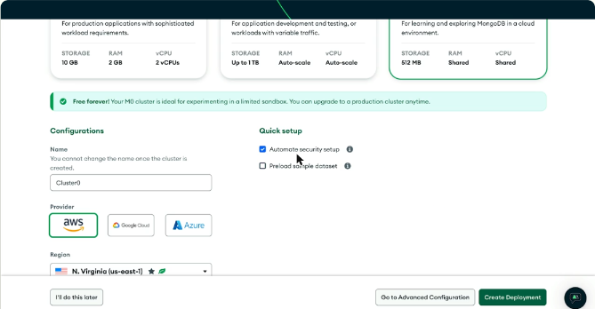
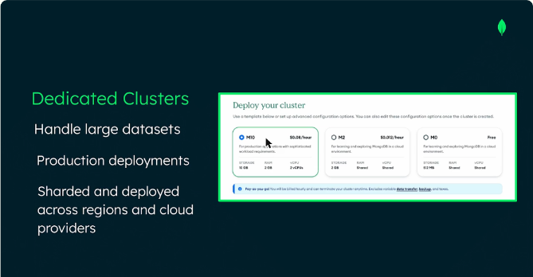
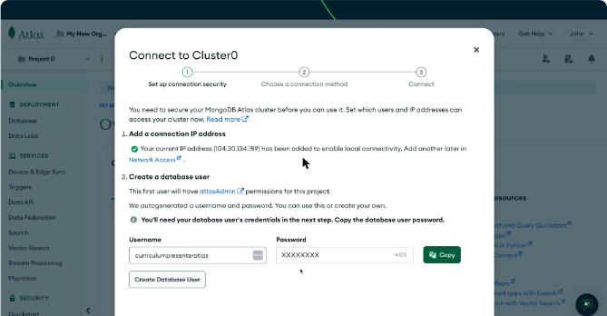
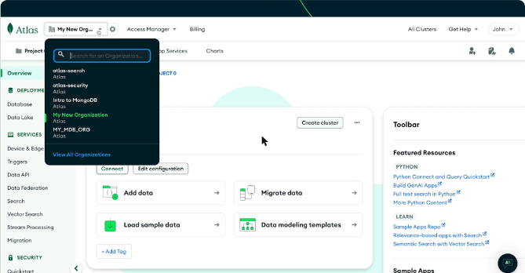
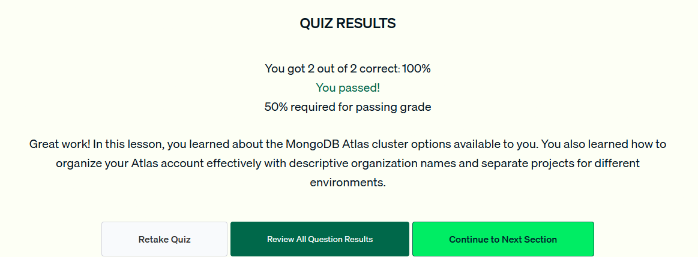

# 04 · Desplegar un cluster en Atlas

Paso a paso para crear el primer cluster en Atlas: elegir el tipo de cluster, configurar el acceso de red, crear el usuario de base de datos y organizar la cuenta en organizaciones y proyectos.

## Pasos para crear el cluster

1. **Crear la cuenta** con el botón *Try Free* de mongodb.com, con correo o con GitHub (los estudiantes tienen beneficios con el GitHub Student Pack). Al entrar por primera vez Atlas hace unas preguntas para recomendar recursos.
2. **Elegir el tipo de cluster** (ver la tabla de abajo). Para aprender se usa **M0**.
3. **Nombre del cluster:** por defecto `Cluster0`. **No se puede cambiar después**, así que conviene que describa su propósito.
4. **Quick setup:**
    - *Automate security setup* agrega tu IP actual a la lista de acceso y facilita la conexión.
    - *Preload sample dataset* (opcional) carga datos de ejemplo.
5. **Proveedor y región:** con un cluster compartido las opciones de región son limitadas. Atlas sugiere la región más cercana.
6. **Create Deployment** abre la ventana *Connect to Cluster*.



*Figura: nombre `Cluster0`, seguridad automática, proveedor (AWS, Google Cloud o Azure) y región.*

## Tipos de cluster: M0, Flex y Dedicated

| Tipo | Costo | Para qué sirve | Límites |
|---|---|---|---|
| **M0 (gratis, compartido)** | Gratis para siempre | Aprender, cargar datos de ejemplo, probar CRUD | 512 MB de almacenamiento, RAM y vCPU compartidas. **Solo un M0 por proyecto**. Sin las herramientas avanzadas de operación |
| **Flex** (antes *Serverless* y M2/M5) | Pago por uso, con tope mensual | Desarrollo, pruebas y cargas con tráfico variable | Recursos que se ajustan solos. No es para producción exigente |
| **Dedicated (M10 en adelante)** | Por hora | **Producción**. MongoDB recomienda **M30 o más** para aplicaciones de alto tráfico | Solo los dedicados pueden tener **sharding** y desplegarse en **varias regiones y varios proveedores** |

- Un M0 se puede **subir de nivel** a Flex o Dedicated en cualquier momento.
- En el video, la opción de pago por uso aparece como *Serverless*. En Atlas actual ese papel lo cumple **Flex**.



*Figura: la pantalla «Deploy your cluster» con M10 (dedicado), M2 y M0 (gratis).*

## Network access y database users

- **Network access:** solo se conectan las IP que estén en la **IP Access List**. La seguridad automática agrega tu IP actual. Después se pueden agregar más en *Network Access*.
- **Database user:** es un usuario **distinto de tu cuenta de Atlas**. Atlas puede generar el usuario y la contraseña. Hay que **copiar la contraseña al crearlo** porque después no se puede recuperar. El primer usuario recibe el rol `atlasAdmin` del proyecto.
- Luego Atlas ofrece los métodos de conexión (driver, shell, Compass). El **connection string** tiene esta forma:

```text
mongodb+srv://<usuario>:<contraseña>@cluster0.xxxxx.mongodb.net/
```



*Figura: ventana «Connect to Cluster0»: primero se agrega la IP de conexión y después se crea el usuario de la base de datos.*

## Organizaciones y proyectos

- **Organización:** agrupa usuarios y equipos y les da acceso a proyectos. Conviene darle un **nombre descriptivo** en *Settings* (en el video: «Intro to MongoDB: Testing»).
- **Proyecto:** organiza recursos como los clusters. Una práctica común es tener **proyectos separados para desarrollo, pruebas y producción**.
- En *Project Overview* se ve el estado del cluster y los atajos para cargar datos de ejemplo.



*Figura: el selector de organizaciones arriba a la izquierda y la vista general del proyecto.*

!!! tip "Para recordar"
    - **M0 = gratis y compartido**, ideal para aprender. Solo uno por proyecto.
    - **Flex = pago por uso** para desarrollo y tráfico variable.
    - **Dedicated (M10+) = producción**. Solo los dedicados admiten sharding y despliegue multirregión o multinube.
    - El nombre del cluster **no se puede cambiar** después de crearlo.
    - Usuario de base de datos ≠ cuenta de Atlas. Guarda la contraseña al crearlo.
    - Pista para el examen: para «cargar datos de ejemplo y probar CRUD» las opciones adecuadas son **M0** y la de pago por uso (Serverless o Flex), no M10 ni Dedicated.
    - Pista para el examen: separa entornos con **proyectos distintos** y nombra la organización de forma descriptiva. No pongas todo en un solo proyecto.

## Cuestionario

Resultado: **2/2 correctas (100 %)**. Las preguntas cubrieron qué tipo de cluster conviene para experimentar y cómo organizar la cuenta por entornos.



*Figura: cuestionario de la lección 4 aprobado.*

El laboratorio práctico de la lección (crear la cuenta y desplegar el cluster en Atlas) está **Pendiente**.

## Fuentes y aviso legal

- **Fuente:** cursos de MongoDB University. Sitios oficiales: [learn.mongodb.com](https://learn.mongodb.com) · [mongodb.com/docs](https://www.mongodb.com/docs).
- **Uso:** apuntes personales de estudio, sin fines comerciales y con redacción propia. Las imágenes del curso son fragmentos breves citados con fines educativos; sus derechos son de sus titulares.
- **Sin afiliación:** sitio no oficial, no afiliado ni respaldado por MongoDB. Las marcas pertenecen a sus dueños.
- Más detalles y cómo pedir el retiro de contenido en el [aviso legal](../../aviso-legal.md).
