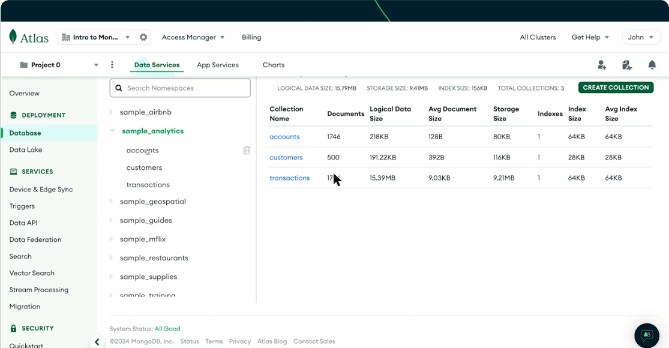
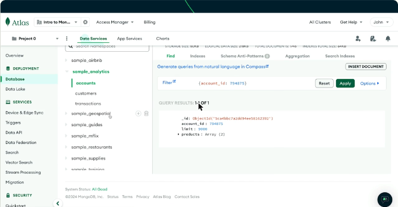
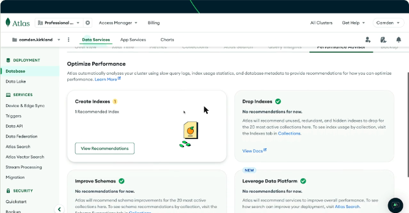
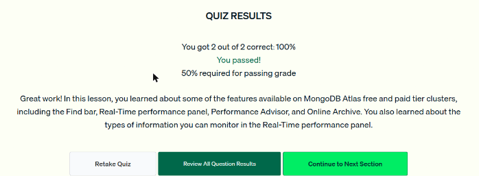

# 05 · Explorar la interfaz de Atlas

Recorrido por las funciones de la interfaz de Atlas: cargar el dataset de ejemplo, navegar los datos con el **Data Explorer**, hacer consultas y conocer las herramientas de operación de los clusters dedicados.

## Cargar datos de ejemplo

1. En *Project Overview* se elige **Load sample data**. La carga tarda unos minutos.
2. Con **Browse Collections** se abre la vista de colecciones.
3. A la izquierda aparecen las bases (`sample_airbnb`, `sample_analytics`, `sample_mflix`, `sample_restaurants`, `sample_supplies`…). Al elegir una colección se ven sus documentos y estadísticas: número de documentos, tamaño e índices.



*Figura: la base `sample_analytics` con las colecciones `accounts`, `customers` y `transactions`.*

## Consultar con la barra Find

En la pestaña **Find** se escribe un filtro con sintaxis de consulta de MongoDB y se pulsa *Apply*:

```javascript
{ account_id: 794875 }
```

El resultado muestra solo el documento que coincide (`QUERY RESULTS: 1-1 OF 1`).



*Figura: el filtro `{account_id: 794875}` sobre la colección `accounts` devuelve un solo documento.*

## Otras pestañas del Data Explorer

- **CRUD:** insertar, editar y borrar documentos desde la interfaz.
- **Aggregation:** construir pipelines de agregación.
- **Search Indexes:** crear índices para **Atlas Search** y **Atlas Vector Search**.
- **Command Line Tools:** guías para trabajar desde la terminal, conectar aplicaciones e importar o exportar datos.

## Funciones de operación (clusters dedicados)

| Herramienta | Qué ofrece | Disponible en |
|---|---|---|
| **Metrics** | Métricas clave de la salud del cluster | Todos los clusters |
| **Real-Time Performance Panel** | Operaciones actuales, tráfico de red, ejecución y rendimiento de consultas, estadísticas de hardware de los hosts | **M10 en adelante** |
| **Performance Advisor** | Analiza el cluster y recomienda mejoras, por ejemplo **qué índices crear** | **M10 en adelante** |
| **Online Archive** | Mueve los datos poco consultados a almacenamiento más barato, y siguen siendo consultables | **M10 en adelante** |



*Figura: Performance Advisor recomienda crear un índice. Revisa índices, esquemas y oportunidades de mejora.*

!!! tip "Para recordar"
    - La barra **Find** está en todos los tiers, incluido M0.
    - Al pasar de M0 a M10 se ganan el **Real-Time Performance Panel**, el **Performance Advisor** y el **Online Archive**.
    - El Real-Time Panel muestra **operaciones actuales, hardware y tráfico de red**. No muestra resúmenes históricos de un mes.
    - Datos de ejemplo: *Load sample data* → *Browse Collections*.

## Cuestionario

Resultado: **2/2 correctas (100 %)**. Las preguntas cubrieron qué funciones se ganan al subir de M0 a M10 y qué información muestra el Real-Time Performance Panel.



*Figura: cuestionario de la lección 5 aprobado.*

## Fuentes y aviso legal

- **Fuente:** cursos de MongoDB University. Sitios oficiales: [learn.mongodb.com](https://learn.mongodb.com) · [mongodb.com/docs](https://www.mongodb.com/docs).
- **Uso:** apuntes personales de estudio, sin fines comerciales y con redacción propia. Las imágenes del curso son fragmentos breves citados con fines educativos; sus derechos son de sus titulares.
- **Sin afiliación:** sitio no oficial, no afiliado ni respaldado por MongoDB. Las marcas pertenecen a sus dueños.
- Más detalles y cómo pedir el retiro de contenido en el [aviso legal](../../aviso-legal.md).
