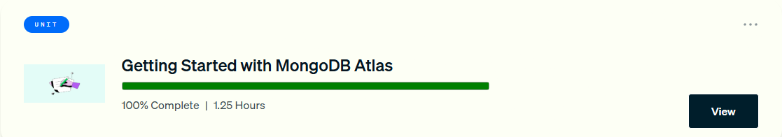

# MongoDB University · Getting Started with MongoDB Atlas

Apuntes de la unidad gratuita **Getting Started with MongoDB Atlas** de MongoDB University (learn.mongodb.com). Es parte de la ruta *MongoDB Python Developer Path*. Cubre los fundamentos de MongoDB como base de datos documental y distribuida, su arquitectura (replicación, read y write concerns, sharding) y el uso de **MongoDB Atlas**: tipos de cluster, seguridad, despliegue y exploración de datos.

## Lecciones

| # | Lección | Estado | Fecha | Resultado | Notas |
|---|---|---|---|---|---|
| 1 | Foundations of MongoDB | Completado | 2026-10-25 | Cuestionario 2/2 (100 %) | [Ver apuntes](01-fundamentos-mongodb.md) |
| 2 | MongoDB Architecture Overview | Completado | 2026-10-25 | Cuestionario 2/2 (100 %) | [Ver apuntes](02-arquitectura-mongodb.md) |
| 3 | Atlas Overview | Completado | 2026-10-25 | Cuestionario 2/2 (100 %) | [Ver apuntes](03-vision-general-atlas.md) |
| 4 | Deploying an Atlas Cluster | Completado | 2026-10-25 | Cuestionario 2/2 (100 %). Lab práctico: Pendiente | [Ver apuntes](04-desplegar-cluster-atlas.md) |
| 5 | Exploring the Atlas UI | Completado | 2026-10-25 | Cuestionario 2/2 (100 %) | [Ver apuntes](05-explorar-interfaz-atlas.md) |
| 6 | Conclusion | Completado | 2026-10-25 | Unidad al 100 % | [Ver apuntes](06-conclusion.md) |

## Resumen del avance

- **Avance de la unidad:** 100 %. Aparece en «Completed» del panel de MongoDB University con una duración de 1,25 horas.
- **Cuestionarios:** 5 de 5 aprobados, **10/10 respuestas correctas** (se exigía el 50 % en cada uno).
- **Constancia:** la unidad tiene *Proof of Completion* disponible en el panel. Esta unidad no otorga insignia de Credly.
- **Pendiente:** el laboratorio práctico de la lección 4 (crear la cuenta de Atlas y desplegar un cluster M0).

*Figura: la unidad «Getting Started with MongoDB Atlas» al 100 % en el panel de MongoDB University.*

## Mapa rápido de conceptos

| Tema | Idea central |
|---|---|
| Modelo de documentos | Documentos tipo JSON (BSON), esquema flexible y datos polimórficos |
| Jerarquía | Documento → colección → base de datos → nodo → cluster |
| Replicación | Replica sets de `mongod` con los mismos datos, para alta disponibilidad |
| Consistencia | Read concern (por defecto `local`) y write concern (por defecto `majority`) |
| Sharding | Escalabilidad horizontal repartiendo datos entre shards |
| Atlas | DBaaS en AWS, GCP y Azure, multirregión, con failover automático |
| Seguridad | MFA, RBAC, VPC con IP Access List, cifrado en tránsito, en reposo y en uso |
| Tipos de cluster | M0 (gratis, aprender), Flex (pago por uso, desarrollo), Dedicated M10+ (producción, sharding, multirregión) |
| Interfaz | Data Explorer, Find, Aggregation, Search Indexes, Real-Time Panel, Performance Advisor, Online Archive |
