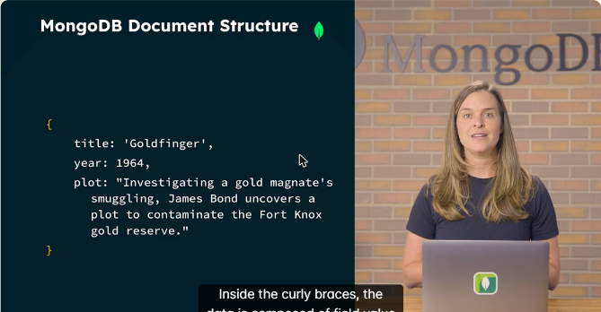
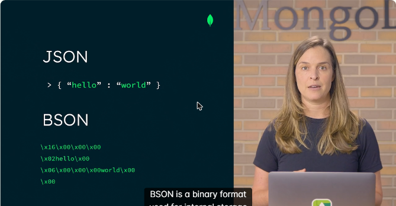
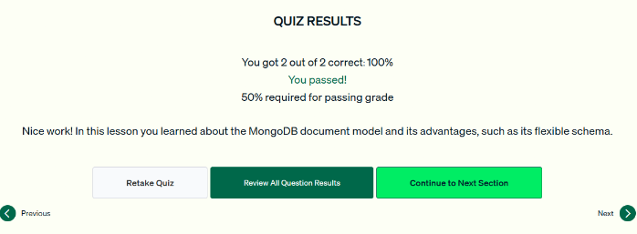

# 03.1 · Visión general del modelo de documentos

Primera lección de la unidad *MongoDB and the Document Model*. Explica la estructura de un documento, la diferencia entre JSON y BSON, cómo MongoDB maneja datos polimórficos y los límites de tamaño y anidamiento.

## Estructura de un documento

- El **documento** es la unidad mínima de datos. Varios documentos forman una **colección**, las colecciones viven en una **base de datos**, y la base puede estar en uno o varios nodos de un cluster.
- Todo documento empieza y termina con **llaves `{ }`** y contiene pares **campo: valor**.
- **Nombres de campo:** son strings, deben ser **únicos dentro del documento** y conviene que sean **claros y descriptivos** (`username` es mejor que `u-n`).
- **Valores:** strings, números, booleanos, arreglos de tipos mixtos o documentos embebidos.
- **Regla de oro:** *los datos que se consultan juntos se guardan juntos*, usando arreglos o documentos embebidos (por ejemplo, el campo `imdb` de una película es un subdocumento).

```javascript
{
  title: 'Goldfinger',
  year: 1964,
  plot: "Investigating a gold magnate's smuggling, James Bond uncovers a plot..."
}
```



*Figura: un documento de la colección `movies` con pares campo-valor entre llaves.*

## JSON y BSON

| | JSON | BSON (Binary JSON) |
|---|---|---|
| Formato | Texto legible para humanos | Binario |
| Uso | Representar e intercambiar datos | Almacenamiento interno y transmisión por la red |
| Tipos | Básicos | Agrega tipos como **Date**, **ObjectId** y **Timestamp** |
| Diseño | — | Ligero, recorrible (*traversable*) y eficiente |



*Figura: el mismo `{ "hello": "world" }` en JSON (texto) y en BSON (bytes).*

## Esquema flexible y datos polimórficos

- **Polimórficos:** los campos pueden tener tipos y formas distintas de un documento a otro dentro de la misma colección. Algunas películas tienen puntaje de *metacritic* y otras no.
- Admite datos de texto, geoespaciales, series de tiempo, grafos y más.
- **Agregar campos es fácil:** no hay que reconstruir ni reindexar la colección. Para registrar locaciones de filmación basta con empezar a incluir el campo en los documentos nuevos o actualizados.

## Límites de los documentos

| Límite | Valor | Por qué existe |
|---|---|---|
| Tamaño máximo de documento | **16 MB** | Evita que un documento consuma demasiada memoria o ancho de banda |
| Niveles de anidamiento | **100** | Mantiene simple y eficiente el código interno de MongoDB |

!!! tip "Para recordar"
    - Documento = llaves con pares campo-valor. Los nombres de campo son **strings únicos y descriptivos**.
    - **Lo que se consulta junto, se guarda junto.**
    - MongoDB **almacena en BSON** (binario, con tipos extra). JSON es la representación legible.
    - El **esquema flexible** es lo que permite manejar datos polimórficos.
    - Límites: **16 MB** por documento y **100 niveles** de anidamiento.
    - Pista para el examen: abreviar nombres de campo «para ahorrar disco» o repetirlos **no** es buena práctica.

## Cuestionario

Resultado: **2/2 correctas (100 %)**. Las preguntas cubrieron las buenas prácticas para nombrar campos y la característica que permite datos polimórficos.



*Figura: cuestionario de la lección 1 aprobado.*

## Fuentes y aviso legal

- **Fuente:** cursos de MongoDB University. Sitios oficiales: [learn.mongodb.com](https://learn.mongodb.com) · [mongodb.com/docs](https://www.mongodb.com/docs).
- **Uso:** apuntes personales de estudio, sin fines comerciales y con redacción propia. Las imágenes del curso son fragmentos breves citados con fines educativos; sus derechos son de sus titulares.
- **Sin afiliación:** sitio no oficial, no afiliado ni respaldado por MongoDB. Las marcas pertenecen a sus dueños.
- Más detalles y cómo pedir el retiro de contenido en el [aviso legal](../../../aviso-legal.md).
