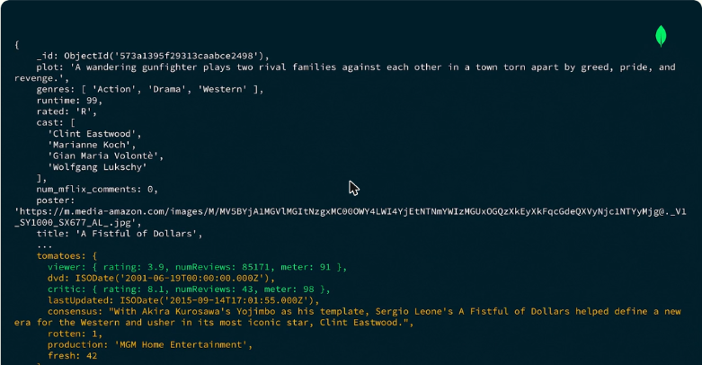
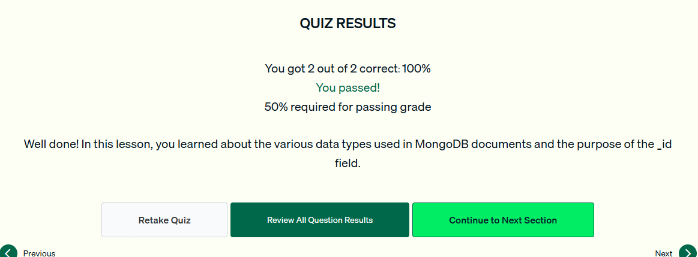

# 03.2 · Tipos de datos en MongoDB

BSON admite más tipos que JSON, y eso permite modelar más casos de uso. Esta lección repasa los tipos principales con un documento de `sample_mflix.movies`.

## Tipos de datos BSON

| Tipo | Descripción | Ejemplo en `movies` |
|---|---|---|
| **Boolean** | `true` o `false`. Estados binarios, como si una función está activa | — |
| **Null** | Ausencia de valor o valor desconocido | — |
| **String** | Texto entre comillas simples o dobles | `title: 'A Fistful of Dollars'` |
| **Number** | Enteros **Int32** e **Int64**. Decimales **Double** y **Decimal128** (alta precisión, datos financieros) | `runtime: 99` |
| **Object** | Documento embebido entre llaves para agrupar datos relacionados | `tomatoes: { viewer: {...}, critic: {...} }` |
| **Array** | Lista entre corchetes. Cada elemento puede ser de cualquier tipo | `cast: [...]`, `directors: [...]` |
| **Date** | Timestamp en milisegundos desde el **1 de enero de 1970** (Unix epoch) | `released: ISODate(...)` |
| **ObjectId** | Identificador de 24 caracteres hexadecimales | `_id: ObjectId('573a1395f29313caabce2498')` |

- Un campo puede ser arreglo aunque tenga un solo valor (`directors`), porque una película **puede** tener varios directores.
- Las **fechas** como timestamp son eficientes para guardar, ordenar, comparar y convertir a otros formatos.

*Figura: en un mismo documento aparecen ObjectId, strings, números, arreglos (`genres`, `cast`) y subdocumentos (`tomatoes`) con fechas ISODate.*

*Figura: las fechas se guardan como timestamp (milisegundos desde 1970), eficiente para consultar y ordenar.*

## El campo `_id`

- **Todo documento debe tener `_id`**, con un valor **único** en la colección.
- Se le puede dar cualquier valor. MongoDB **rechaza** un documento con un `_id` duplicado.
- Si no se indica, MongoDB **genera automáticamente un ObjectId**.
- Un ObjectId combina un **timestamp**, un **valor aleatorio** y un **contador incremental**, lo que garantiza que sea único.

!!! tip "Para recordar"
    - Tipos clave: Boolean, Null, String, Number (Int32, Int64, Double, **Decimal128**), Object, Array, Date, ObjectId.
    - **Decimal128** = alta precisión, ideal para **datos financieros**.
    - `_id` es **obligatorio y único**. No hay que definirlo a mano: si falta, se genera un **ObjectId**.
    - Date se guarda como **milisegundos desde el epoch** (1970-01-01).

## Cuestionario

Resultado: **2/2 correctas (100 %)**. Las preguntas cubrieron las propiedades del campo `_id` y el tipo numérico adecuado para cálculos financieros.

*Figura: cuestionario de la lección 2 aprobado.*

## Fuentes y aviso legal

- **Fuente:** cursos de MongoDB University. Sitios oficiales: [learn.mongodb.com](https://learn.mongodb.com) · [mongodb.com/docs](https://www.mongodb.com/docs).
- **Uso:** apuntes personales de estudio, sin fines comerciales y con redacción propia. Las imágenes del curso son fragmentos breves citados con fines educativos; sus derechos son de sus titulares.
- **Sin afiliación:** sitio no oficial, no afiliado ni respaldado por MongoDB. Las marcas pertenecen a sus dueños.
- Más detalles y cómo pedir el retiro de contenido en el [aviso legal](../../../aviso-legal.md).
