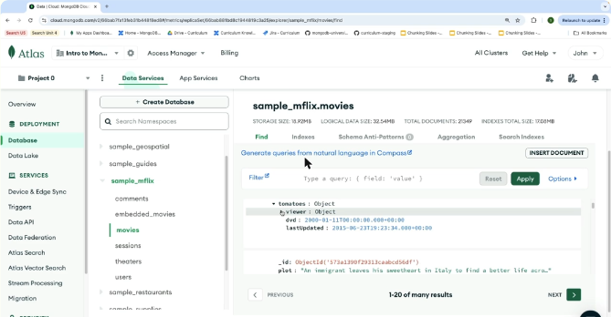
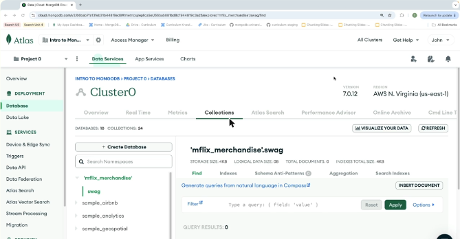
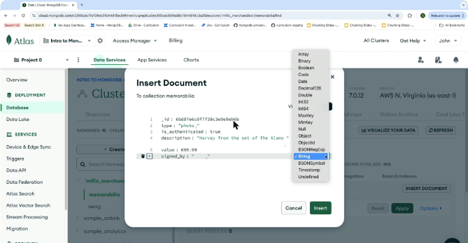
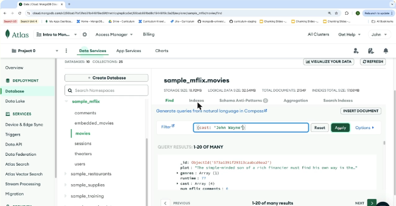
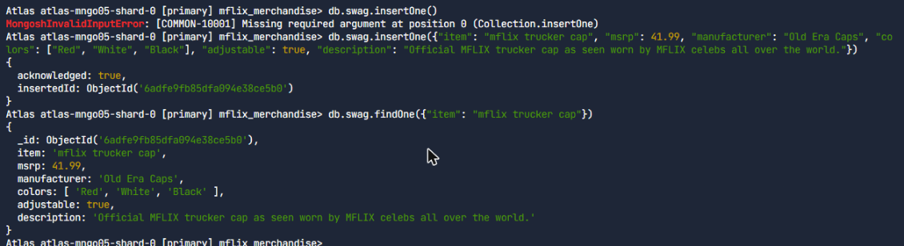
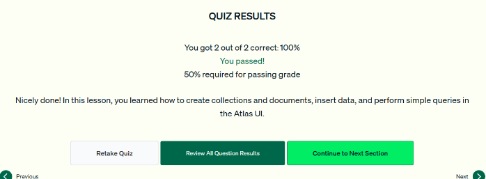

# 03.3 · Gestionar bases, colecciones y documentos en Atlas

Práctica guiada en la interfaz de Atlas: navegar los datos, crear una base de datos y colecciones, insertar un documento eligiendo los tipos de datos y hacer una consulta simple.

## Navegar los datos

1. **Database** → **Browse Collections** en el cluster (en el ejemplo, un M0 llamado `Cluster0`).
2. Se busca la base `sample_mflix` en la barra de búsqueda de *namespaces*. Contiene `comments`, `movies`, `users`, `theaters`…
3. Al elegir `movies` aparecen sus metadatos (tamaño, total de documentos, índices) y los documentos a la derecha.
4. Los campos con arreglos o documentos anidados tienen una **flecha para expandir** (por ejemplo `cast` o `tomatoes.viewer`).



*Figura: `sample_mflix.movies` en el Data Explorer, con el subdocumento `tomatoes` expandido.*

## Crear una base de datos y colecciones

Caso: la app *mflix* empieza a vender mercancía.

1. **Create Database** → nombre `mflix_merchandise`, primera colección `swag` → **Create**.
2. Para agregar otra colección: el botón **+** junto a la base, o **Create Collection** → `memorabilia`.

!!! note "Detalle"
    En MongoDB una base de datos no existe sin al menos una colección. Por eso Atlas pide el nombre de la primera colección al crear la base.



*Figura: la nueva base `mflix_merchandise` con la colección `swag`.*

## Insertar un documento

1. En `memorabilia`, **Insert Document**. Se puede escribir en **JSON** o usar la **vista de tabla**.
2. Con el **+** junto a `_id` se agregan campos. Cada valor es **String** por defecto y se cambia en el desplegable de tipo:
    - `type: "photo"` (String)
    - `is_authenticated: true` (**Boolean**)
    - `description`, `value: 699.99` (número)
    - `signed_by: ["John Wayne", "Richard Widmark", ...]` (**Array**)
3. **Insert** guarda el documento.



*Figura: el diálogo «Insert Document» con el menú de tipos BSON (Array, Boolean, Date, Decimal128, Int32, ObjectId, String…).*

## Consulta simple

En la barra **Filter** se escriben pares campo-valor y se pulsa **Apply** (o Enter):

```javascript
{ cast: 'John Wayne' }
```

- Filtra las películas con John Wayne en el reparto, aunque `cast` sea un arreglo: la coincidencia funciona con cualquier elemento.
- Se muestran 20 resultados por página. Con **Next** se pasa a la siguiente.



*Figura: el filtro `{cast: 'John Wayne'}` sobre `movies`.*

!!! tip "Para recordar"
    - Ruta: **Database → Browse Collections → Collections**.
    - Crear una base pide también el nombre de su **primera colección**.
    - Insert Document: JSON o tabla. En la tabla se elige el **tipo** de cada campo (String por defecto).
    - Consulta simple = **pares campo-valor en la barra Filter** de la pestaña Collections.

## Cuestionario y laboratorio

- Cuestionario: **2/2 correctas (100 %)**. Las preguntas cubrieron cómo hacer una consulta simple en Atlas y los pasos para insertar un documento.
- Laboratorio práctico en Atlas: **Completado**. Se creó la base `mflix_merchandise` con la colección `swag`, se insertó un documento con `insertOne()` y se recuperó con `findOne()`:

```javascript
db.swag.insertOne({ item: "mflix trucker cap", msrp: 41.99, manufacturer: "Old Era Caps",
  colors: ["Red", "White", "Black"], adjustable: true })
db.swag.findOne({ item: "mflix trucker cap" })
```





*Figura: cuestionario de la lección 3 aprobado.*
