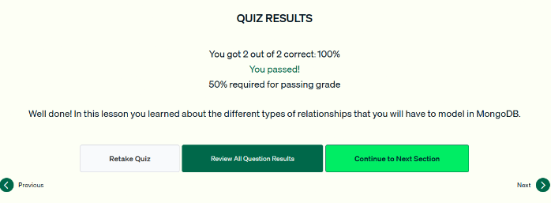

# 03.4 · Relaciones entre datos

Primeros conceptos de modelado de datos en MongoDB: entidades, atributos y los tres tipos de relación.

## Entidades y atributos

| Concepto | Qué es | En MongoDB | Ejemplo (app de películas) |
|---|---|---|---|
| **Entidad** | Objeto o concepto único e independiente (persona, producto, organización, lugar) | Un **documento**, agrupado en una **colección** | `movies`, `users`, `comments` |
| **Atributo** | Característica que describe una entidad | Un **par campo-valor** del documento | `title`, `cast`, `rating` |

*Figura: un documento de la colección `comments` es una entidad. Su `movie_id` apunta a la película comentada.*

## Tipos de relación

| Relación | Definición | Ejemplo |
|---|---|---|
| **Uno a uno (1:1)** | Una entidad se relaciona con exactamente otra. Es la más común en MongoDB | Una película y el estudio que la estrenó |
| **Uno a muchos (1:N)** | Una entidad se relaciona con varias | Una película y su reparto |
| **Muchos a muchos (N:M)** | Varias entidades se relacionan con varias | Películas y cines: una película se proyecta en muchos cines y un cine proyecta muchas películas |

*Figura: estudio ↔ película como ejemplo de relación uno a uno.*

!!! tip "Para recordar"
    - **Entidad → documento (en una colección); atributo → campo-valor.**
    - 1:1 = película y estudio. **1:N = película y reparto.** N:M = películas y cines.
    - Pista para el examen: «una película en varios cines» o «un cine con varias películas» describen la misma relación **muchos a muchos**, no uno a muchos.
    - El rating, el género o la fecha de estreno son **atributos**, no entidades.

## Cuestionario

Resultado: **2/2 correctas (100 %)**. Las preguntas cubrieron cómo identificar una relación uno a muchos y qué cuenta como entidad.

*Figura: cuestionario de la lección 4 aprobado.*
