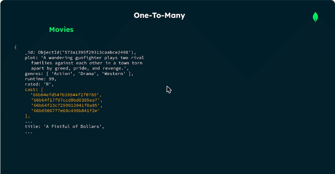
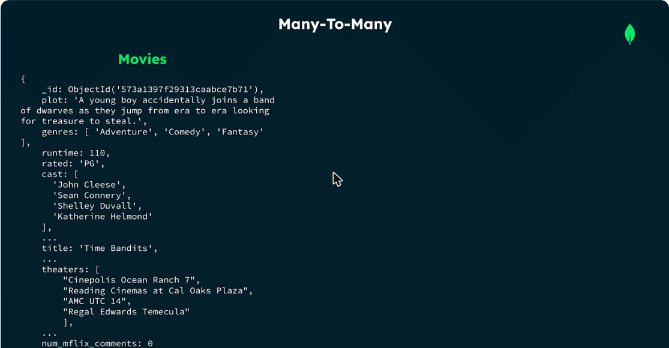
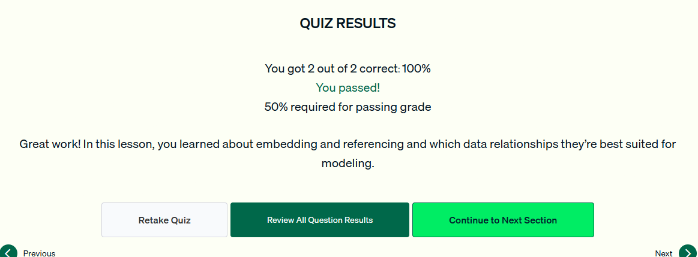

# 03.5 · Embeber y referenciar

Las dos formas de modelar relaciones en MongoDB: **embeber** los datos relacionados dentro del documento o **referenciarlos** con identificadores que apuntan a otra colección.

## Según el tipo de relación

| Relación | Enfoque típico | Ejemplo |
|---|---|---|
| **Uno a uno** | **Embeber** en el documento padre. Todo se recupera con una sola consulta | El estudio como campo dentro de la película |
| **Uno a muchos** | **Embeber** de preferencia (arreglo). **Referenciar** si el conjunto relacionado es grande o se consulta o actualiza por separado | `cast` como arreglo de nombres, o como arreglo de IDs hacia una colección `performers` |
| **Muchos a muchos** | Embeber o referenciar según los requisitos (también se pueden combinar) | Películas con un arreglo de cines y cines con un arreglo de películas, o arreglos de **referencias** cruzadas |

```javascript
// Uno a muchos con referencias: cast apunta a documentos de performers
{
  _id: ObjectId('573a1395f29313caabce2498'),
  title: 'A Fistful of Dollars',
  cast: ['66b64efd547b38844f2f0780', '66b64f17f97ccd9bd0385ea7', ...]
}
```



*Figura: el campo `cast` guarda IDs que referencian documentos de otra colección.*



*Figura: una película con un arreglo embebido de cines (`theaters`). En el otro lado, cada cine tendría su arreglo de películas.*

- En el caso películas ↔ cines, los dos documentos guardan muchos datos y se consultan por separado, así que conviene usar **referencias en ambos sentidos**.
- Por lo general se **desaconseja la referencia bidireccional** por el costo de mantenerla. En esta app se justifica.
- Referenciar **reduce el tamaño** del documento pero **complica las consultas** para traer los datos relacionados.

## Criterios para elegir

| Embeber cuando… | Referenciar cuando… |
|---|---|
| Los datos se consultan **juntos, como una unidad** | Los datos se consultan o gestionan **de forma independiente** |
| Los datos relacionados son **pequeños y cambian poco** | Los conjuntos son **grandes o complejos** |
| Se quieren **minimizar operaciones y joins** | Los documentos son **grandes o van a crecer** |


*Figura: embeber sirve para acceso como unidad, datos pequeños de tamaño fijo y menos operaciones.*


*Figura: referenciar sirve para acceso independiente y documentos grandes o que crecen.*

Si un documento se acerca a los límites (**16 MB** o **100 niveles** de anidamiento), conviene **aplanar** la estructura o pasar a **referencias**.

!!! tip "Para recordar"
    - **1:1 → embeber.** 1:N → embeber de preferencia, o referenciar si es grande o independiente. N:M → depende.
    - Embeber = menos consultas y joins, pero documentos más grandes. Referenciar = documentos pequeños, pero consultas más complejas.
    - Pista para el examen: si cada película tiene **pocos** géneros (de un catálogo pequeño), embeberlos en la película está bien aunque la relación sea N:M, porque no infla el documento y permite filtrar por género.
    - Pista para el examen: evita arreglos **sin límite** (miles de IDs de películas dentro de un género).

## Cuestionario

Resultado: **2/2 correctas (100 %)**. Las preguntas cubrieron el enfoque típico para relaciones uno a uno y un caso de diseño de películas y géneros.



*Figura: cuestionario de la lección 5 aprobado.*
