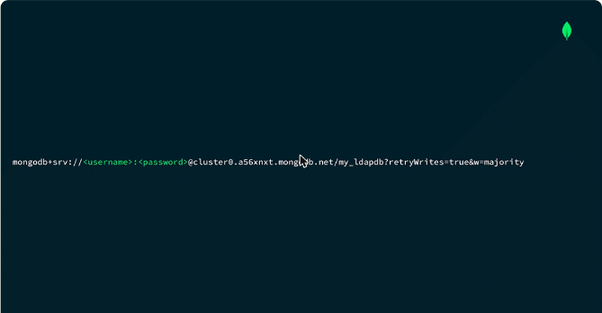
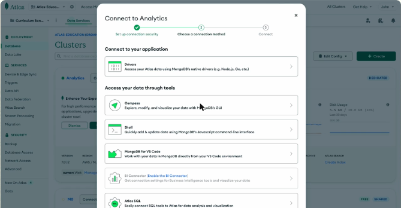
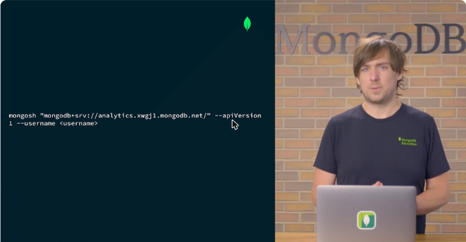
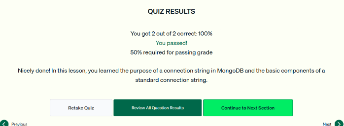

# 04.1 · Connection strings de MongoDB

El **connection string** es lo que usa un cliente (mongosh, Compass o un driver) para conectarse a un cluster y fijar las opciones de conexión.

## Dos formatos

| Formato | Prefijo | Características |
|---|---|---|
| **SRV** (el que usa Atlas por defecto) | `mongodb+srv://` | Activa **TLS** automáticamente. El driver consulta el **registro DNS SRV** del dominio después de la `@` para obtener los nodos y sus puertos. Un registro **TXT** aporta opciones extra |
| **Estándar** | `mongodb://` | Se escriben los hosts y puertos (`host:puerto`) a mano. Sirve para servidores sin SRV |

## Partes del connection string

```text
mongodb+srv://<username>:<password>@cluster0.a56xnxt.mongodb.net/my_ldapdb?retryWrites=true&w=majority
└── prefijo ──┘└──── credenciales ────┘└────────── host ──────────┘└─ BD auth ┘└──── opciones ─────┘
```

| Parte | Obligatoria | Detalle |
|---|---|---|
| Prefijo | Sí | `mongodb://` o `mongodb+srv://` |
| Usuario y contraseña | Si hay control de acceso | En Atlas el control de acceso está **siempre activo** y no se puede desactivar |
| Host | Sí | Dirección del cluster (con SRV) o lista `host:puerto` |
| Base de autenticación | No | Contra qué base se validan las credenciales. Por defecto es `admin` |
| Opciones (*query string*) | No | Pares nombre=valor, por ejemplo `retryWrites=true` o `w=majority` |



*Figura: connection string SRV con usuario, contraseña, host, base de autenticación y opciones.*

## Dónde se encuentra en Atlas

1. En el panel del proyecto, botón **Connect** del cluster.
2. Se elige el método: **Drivers**, **Compass**, **Shell**, **MongoDB for VS Code**, Atlas SQL, etc. El string cambia un poco según la opción.
3. Con **Shell**, Atlas muestra el comando completo:

```bash
mongosh "mongodb+srv://analytics.xwgj1.mongodb.net/" --apiVersion 1 --username <username>
```

- `--apiVersion 1` asegura que el shell y el servidor usen la misma versión de la Stable API.
- `--username` indica el usuario. La contraseña se pide después de forma interactiva.



*Figura: el diálogo «Connect» de Atlas con las opciones Drivers, Compass, Shell y VS Code.*



*Figura: el comando que da Atlas para conectarse con mongosh.*

!!! tip "Para recordar"
    - Para qué sirve: **conectarse al cluster y especificar opciones de conexión**. No sirve para consultar datos ni para dar permisos.
    - `+srv` = TLS activado y descubrimiento de hosts por DNS. Atlas lo usa por defecto.
    - Componentes básicos de un string estándar: **host** y **usuario/contraseña**.
    - Base de autenticación por defecto: `admin`.
    - Se obtiene en Atlas con **Connect → método** (Shell, Drivers, Compass…).

## Cuestionario

Resultado: **2/2 correctas (100 %)**. Las preguntas cubrieron para qué sirve el connection string y sus componentes básicos.



*Figura: cuestionario de la lección 1 aprobado.*

## Fuentes y aviso legal

- **Fuente:** cursos de MongoDB University. Sitios oficiales: [learn.mongodb.com](https://learn.mongodb.com) · [mongodb.com/docs](https://www.mongodb.com/docs).
- **Uso:** apuntes personales de estudio, sin fines comerciales y con redacción propia. Las imágenes del curso son fragmentos breves citados con fines educativos; sus derechos son de sus titulares.
- **Sin afiliación:** sitio no oficial, no afiliado ni respaldado por MongoDB. Las marcas pertenecen a sus dueños.
- Más detalles y cómo pedir el retiro de contenido en el [aviso legal](../../../aviso-legal.md).
