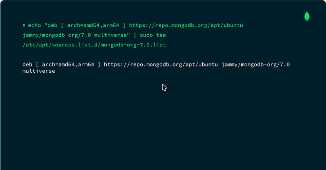
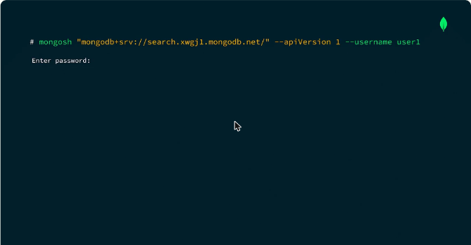
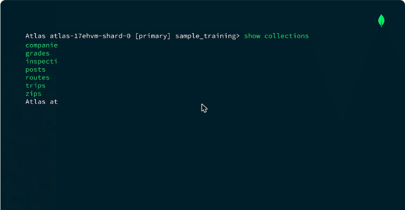
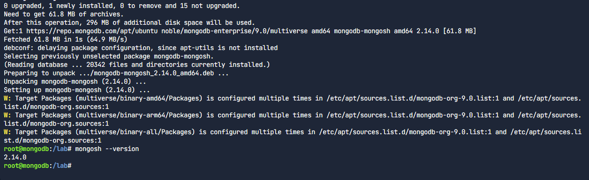
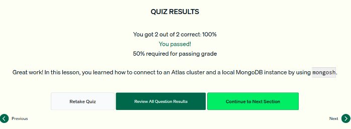

# 04.2 · Instalar mongosh y conectarse

**mongosh** (MongoDB Shell) es la interfaz de línea de comandos para probar consultas y administrar bases de datos. Algunas instalaciones del servidor ya lo incluyen. Los pasos de instalación cambian según el sistema operativo.

## Instalación en Ubuntu

```bash
# 1. Dependencias e importación de la llave pública de MongoDB
sudo apt-get update && sudo apt-get install gnupg
curl -fsSL https://www.mongodb.org/static/pgp/server-7.0.asc | \
  sudo gpg -o /usr/share/keyrings/mongodb-server-7.0.gpg --dearmor

# 2. Agregar el repositorio de MongoDB a las fuentes de apt
echo "deb [ arch=amd64,arm64 signed-by=/usr/share/keyrings/mongodb-server-7.0.gpg ] \
https://repo.mongodb.org/apt/ubuntu jammy/mongodb-org/7.0 multiverse" | \
  sudo tee /etc/apt/sources.list.d/mongodb-org-7.0.list

# 3. Instalar y verificar
sudo apt-get update && sudo apt-get install -y mongodb-mongosh
mongosh --version
```



*Figura: el repositorio de MongoDB agregado a `/etc/apt/sources.list.d/`.*

## Conectarse

| Destino | Comando |
|---|---|
| Local, puerto por defecto (**27017**) | `mongosh` |
| Local, otro puerto | `mongosh --port 28888` |
| Atlas | `mongosh "mongodb+srv://<cluster>.mongodb.net/" --apiVersion 1 --username <usuario>` (pide la contraseña) |



*Figura: al conectarse a Atlas, mongosh pide la contraseña del usuario de base de datos.*

## Helpers básicos de mongosh

| Helper | Qué hace |
|---|---|
| `db` | Muestra la base de datos actual |
| `use sample_training` | Cambia de base de datos |
| `show collections` | Lista las colecciones de la base actual |
| `show dbs` | Lista todas las bases del servidor |
| `help` | Muestra los comandos disponibles |
| `exit` | Sale de mongosh |



*Figura: `show collections` en `sample_training` (companies, grades, inspections, posts, routes, trips, zips).*

!!! tip "Para recordar"
    - Puerto por defecto de MongoDB: **27017**.
    - Para otro puerto: **`mongosh --port <número>`**. No existen `--local` ni un salto automático al siguiente puerto libre.
    - El connection string de Atlas se obtiene en la **interfaz de Atlas → Connect**. mongosh no tiene un comando para mostrarlo.
    - Revisa con `db` en qué base estás antes de modificar documentos.

## Cuestionario y laboratorio

- Cuestionario: **2/2 correctas (100 %)**. Las preguntas cubrieron cómo conectarse a una instancia local en otro puerto y dónde está el connection string de Atlas.
- Laboratorio práctico: **Completado**.

### Laboratorio

En un contenedor Ubuntu 24.04 (*noble*) se instaló mongosh desde el repositorio oficial de MongoDB y luego se usó para conectarse a una instancia local con la base `sample_mflix`:

```bash
gpg --version                                   # gnupg ya instalado
wget -qO- https://www.mongodb.org/static/pgp/server-9.asc | ...   # importa la clave pública del repositorio
cat /etc/os-release                             # VERSION_CODENAME=noble
echo "deb [ arch=amd64,arm64 ] https://repo.mongodb.org/apt/ubuntu noble/mongodb-org/9.0 multiverse"   | tee /etc/apt/sources.list.d/mongodb-org-9.0.list
apt update
apt install -y mongodb-mongosh
mongosh --version                               # 2.14.0

mongosh "mongodb://<usuario>:<clave>@localhost:27017/sample_mflix?directConnection=true&authSource=admin"
show dbs                                        # sample_mflix  19.00 MiB
exit
```





*Figura: cuestionario de la lección 2 aprobado.*

## Fuentes y aviso legal

- **Fuente:** cursos de MongoDB University. Sitios oficiales: [learn.mongodb.com](https://learn.mongodb.com) · [mongodb.com/docs](https://www.mongodb.com/docs).
- **Uso:** apuntes personales de estudio, sin fines comerciales y con redacción propia. Las imágenes del curso son fragmentos breves citados con fines educativos; sus derechos son de sus titulares.
- **Sin afiliación:** sitio no oficial, no afiliado ni respaldado por MongoDB. Las marcas pertenecen a sus dueños.
- Más detalles y cómo pedir el retiro de contenido en el [aviso legal](../../../aviso-legal.md).
