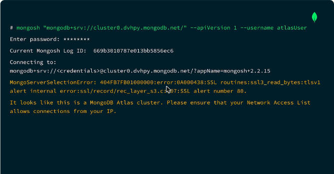
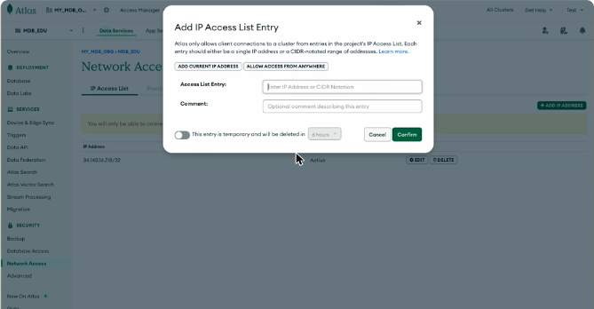
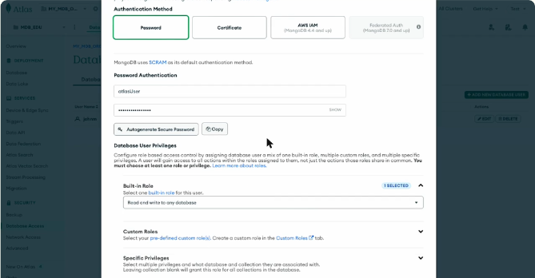
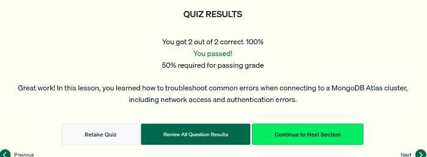

# 04.3 · Resolver errores de conexión

La mayoría de los problemas de conexión vienen de las protecciones de seguridad de MongoDB. Esta lección enseña a diagnosticar los tres errores más comunes y cómo corregirlos.

## 1. Error de acceso de red (timeout)

- **Síntoma:** la conexión tarda y termina con un `MongoServerSelectionError` o un timeout. mongosh sugiere revisar la **Network Access List**.
- **Causa más común:** la IP actual no está en la lista de acceso del proyecto.
- **Solución:** en Atlas, **Network Access → Add IP Address → Add Current IP Address → Confirm**. La entrada tarda unos 30 segundos en quedar *Active*.
    - Se puede agregar una IP, un rango CIDR o la IP actual. Existe la opción de que la entrada sea **temporal**.
    - **Allow access from anywhere** (`0.0.0.0/0`) funciona, pero es un **riesgo de seguridad** y MongoDB lo desaconseja.

*Figura: `MongoServerSelectionError` con la sugerencia de revisar la Network Access List.*

*Figura: el diálogo «Add IP Access List Entry» con *Add current IP address* y la opción de entrada temporal.*

## 2. Error de autenticación (`bad auth : Authentication failed`)

Posibles causas y qué revisar:

- **Contraseña mal escrita.** Las contraseñas distinguen mayúsculas y minúsculas.
- **Usuario mal escrito**, o un usuario que **no existe** en **Database Access**. En ese caso se crea con *Add New Database User*: usuario, contraseña (se puede autogenerar) y al menos un rol (por ejemplo *Read and write to any database*).
- **Deployment equivocado:** confirmar que te conectas al cluster correcto.
- Desde Database Access también se pueden editar usuarios: cambiar la contraseña o los privilegios.

*Figura: alta de `atlasUser` con autenticación por contraseña (SCRAM) y rol integrado.*

## 3. Demasiadas conexiones abiertas

- **Síntoma:** el servidor rechaza conexiones nuevas al llegar al máximo.
- Límite: los clusters **M0, M2 y M5** admiten **500 conexiones abiertas por nodo**. Cada tier tiene su propio límite.
- **Soluciones** (probarlas primero en desarrollo o staging):
    - **Escalar** el cluster a un tier mayor.
    - **Reiniciar** la aplicación.
    - **Prevenir:** limitar el pool con la opción **`maxPoolSize`** del connection string.

!!! tip "Para recordar"
    - **Timeout o `ServerSelectionError` → acceso de red → agregar tu IP** en Network Access. Abrir a cualquier IP es inseguro.
    - **`bad auth` → credenciales:** revisar la ortografía del usuario y la contraseña, que el usuario exista en Database Access y que el cluster sea el correcto.
    - **Demasiadas conexiones →** escalar, reiniciar o usar `maxPoolSize`. Límite de 500 por nodo en M0, M2 y M5.
    - Pista para el examen: actualizar la IP no arregla un error de autenticación, y cambiar credenciales no arregla uno de red.

## Cuestionario y laboratorio

- Cuestionario: **2/2 correctas (100 %)**. Las preguntas cubrieron cómo resolver un error de acceso de red sin debilitar la seguridad y las causas posibles de un error de autenticación.
- Laboratorio práctico en Atlas: **Pendiente**.

*Figura: cuestionario de la lección 3 aprobado.*

## Fuentes y aviso legal

- **Fuente:** cursos de MongoDB University. Sitios oficiales: [learn.mongodb.com](https://learn.mongodb.com) · [mongodb.com/docs](https://www.mongodb.com/docs).
- **Uso:** apuntes personales de estudio, sin fines comerciales y con redacción propia. Las imágenes del curso son fragmentos breves citados con fines educativos; sus derechos son de sus titulares.
- **Sin afiliación:** sitio no oficial, no afiliado ni respaldado por MongoDB. Las marcas pertenecen a sus dueños.
- Más detalles y cómo pedir el retiro de contenido en el [aviso legal](../../../aviso-legal.md).
