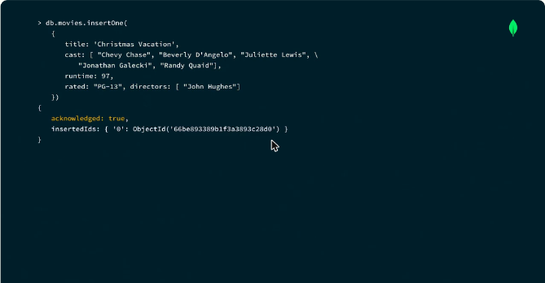
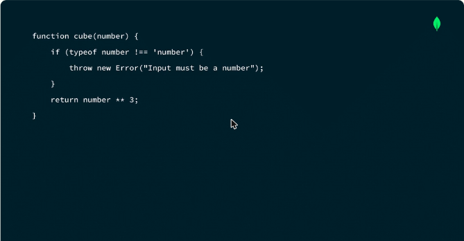
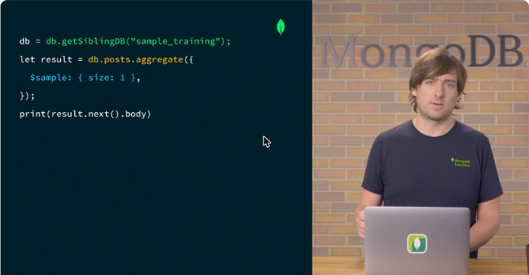
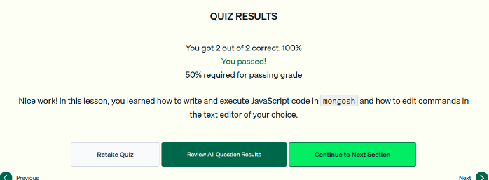

# 04.4 · Usar el MongoDB Shell

Tareas prácticas en mongosh: insertar y buscar documentos, usar funciones JavaScript, cargar scripts, cambiar de base dentro de un script y editar código con un editor externo.

## Insertar y buscar documentos

```javascript
use sample_mflix
db.movies.find({ title: "Christmas Vacation" })   // sin resultados

db.movies.insertOne({
  title: "Christmas Vacation",
  cast: ["Chevy Chase", "Beverly D'Angelo", "Juliette Lewis"],
  runtime: 97,
  rated: "PG-13",
  directors: ["John Hughes"]
})
// { acknowledged: true, insertedId: ObjectId('66be...') }

db.movies.find({ title: "Christmas Vacation" })   // ahora devuelve el documento
```

- `find()` recibe un documento filtro con pares campo-valor.
- `insertOne()` inserta un documento y devuelve el estado (`acknowledged`) y el `_id` generado.
- Gracias al esquema flexible se puede insertar con información parcial y completar el documento después.



*Figura: `insertOne()` devuelve `acknowledged: true` y el ObjectId del nuevo documento.*

## Funciones JavaScript

mongosh está construido sobre **Node.js**, así que acepta JavaScript:

```javascript
function cube(number) {
  if (typeof number !== 'number') {
    throw new Error("Input must be a number");
  }
  return number ** 3;
}
cube(16)   // 4096
```

Al pegar la función, queda en el **ámbito global** de la sesión.



*Figura: una función auxiliar escrita en JavaScript dentro de mongosh.*

## Cargar scripts con `load()` y cambiar de base con `getSiblingDB()`

```javascript
// randomPost.js
db = db.getSiblingDB("sample_training");
let result = db.posts.aggregate({ $sample: { size: 1 } });
print(result.next().body);
```

```javascript
load("randomPost.js")   // imprime un post al azar y deja la sesión en sample_training
```

- **`load()`** ejecuta un archivo JavaScript en la sesión actual.
- **`db.getSiblingDB()`** cambia de base dentro de un script **sin datos de conexión**, lo que hace los scripts portables.
- `$sample` es una etapa de agregación que elige documentos al azar.



*Figura: el script `randomPost.js` cambia a `sample_training` y muestra un post aleatorio.*

## Editar con un editor externo

```javascript
config.get('editor')          // null si no hay editor configurado
config.set('editor', 'vim')   // primero se define el editor
edit cube                     // abre la función en el editor
```

Al guardar y salir, la nueva versión de la función queda cargada en la sesión. Sirve para comandos de varias líneas o largos.

!!! tip "Para recordar"
    - `insertOne()` inserta un documento y `find()` consulta. Se profundiza en las unidades de CRUD.
    - Funciones JS: se escriben directamente en mongosh o se cargan desde un archivo con **`load()`**.
    - **`db.getSiblingDB("base")`** cambia de base dentro de un script.
    - Editor externo: **primero `config.set('editor', '...')`** y después `edit <función>`.

## Cuestionario y laboratorio

- Cuestionario: **2/2 correctas (100 %)**. Las preguntas cubrieron las formas de usar funciones JavaScript en mongosh y el primer paso para configurar un editor externo.
- Laboratorio práctico en Atlas: **Pendiente**.



*Figura: cuestionario de la lección 4 aprobado.*
