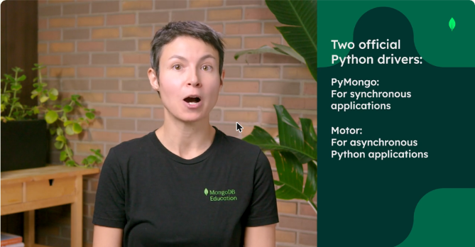
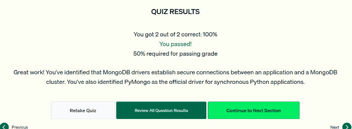

# 05.1 · Bibliotecas cliente de MongoDB para Python

Qué es un **driver** y cuáles son los drivers oficiales de MongoDB para Python.

## Drivers

- Una aplicación necesita un conjunto de bibliotecas para hablar con MongoDB. Ese conjunto es el **driver**, el *middleware* entre la aplicación y la base de datos.
- Un driver oficial **establece conexiones seguras** con el cluster y **ejecuta operaciones** en nombre de la aplicación.
- También permite fijar **opciones de conexión**: seguridad, durabilidad de escritura (*write concern*), aislamiento de lectura (*read concern*), etc.
- Los drivers oficiales siguen las buenas prácticas de cada lenguaje, aprovechan todas las funciones de MongoDB y facilitan las actualizaciones. Con drivers no oficiales u **ODM** (*Object-Document Mapper*) esto es más difícil.

## Drivers oficiales para Python

| Driver | Tipo de aplicación |
|---|---|
| **PyMongo** | **Síncrona** (el que se usa en la ruta) |
| **Motor** | **Asíncrona** (asyncio) |

*Figura: los dos drivers oficiales de Python: PyMongo (síncrono) y Motor (asíncrono).*

La documentación oficial de PyMongo (ejemplos, fundamentos y API) está en el sitio de drivers de MongoDB.

!!! tip "Para recordar"
    - Driver = middleware que **conecta de forma segura y ejecuta operaciones** por la aplicación. No genera gráficos ni administra el sharding.
    - **PyMongo = síncrono. Motor = asíncrono.**
    - Usa drivers oficiales para tener buen rendimiento y actualizaciones sencillas.

## Cuestionario

Resultado: **2/2 correctas (100 %)**. Las preguntas cubrieron la responsabilidad principal de un driver y el driver oficial para Python síncrono.

*Figura: cuestionario de la lección 1 aprobado.*

## Fuentes y aviso legal

- **Fuente:** cursos de MongoDB University. Sitios oficiales: [learn.mongodb.com](https://learn.mongodb.com) · [mongodb.com/docs](https://www.mongodb.com/docs).
- **Uso:** apuntes personales de estudio, sin fines comerciales y con redacción propia. Las imágenes del curso son fragmentos breves citados con fines educativos; sus derechos son de sus titulares.
- **Sin afiliación:** sitio no oficial, no afiliado ni respaldado por MongoDB. Las marcas pertenecen a sus dueños.
- Más detalles y cómo pedir el retiro de contenido en el [aviso legal](../../../aviso-legal.md).
