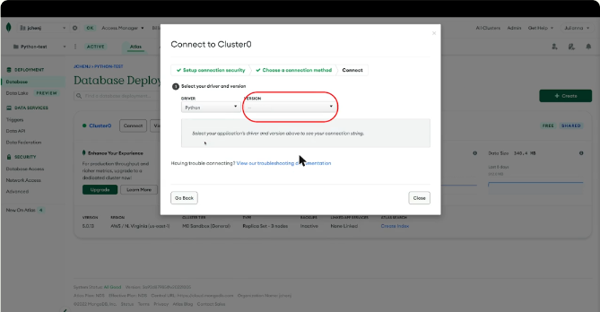
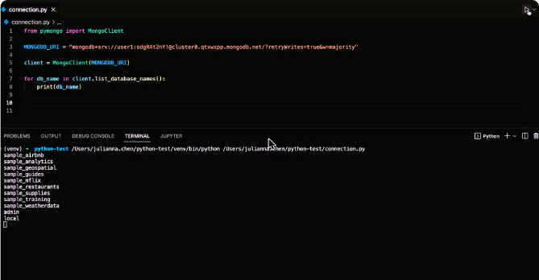
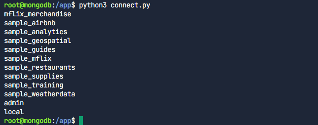
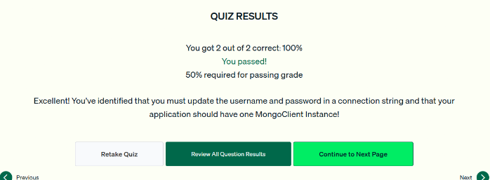

# 05.2 · Conectar una aplicación Python a Atlas

Instalar PyMongo, obtener el connection string desde Atlas y crear un `MongoClient` que se reutilice en toda la aplicación.

## 1. Preparar el proyecto e instalar PyMongo

```bash
mkdir python-test && cd python-test
python -m venv venv
source venv/bin/activate          # en Windows: venv\Scripts\activate
pip install pymongo dnspython
```

`dnspython` hace falta para el formato **`mongodb+srv://`** que usa Atlas, porque resuelve los registros DNS SRV.

## 2. Obtener el connection string

En Atlas: **Database → Connect → Drivers** → driver **Python** y versión de PyMongo → copiar el **connection string** (también llamado *connection URI*).

- El string copiado **no incluye la contraseña**: hay que reemplazar `<password>` y, si hay varios usuarios, también `<username>`. El nombre del cluster ya viene incluido.



*Figura: en «Connect to Cluster0» se elige el driver Python y su versión para obtener el connection string.*

## 3. Conectarse con `MongoClient`

```python
# connection.py
from pymongo import MongoClient

MONGODB_URI = "mongodb+srv://<usuario>:<password>@cluster0.xxxxx.mongodb.net/?retryWrites=true&w=majority"

client = MongoClient(MONGODB_URI)

for db_name in client.list_database_names():
    print(db_name)
```

- `MongoClient` inicia la conexión con la base de datos.
- En proyectos reales el connection string se carga desde un lugar seguro, como **variables de entorno o un `.env`**, y no se escribe en el código.
- Imprimir `list_database_names()` sirve para probar la conexión.



*Figura: el script imprime las bases del cluster (sample_airbnb, sample_mflix, sample_training…).*

## Un solo MongoClient

Una aplicación debe usar **una sola instancia de `MongoClient`** durante toda su vida y reutilizarla en todas las peticiones. Crear clientes **consume muchos recursos**, y crear uno por petición **degrada el rendimiento**. El cliente ya maneja internamente un *pool* de conexiones.

!!! tip "Para recordar"
    - `pip install pymongo dnspython`. dnspython es necesario para `mongodb+srv`.
    - El string se obtiene en **Atlas → Connect → Drivers**. Hay que reemplazar **la contraseña y, si aplica, el usuario**.
    - **Un MongoClient por aplicación** (por cluster), reutilizado en todas las peticiones.
    - No escribas credenciales en el código. Usa variables de entorno o `.env`.

## Cuestionario y laboratorio

- Cuestionario: **2/2 correctas (100 %)**. Las preguntas cubrieron qué partes del connection string hay que reemplazar y cuántos MongoClient debe tener una aplicación.
- Laboratorio práctico en Atlas: **Completado**.

### Laboratorio

Se completó el archivo `connect.py` para que el `MongoClient` use la variable con el connection string del cluster `myAtlasClusterEDU` y se listaron las bases de datos:

```python
from pymongo import MongoClient

# Connection string del cluster (en un proyecto real va en una variable de entorno)
MONGODB_URI = "mongodb+srv://<usuario>:<clave>@myatlasclusteredu.xxxxx.mongodb.net"

client = MongoClient(MONGODB_URI)

for db_name in client.list_database_names():
    print(db_name)
```

```bash
python3 connect.py   # sample_analytics, sample_mflix, sample_training, ... admin, local
```





*Figura: cuestionario de la lección 2 aprobado.*

## Fuentes y aviso legal

- **Fuente:** cursos de MongoDB University. Sitios oficiales: [learn.mongodb.com](https://learn.mongodb.com) · [mongodb.com/docs](https://www.mongodb.com/docs).
- **Uso:** apuntes personales de estudio, sin fines comerciales y con redacción propia. Las imágenes del curso son fragmentos breves citados con fines educativos; sus derechos son de sus titulares.
- **Sin afiliación:** sitio no oficial, no afiliado ni respaldado por MongoDB. Las marcas pertenecen a sus dueños.
- Más detalles y cómo pedir el retiro de contenido en el [aviso legal](../../../aviso-legal.md).
