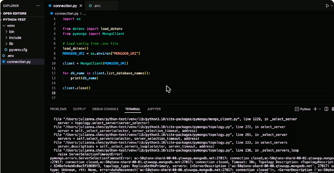
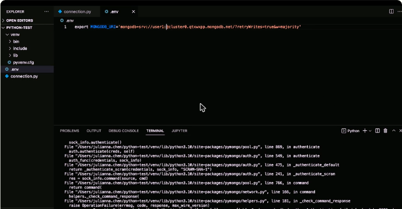
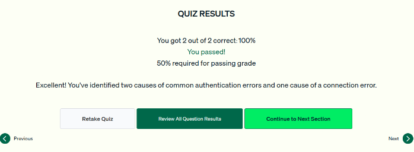

# 05.3 · Resolver problemas de conexión en Python

Cómo reconocer y corregir los dos errores de conexión más comunes con PyMongo: **acceso de red** y **autenticación**.

## Aplicación de ejemplo

```python
import os
from dotenv import load_dotenv
from pymongo import MongoClient

load_dotenv()                                 # carga variables desde .env
MONGODB_URI = os.environ["MONGODB_URI"]

client = MongoClient(MONGODB_URI)
for db_name in client.list_database_names():
    print(db_name)
client.close()
```

```bash
# .env
export MONGODB_URI='mongodb+srv://user1:<password>@cluster0.xxxxx.mongodb.net/?retryWrites=true&w=majority'
```

## Error de red: `pymongo.errors.ServerSelectionTimeoutError`

- **Síntoma:** la conexión tarda y termina con `ServerSelectionTimeoutError` (*connection closed*).
- **Causa:** la IP no está en la **IP Access List**. Por defecto un cluster de Atlas **no tiene acceso desde fuera**.
- **Solución:** **Network Access → Add IP Address → Add Current IP Address → Confirm**. Tarda unos 30 segundos.
- *Allow Access From Anywhere* funciona, pero es un riesgo de seguridad.



*Figura: el script con `load_dotenv` y el traceback de `ServerSelectionTimeoutError` cuando la IP no tiene acceso.*

## Error de autenticación: `pymongo.errors.OperationFailure: Authentication failed`

Causas habituales:

- **Falta la contraseña** en el connection string. Atlas **no la rellena** al copiarlo, para proteger los datos.
- Usuario o contraseña **mal escritos**.
- Un **usuario que no existe** (por ejemplo `user2` en lugar de `user1`). El mensaje de error es el mismo.

Solución: revisar y corregir el usuario y la contraseña en el `.env` o el string, y confirmar que el usuario existe en **Database Access**.



*Figura: el `.env` con el connection string sin la contraseña real provoca `OperationFailure: Authentication failed`.*

!!! tip "Para recordar"
    - **`ServerSelectionTimeoutError` → acceso de red** → agregar la IP en Network Access.
    - **`OperationFailure: Authentication failed` → credenciales** → falta la contraseña, está mal escrita o el usuario no existe.
    - Atlas **nunca** incluye la contraseña en el string copiado.
    - Usar una VPN no es por sí mismo una causa de error de autenticación.

## Cuestionario

Resultado: **2/2 correctas (100 %)**. Las preguntas cubrieron la causa de un timeout de selección de servidor y las causas de un error de autenticación.



*Figura: cuestionario de la lección 3 aprobado.*

## Fuentes y aviso legal

- **Fuente:** cursos de MongoDB University. Sitios oficiales: [learn.mongodb.com](https://learn.mongodb.com) · [mongodb.com/docs](https://www.mongodb.com/docs).
- **Uso:** apuntes personales de estudio, sin fines comerciales y con redacción propia. Las imágenes del curso son fragmentos breves citados con fines educativos; sus derechos son de sus titulares.
- **Sin afiliación:** sitio no oficial, no afiliado ni respaldado por MongoDB. Las marcas pertenecen a sus dueños.
- Más detalles y cómo pedir el retiro de contenido en el [aviso legal](../../../aviso-legal.md).
