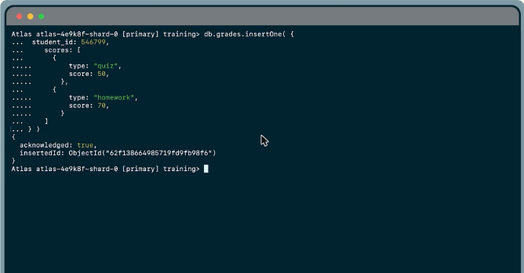
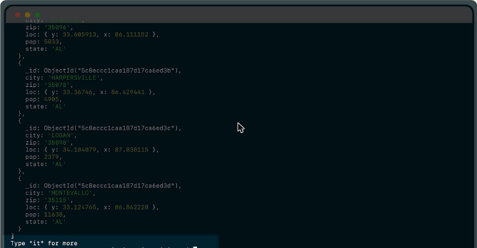
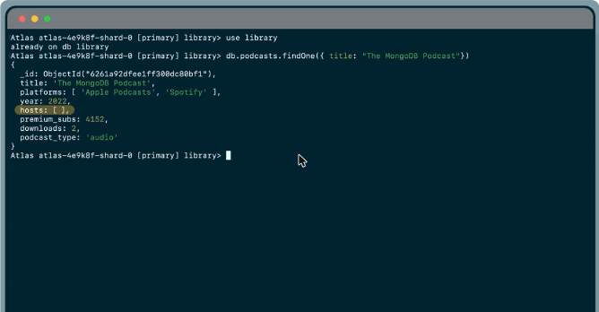
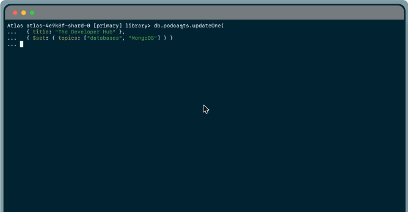
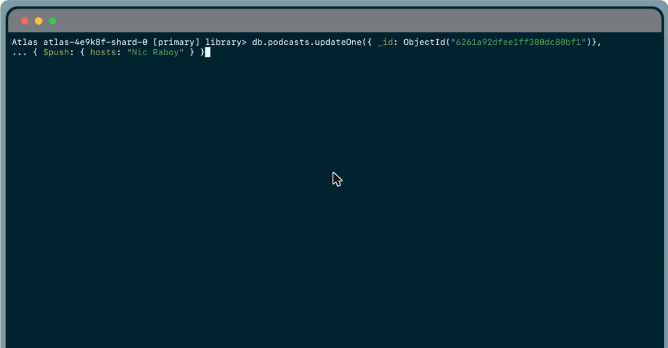
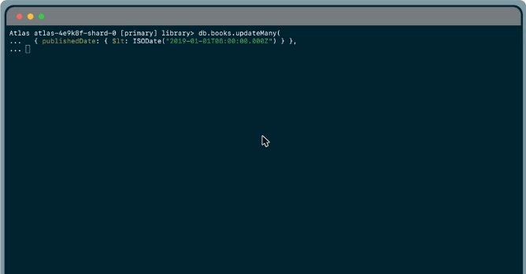
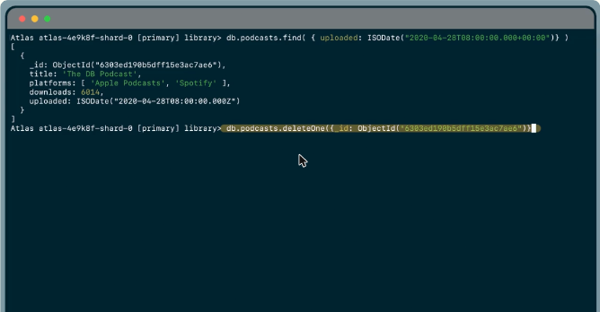
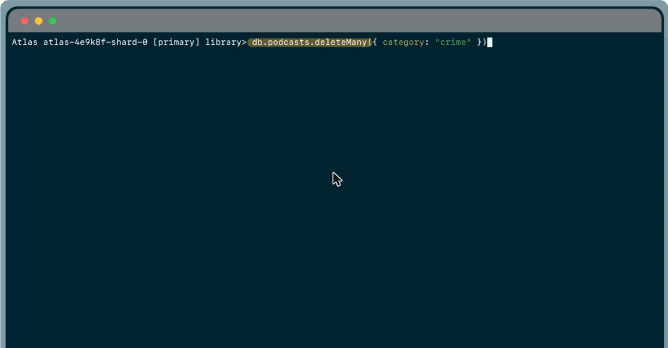
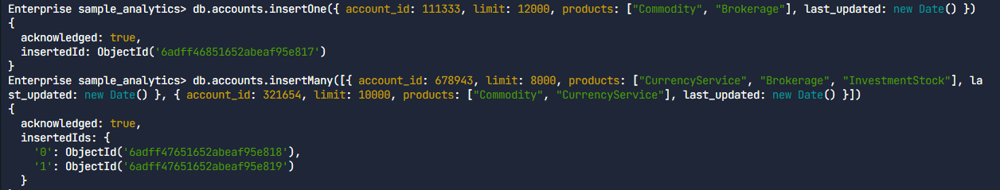
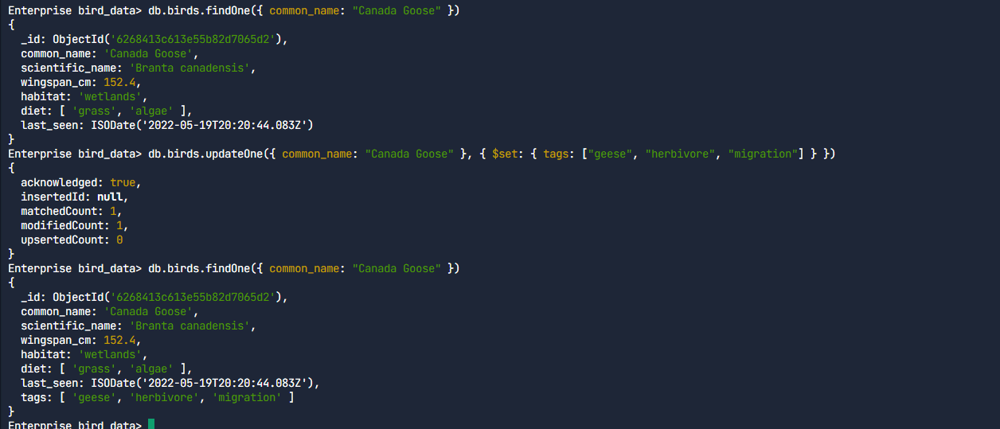

# 06.1 · Operaciones CRUD (insertar, buscar, actualizar y borrar)

Métodos básicos del shell para **crear, leer, actualizar y eliminar** documentos.

## Insertar: `insertOne()` e `insertMany()`

```javascript
db.grades.insertOne({
  student_id: 546799,
  scores: [ { type: "quiz", score: 50 }, { type: "homework", score: 70 } ]
})
// { acknowledged: true, insertedId: ObjectId("62f1...") }

db.grades.insertMany([ { student_id: 1 }, { student_id: 2 } ])   // arreglo de documentos
```

- Si la colección **no existe, MongoDB la crea** al insertar. Cuidado con crear colecciones por error.
- Todo documento necesita un `_id` único. Si no se da, se genera un ObjectId.
- `insertMany()` recibe un **arreglo** de documentos separados por comas.



*Figura: `insertOne()` devuelve `acknowledged: true` y el `insertedId` generado.*

## Buscar: `find()`, `$eq` e `$in`

```javascript
db.zips.find()                                  // todos; el shell itera el cursor
it                                              // siguiente página de resultados
db.zips.find({ state: "AZ" })                   // igualdad implícita
db.zips.find({ state: { $eq: "AZ" } })          // equivalente con $eq
db.zips.find({ city: { $in: ["PHOENIX", "CHICAGO"] } })
```

- `find()` devuelve un **cursor**. Con `it` se ven más resultados en el shell.
- **`$in`** selecciona los documentos cuyo campo es igual a **cualquiera** de los valores del arreglo.



*Figura: `db.zips.find()` devuelve documentos de la colección y el shell sugiere escribir "it" para ver más.*


*Figura: `$in` selecciona los documentos cuyo valor coincide con alguno del arreglo.*

## Actualizar un documento: `updateOne()` con `$set`, `$push` y `upsert`

`updateOne(filtro, actualización, opciones)`:

| Operador u opción | Qué hace |
|---|---|
| **`$set`** | Agrega un campo nuevo o **reemplaza** el valor de uno existente |
| **`$push`** | **Agrega un elemento a un arreglo**. Si el campo no existe, crea el arreglo con ese elemento |
| **`upsert: true`** | *Update or insert*: si ningún documento coincide con el filtro, **inserta** uno nuevo con los datos del filtro y la actualización |

```javascript
db.podcasts.updateOne(
  { _id: ObjectId("6261a92dfee1ff300dc80bf1") },
  { $set: { subscribers: 98562 } }
)
db.podcasts.updateOne(
  { title: "The Developer Hub" },
  { $set: { topics: ["databases", "MongoDB"] } },
  { upsert: true }
)
db.podcasts.updateOne(
  { _id: ObjectId("6261a92dfee1ff300dc80bf1") },
  { $push: { hosts: "Nic Raboy" } }
)
```

La respuesta incluye `matchedCount`, `modifiedCount` y `upsertedCount`.



*Figura: el documento del podcast antes de actualizarlo, con `hosts` vacío y sin `subscribers`.*



*Figura: `updateOne()` con `$set` para agregar un campo.*



*Figura: `$push` agrega un host al arreglo `hosts`.*

## Actualizar varios: `updateMany()`

```javascript
db.books.updateMany(
  { publishedDate: { $lt: new Date("2019-01-01") } },
  { $set: { status: "LEGACY" } }
)
```

- Actualiza **todos** los documentos que coinciden con el filtro.
- **No es "todo o nada":** si falla a mitad, **no revierte** lo ya actualizado. Se vuelve a ejecutar para completar.
- **No tiene aislamiento:** los cambios se ven a medida que se aplican. No sirve para casos como **transacciones financieras**.



*Figura: `updateMany()` filtra los libros publicados antes de 2019 con `$lt`.*


*Figura: `updateMany()` no es una operación todo o nada y no revierte los cambios.*

## Borrar: `deleteOne()` y `deleteMany()`

```javascript
db.podcasts.find({ uploaded: ISODate("2020-04-28T08:00:00.000+00:00") })   // localizar el duplicado
db.podcasts.deleteOne({ _id: ObjectId("6303ed190b5dff15e3ac7ae6") })
db.podcasts.deleteMany({ category: "crime" })
```

Los dos reciben un filtro y un objeto de opciones opcional, y devuelven `deletedCount`.



*Figura: primero se localiza el duplicado con `find()` y después se borra por `_id` con `deleteOne()`.*



*Figura: `deleteMany({ category: "crime" })` borra todos los documentos que coinciden.*

!!! tip "Para recordar"
    - Insertar: `insertOne()` (un documento) o `insertMany()` (un **arreglo**). La colección se crea sola.
    - `find()` devuelve un cursor. `$in` = cualquiera de los valores. La igualdad implícita equivale a `$eq`.
    - `$set` agrega o reemplaza un campo. `$push` agrega a un arreglo. `upsert: true` inserta si no hay coincidencia.
    - `updateMany()` **no es atómico ni aislado**: no revierte cambios parciales.
    - Para borrar todos los que cumplen una condición se usa `deleteMany(filtro)`. `drop()` elimina la colección entera.

## Laboratorio

Laboratorio práctico (*Perform CRUD Operations and Design Effective Queries*): **Completado**. Tuvo cuatro retos en mongosh sobre `sample_analytics.accounts` y `bird_data.birds`:

```javascript
// Insertar uno y varios documentos
db.accounts.insertOne({ account_id: 111333, limit: 12000,
  products: ["Commodity", "Brokerage"], last_updated: new Date() })
db.accounts.insertMany([
  { account_id: 678943, limit: 8000, products: ["CurrencyService", "Brokerage", "InvestmentStock"], last_updated: new Date() },
  { account_id: 321654, limit: 10000, products: ["Commodity", "CurrencyService"], last_updated: new Date() }
])

// Buscar por igualdad sobre _id
db.accounts.find({ _id: ObjectId("5ca4bbc7a2dd94ee581623c8") })

// Agregar un campo nuevo con $set y comprobarlo
db.birds.updateOne({ common_name: "Canada Goose" },
  { $set: { tags: ["geese", "herbivore", "migration"] } })   // matchedCount: 1, modifiedCount: 1
db.birds.findOne({ common_name: "Canada Goose" })

// Borrar varios documentos con un filtro de comparación
db.birds.find({ sightings_count: { $lte: 10 } })        // 3 documentos
db.birds.deleteMany({ sightings_count: { $lte: 10 } })  // deletedCount: 3
```




