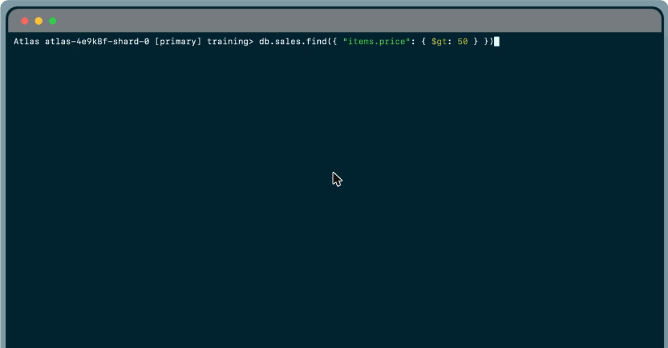
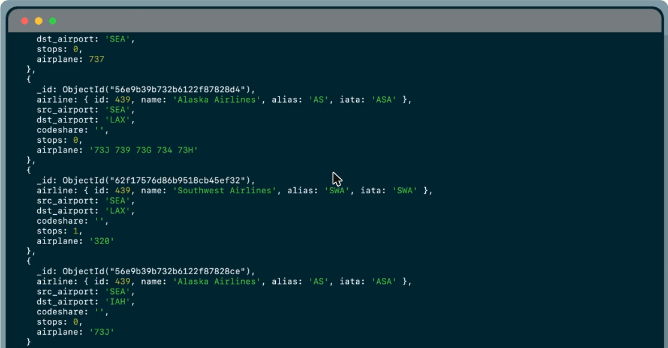
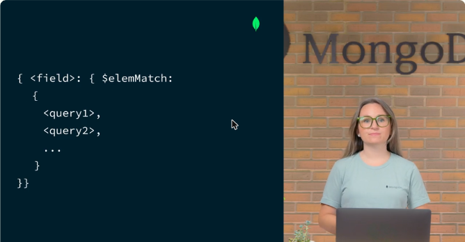

# 06.2 · Diseñar consultas efectivas

Operadores de **comparación**, operadores **lógicos** y consultas sobre **arreglos**.

## Operadores de comparación

| Operador | Significado |
|---|---|
| `$gt` | mayor que |
| `$gte` | mayor o igual que |
| `$lt` | menor que |
| `$lte` | menor o igual que |
| `$eq` / `$ne` | igual / distinto |

```javascript
db.sales.find({ "items.price": { $gt: 50 } })     // dot notation hacia subdocumentos
db.sales.find({ "customer.age": { $lte: 65 } })
```

- La sintaxis es `{ campo: { $operador: valor } }`.
- Para llegar a subdocumentos se usa **dot notation** entre comillas: `"items.price"`.



*Figura: `find({ "items.price": { $gt: 50 } })` busca ventas con al menos un artículo de más de 50.*

## Operadores lógicos: `$and` y `$or`

```javascript
// $and explícito y su forma implícita (con coma)
db.routes.find({ $and: [ { "airline.name": "Southwest Airlines" }, { stops: { $gte: 1 } } ] })
db.routes.find({ "airline.name": "Southwest Airlines", stops: { $gte: 1 } })

// $or
db.routes.find({ $or: [ { dst_airport: "SEA" }, { src_airport: "SEA" } ] })

// Varios $or: hace falta el $and explícito
db.routes.find({
  $and: [
    { $or: [ { dst_airport: "SEA" }, { src_airport: "SEA" } ] },
    { $or: [ { "airline.name": "American Airlines" }, { airplane: 320 } ] }
  ]
})
```

- `$and` exige que se cumplan **todas** las condiciones. `$or` exige **al menos una**.
- La **coma** funciona como `$and` implícito.
- Si se repite el mismo operador (por ejemplo dos `$or`) sin `$and` explícito, **el segundo sobrescribe al primero**, porque un objeto JSON no puede tener dos claves iguales.



*Figura: rutas que salen de SEA o llegan a SEA, devueltas por la consulta con `$or`.*

## Consultas sobre arreglos y `$elemMatch`

```javascript
db.accounts.find({ products: "InvestmentStock" })
// coincide si products ES "InvestmentStock" o es un arreglo que lo CONTIENE

db.accounts.find({ products: { $elemMatch: { $eq: "InvestmentStock" } } })
// solo si products es un ARREGLO con ese elemento

db.sales.find({
  items: { $elemMatch: { name: "laptop", price: { $gt: 800 }, quantity: { $gte: 1 } } }
})
// un MISMO elemento debe cumplir todos los criterios
```

- **Igualdad con un arreglo completo** (`{ categories: ["Action", "Comedy"] }`) busca una coincidencia **exacta**: mismos elementos y **mismo orden**.



*Figura: `$elemMatch` recibe varios criterios que debe cumplir un mismo elemento del arreglo.*

!!! tip "Para recordar"
    - `$gt`/`$gte`/`$lt`/`$lte`. Dot notation con comillas para subcampos.
    - Coma = `$and` implícito. **Usa `$and` explícito cuando repitas un operador** como `$or`.
    - `{ campo: valor }` sobre un arreglo = "contiene". `{ campo: [a, b] }` = arreglo **exacto y en orden**.
    - `$elemMatch` = un mismo elemento cumple varias condiciones, o forzar que el campo sea arreglo.
