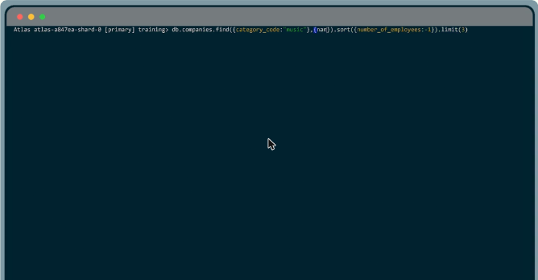
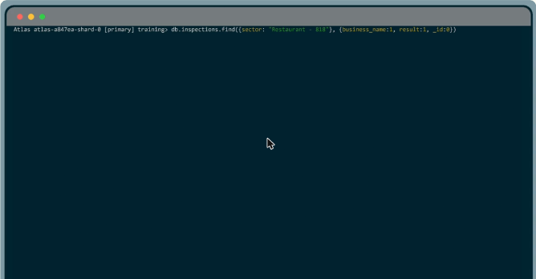
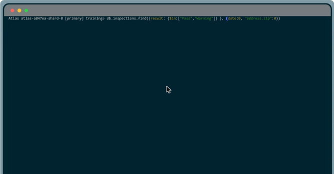
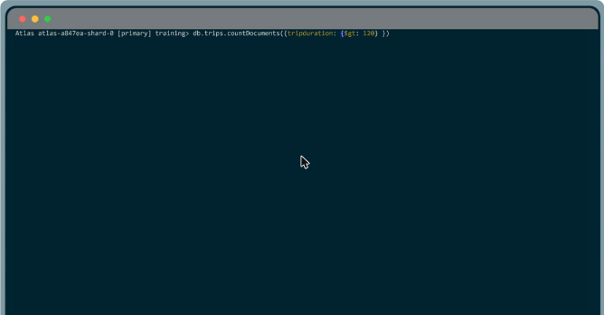

# 06.3 · Modificar los resultados de una consulta

Ordenar, limitar, proyectar campos y contar documentos.

## Cursores, `sort()` y `limit()`

- `find()` devuelve un **cursor**, un puntero al conjunto de resultados.
- Los **métodos de cursor** se encadenan a la consulta y actúan sobre los resultados antes de enviarlos al cliente.

```javascript
db.companies.find({ category_code: "music" }).sort({ name: 1 })           // A→Z
db.companies.find({ category_code: "music" }, { name: 1, number_of_employees: 1 })
  .sort({ number_of_employees: -1 })
  .limit(3)                                                                // top 3
```

- `sort()`: **1 = ascendente**, **-1 = descendente**. Se puede ordenar por varios campos.
- En los strings, las **mayúsculas se ordenan antes** que las minúsculas (se puede cambiar con las opciones).
- `limit(n)` recibe un **número**, no un documento. Limitar mejora el rendimiento porque evita procesar datos de más.



*Figura: las 3 empresas de música con más empleados: `sort({ number_of_employees: -1 }).limit(3)`.*

## Proyección: elegir los campos devueltos

El segundo argumento de `find()` es el **documento de proyección**:

```javascript
// Inclusión: solo business_name y result, y se quita _id
db.inspections.find({ sector: "Restaurant - 818" }, { business_name: 1, result: 1, _id: 0 })

// Exclusión: todo menos date y address.zip
db.inspections.find({ result: { $in: ["Pass", "Warning"] } }, { date: 0, "address.zip": 0 })
```

- **1 = incluir**, **0 = excluir**.
- **No se pueden mezclar** inclusión y exclusión en la misma proyección. La excepción es **`_id`**, que se incluye por defecto y se puede quitar con `_id: 0`.
- Los subcampos se proyectan con dot notation **entre comillas** (`"address.zip"`). Sin comillas da error de sintaxis.
- Proyectar reduce los datos transferidos y mejora el rendimiento.



*Figura: proyección por inclusión `{business_name: 1, result: 1, _id: 0}`.*



*Figura: proyección por exclusión `{date: 0, "address.zip": 0}` junto con `$in`.*

## Contar: `countDocuments()`

```javascript
db.trips.countDocuments()                                                        // toda la colección (10 000)
db.trips.countDocuments({ tripduration: { $gt: 120 }, usertype: "Subscriber" })  // con filtro
```

Recibe un **filtro** y un documento de **opciones** (poco usado).



*Figura: `countDocuments()` con un filtro `$gt` sobre la duración del viaje.*

!!! tip "Para recordar"
    - Top N mayores: `.sort({ campo: -1 }).limit(N)`. `limit` recibe un número.
    - Proyección: segundo argumento de `find()`. 1 incluye, 0 excluye. **No se mezclan, salvo `_id: 0`.**
    - Contar: **`db.coleccion.countDocuments(filtro)`**. No existe `find().countDocuments()`.
