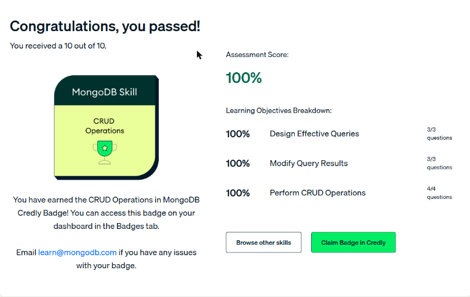

# Unidad 6 · CRUD Operations in MongoDB

Unidad de la ruta *MongoDB Python Developer Path* (formato *skill badge*). Cubre la inserción, búsqueda, actualización y borrado de documentos, el diseño de consultas con operadores y la forma de ordenar, limitar, proyectar y contar resultados. Termina con un **Skill Check** que otorga una insignia de Credly.

| # | Sección | Estado | Resultado | Apuntes |
|---|---|---|---|---|
| 1 | Perform CRUD Operations | Completado | 5 videos | [Ver](01-operaciones-crud.md) |
| 2 | Design Effective Queries | Completado | 3 videos. Lab: Completado | [Ver](02-consultas-efectivas.md) |
| 3 | Modify Query Results | Completado | 3 videos. Lab: Completado | [Ver](03-modificar-resultados.md) |
| 4 | Skill Check | Completado | **10/10 (100 %)**. Insignia *CRUD Operations in MongoDB* | — |

## Resultado del Skill Check

- Puntaje: **10 de 10 (100 %)**.
- Desglose: *Perform CRUD Operations* 4/4, *Design Effective Queries* 3/3, *Modify Query Results* 3/3.
- Insignia obtenida: **MongoDB Skill · CRUD Operations** (Credly). Está disponible en la pestaña *Badges* del panel.

*Figura: Skill Check aprobado con 10/10 y la insignia «CRUD Operations» de MongoDB.*

!!! tip "Para recordar"
    - `insertOne` / `insertMany([...])`, `find`, `updateOne` / `updateMany`, `deleteOne` / `deleteMany`.
    - `$set` reemplaza o agrega, `$push` agrega a un arreglo, `upsert: true` inserta si no hay coincidencia.
    - Comparación: `$gt`, `$gte`, `$lt`, `$lte`, `$in`. Lógicos: `$and`, `$or`. Arreglos: `$elemMatch`.
    - `sort({ campo: -1 }).limit(n)`, proyección `{ campo: 1, _id: 0 }`, `countDocuments(filtro)`.
