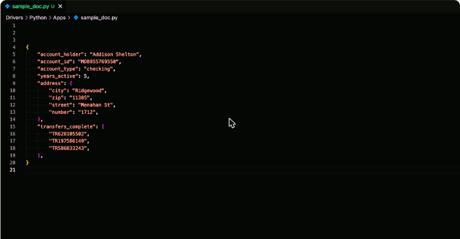
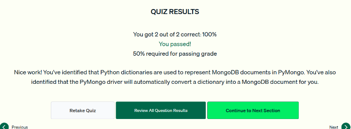

# 07.1 · Documentos BSON en Python

Cómo se representan los documentos de MongoDB en Python con PyMongo.

## BSON y diccionarios

- **BSON** (Binary JSON) es el formato en que MongoDB guarda y transmite los datos. Está optimizado para almacenamiento, lectura y transmisión, es **más seguro** que JSON en texto plano (no es vulnerable a inyección JSON) y tiene **más tipos de datos**.
- En PyMongo un documento es un **diccionario de Python** (`dict`).
- PyMongo **convierte automáticamente** los tipos nativos de Python a BSON y viceversa: `str`, `int`, `float`, `list`, `dict` (subdocumento) y `datetime`.

```python
new_document = {
    "account_holder": "Addison Shelton",
    "account_id": "MDB955769550",
    "account_type": "checking",
    "years_active": 5,                                   # int
    "address": {"city": "Ridgewood", "zip": "11385"},    # dict → subdocumento
    "transfers_complete": ["TR628105502", "TR197586149"] # list → arreglo
}
```



*Figura: un documento de cuenta bancaria escrito como diccionario de Python, con string, int, lista y subdocumento.*

## Tipos que necesitan el paquete `bson`

Algunos tipos BSON se manejan con las clases del paquete **`bson`**, que viene con PyMongo:

| Tipo BSON | Clase en Python |
|---|---|
| **ObjectId** | `from bson.objectid import ObjectId` |
| **Int64** | `bson.int64.Int64` |
| **Decimal128** | `bson.decimal128.Decimal128` |
| **Regex** | `bson.regex.Regex` |

Si se inserta un documento sin `_id`, MongoDB agrega uno con un valor de tipo **ObjectId**.


*Figura: unos pocos tipos necesitan el paquete `bson` para trabajar con BSON desde Python.*

!!! tip "Para recordar"
    - Documento de MongoDB = **diccionario** en Python.
    - PyMongo convierte el diccionario a BSON **automáticamente**. No hace falta una biblioteca extra ni agregar `_id`.
    - `ObjectId`, `Int64`, `Decimal128` y `Regex` se manejan con el paquete **`bson`**.

## Cuestionario

Resultado: **2/2 correctas (100 %)**. Las preguntas cubrieron el tipo de Python que representa un documento y la conversión de diccionario a BSON.



*Figura: cuestionario de la lección 1 aprobado.*
