# 07.2 · CRUD con PyMongo: insertar, consultar, actualizar y borrar

Lecciones 2 a 5 de la unidad. En PyMongo los métodos se escriben en *snake_case* y se llaman sobre una referencia a la colección.

## Preparación común

```python
from pymongo import MongoClient
from bson.objectid import ObjectId   # para filtrar por _id

client = MongoClient(MONGODB_URI)
db = client.bank                     # referencia a la base
accounts_collection = db.accounts    # referencia a la colección
# ... operaciones ...
client.close()
```

## Insertar: `insert_one()` e `insert_many()`

```python
new_account = {"account_holder": "Linus Torvalds", "account_id": "MDB829001337",
               "account_type": "checking", "balance": 50352434,
               "last_updated": datetime.datetime.utcnow()}
result = accounts_collection.insert_one(new_account)
print(f"_id del documento insertado: {result.inserted_id}")

new_accounts = [ {...}, {...} ]                       # lista (iterable) de documentos
result = accounts_collection.insert_many(new_accounts)
print(len(result.inserted_ids), result.inserted_ids)
```

- `insert_one()` devuelve `inserted_id`. `insert_many()` recibe un **iterable** y devuelve `inserted_ids`.
- Si falta `_id`, el driver lo genera.

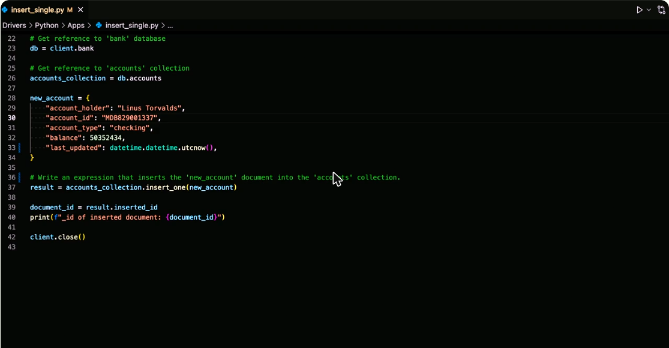

*Figura: `insert_one()` sobre `accounts_collection` e impresión de `result.inserted_id`.*

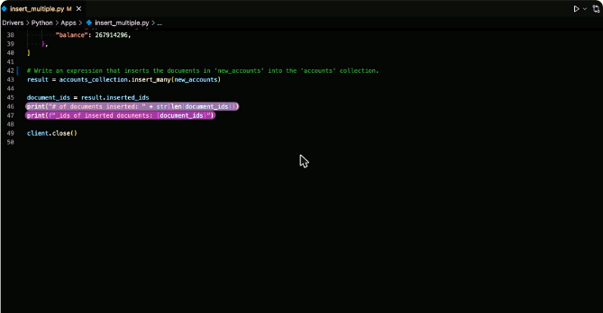

*Figura: `insert_many()` con una lista de documentos, imprimiendo cuántos se insertaron y sus `_id`.*

## Consultar: `find_one()` y `find()`

```python
document_to_find = {"_id": ObjectId("62d6e04ecab6d8e1304974ae")}
result = accounts_collection.find_one(document_to_find)   # un documento o None
pprint.pprint(result)

documents_to_find = {"balance": {"$gt": 4700}}
cursor = accounts_collection.find(documents_to_find)      # cursor iterable
num_docs = 0
for document in cursor:
    num_docs += 1
    pprint.pprint(document)
print("Documentos encontrados:", num_docs)
```

- `find_one()` devuelve **un documento** (o `None`). Sirve cuando solo puede haber una coincidencia, como con `_id`.
- `find()` devuelve un **cursor** que se recorre con `for`. Sin filtro devuelve toda la colección.
- Los operadores de consulta (`$gt`, `$in`…) se escriben como claves string: `{"$gt": 4700}`.

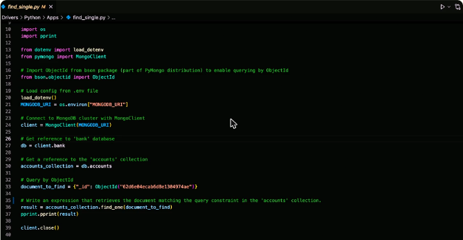

*Figura: `find_one()` con un filtro por `ObjectId`, importado de `bson.objectid`.*

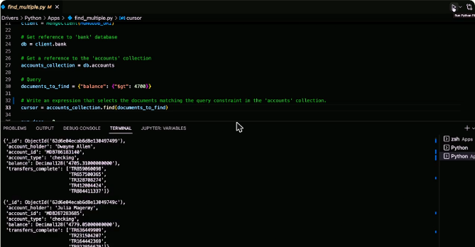

*Figura: `find({"balance": {"$gt": 4700}})` devuelve un cursor con varios documentos.*

## Actualizar: `update_one()` y `update_many()`

```python
document_to_update = {"_id": ObjectId("62d6e04ecab6d8e130497482")}
add_to_balance = {"$inc": {"balance": 100}}
result = accounts_collection.update_one(document_to_update, add_to_balance)
print("Documentos actualizados:", result.modified_count)

select_accounts = {"account_type": "savings"}
set_field = {"$set": {"minimum_balance": 100}}
result = accounts_collection.update_many(select_accounts, set_field)
print(result.matched_count, result.modified_count)
```

- Los dos reciben **dos argumentos obligatorios**: el filtro y el documento de actualización, sin envolverlos en llaves adicionales.
- `$inc` incrementa un número (con valor negativo, resta). `$set` crea el campo si no existe.
- El resultado expone `matched_count` y `modified_count`.

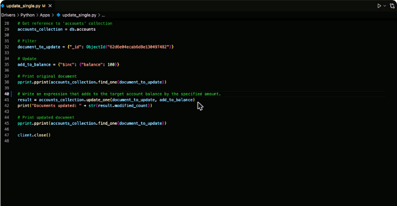

*Figura: `update_one()` con `$inc` para sumar 100 al saldo.*

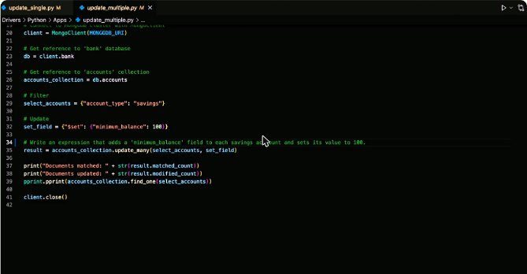

*Figura: `update_many()` agrega `minimum_balance` a todas las cuentas de ahorro.*

## Borrar: `delete_one()` y `delete_many()`

```python
result = accounts_collection.delete_one({"_id": ObjectId("62d6e04ecab6d8e130497485")})
result = accounts_collection.delete_many({"balance": {"$lt": 2000}})
print("Documentos borrados:", result.deleted_count)
```

- Devuelven un `DeleteResult` con `deleted_count`.
- ⚠️ `delete_one({})` borra el **primer** documento de la colección. ⚠️ `delete_many({})` **borra todos los documentos**.

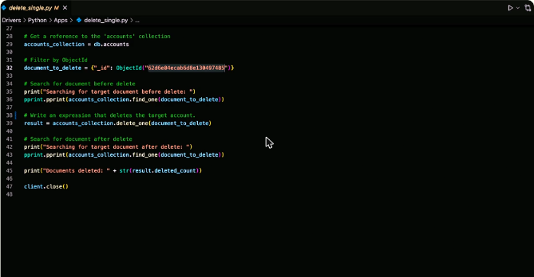

*Figura: `delete_one()` por `_id`, comprobando el documento antes y después de borrarlo.*

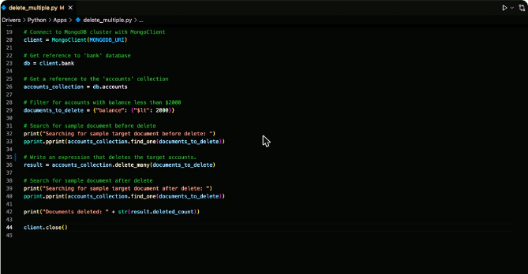

*Figura: `delete_many()` borra las cuentas con saldo menor a 2000.*

!!! tip "Para recordar"
    - Insertar un documento: `coleccion.insert_one(doc)`. Varios: `coleccion.insert_many(lista)`.
    - Un resultado directo: `find_one(filtro)`. Varios: `find(filtro)`, que devuelve un cursor.
    - `update_one(filtro, update)` y `update_many(filtro, update)`: dos argumentos separados, con paréntesis y no corchetes.
    - `delete_one` y `delete_many`. **Un filtro vacío en `delete_many` vacía la colección.**
    - Pista para el examen: métodos como `insert()`, `update()`, `delete()` o `hide()` **no son** la API actual de PyMongo.

## Cuestionarios y laboratorios

- Cuestionarios de las lecciones 2 a 5: **2/2 correctas (100 %) en cada uno**. Cubrieron qué método usar para insertar uno o varios documentos, consultas con `find_one` y `find`, actualizaciones con `update_one` y `update_many`, y borrados con `delete_many` y `delete_one`.
- Laboratorios prácticos en Atlas: **Pendiente**.

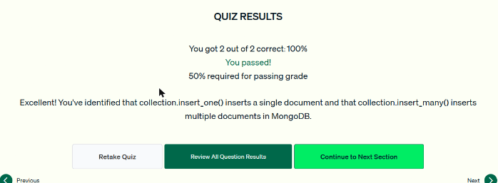

*Figura: cuestionario de la lección 2 (inserción) aprobado.*

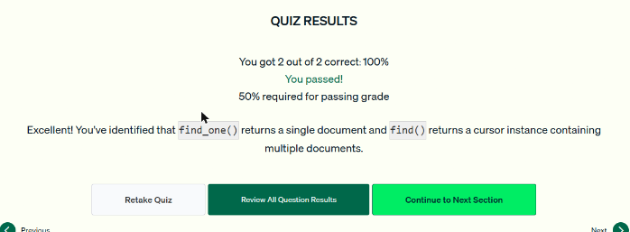

*Figura: cuestionario de la lección 3 (consultas) aprobado.*

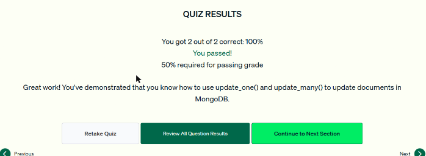

*Figura: cuestionario de la lección 4 (actualización) aprobado.*


*Figura: cuestionario de la lección 5 (borrado) aprobado.*
