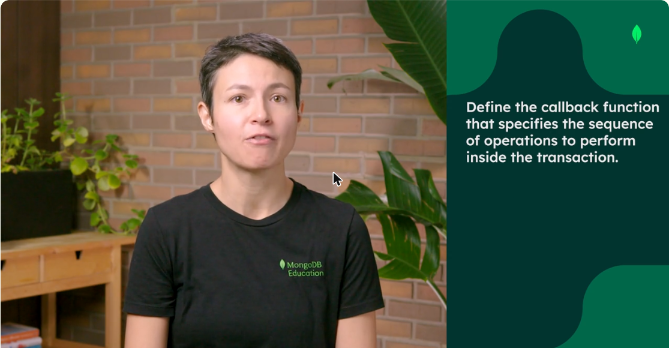
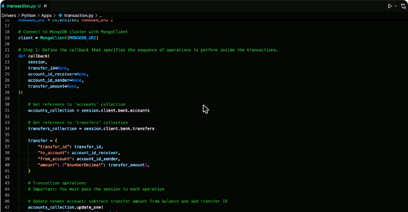
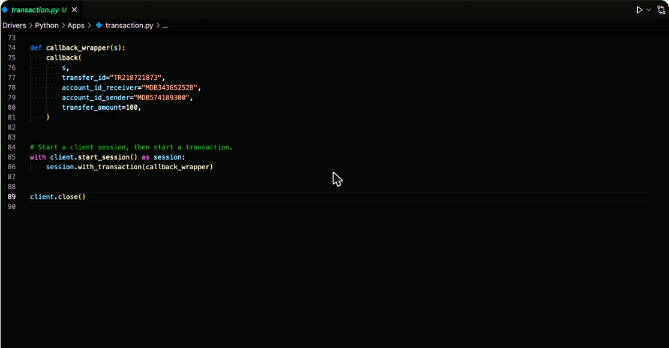
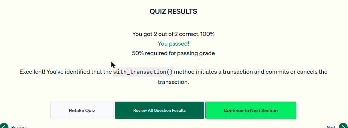
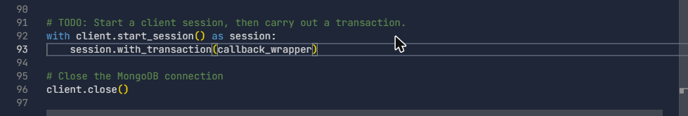
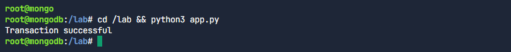

# 07.3 · Transacciones multidocumento en Python

Una **transacción** es un grupo de operaciones que se completan **todas juntas o ninguna** (**atomicidad**). Ejemplos: una transferencia de dinero en una app de pagos, o sacar un artículo del inventario y agregarlo al carrito.

## Pasos con la *callback API* de PyMongo

1. **Definir el callback** con la secuencia de operaciones. Su único parámetro obligatorio es la **sesión**.
2. **Iniciar una sesión** de cliente con `client.start_session()`.
3. **Ejecutar la transacción** con `session.with_transaction(callback)`: inicia la transacción, ejecuta el callback y hace **commit**, o la **cancela** si hay un error.

Por defecto, MongoDB **cancela** automáticamente cualquier transacción multidocumento que dure **más de 60 segundos**.

## Ejemplo: transferencia bancaria

Se actualizan dos documentos de `accounts` (quien envía y quien recibe) y se inserta un registro en `transfers`. Como son varios documentos en dos colecciones, hace falta una transacción.

```python
def callback(session, transfer_id=None, account_id_receiver=None,
             account_id_sender=None, transfer_amount=None):
    accounts_collection = session.client.bank.accounts
    transfers_collection = session.client.bank.transfers

    transfer = {"transfer_id": transfer_id, "to_account": account_id_receiver,
                "from_account": account_id_sender,
                "amount": {"$numberDecimal": transfer_amount}}

    # IMPORTANTE: pasar session=session a CADA operación
    accounts_collection.update_one(
        {"account_id": account_id_sender},
        {"$inc": {"balance": -transfer_amount}, "$push": {"transfers_complete": transfer_id}},
        session=session)
    accounts_collection.update_one(
        {"account_id": account_id_receiver},
        {"$inc": {"balance": transfer_amount}, "$push": {"transfers_complete": transfer_id}},
        session=session)
    transfers_collection.insert_one(transfer, session=session)
    print("Transaction successful")

def callback_wrapper(s):
    callback(s, transfer_id="TR218721873", account_id_receiver="MDB343652528",
             account_id_sender="MDB574189300", transfer_amount=100)

with client.start_session() as session:
    session.with_transaction(callback_wrapper)

client.close()
```

- Las referencias a las colecciones se obtienen **a través de la sesión** (`session.client.bank.accounts`).
- El *wrapper* permite reutilizar el callback con distintos valores. La buena práctica general es usar una **lambda**.
- Si una operación falla, se **cancela toda la transacción**: no se confirma nada y las operaciones ya hechas se revierten.



*Figura: el primer paso es definir el callback con las operaciones de la transacción.*



*Figura: el callback obtiene las colecciones desde la sesión y arma el documento de la transferencia.*



*Figura: `start_session()` en un bloque `with` y `session.with_transaction(callback_wrapper)`.*

!!! tip "Para recordar"
    - Transacción = **todo o nada** (atomicidad, ACID).
    - **`with_transaction()`** inicia, ejecuta el callback y hace commit o cancela.
    - Hay que pasar **`session=session`** a cada operación dentro del callback.
    - Si algo falla, nada se confirma. Límite por defecto: **60 segundos**.

## Cuestionario y laboratorio

- Cuestionario: **2/2 correctas (100 %)**. Las preguntas cubrieron qué pasa cuando falla una operación y qué método inicia, ejecuta y confirma o cancela la transacción.
- Laboratorio práctico: **Completado** (ver la sección *Laboratorio*).



*Figura: cuestionario de la lección 6 aprobado.*

## Laboratorio

El `app.py` ya traía la función `callback(session, ...)` (resta el monto al emisor con `$inc`, se lo suma al receptor junto con `$push` del ID de transferencia e inserta el documento en `transfers`, todo con `session=session`) y un `callback_wrapper` con los datos de la transferencia. Faltaba abrir la sesión y ejecutar la transacción:

```python
def callback_wrapper(s):
    callback(s, transfer_id="TR218721873",
             account_id_receiver="MDB343652528",
             account_id_sender="MDB574189300",
             transfer_amount=100)

with client.start_session() as session:
    session.with_transaction(callback_wrapper)   # commit si todo sale bien, abort si algo falla

client.close()
```

Al ejecutar `python3 app.py` se imprime `Transaction successful`.





## Fuentes y aviso legal

- **Fuente:** cursos de MongoDB University. Sitios oficiales: [learn.mongodb.com](https://learn.mongodb.com) · [mongodb.com/docs](https://www.mongodb.com/docs).
- **Uso:** apuntes personales de estudio, sin fines comerciales y con redacción propia. Las imágenes del curso son fragmentos breves citados con fines educativos; sus derechos son de sus titulares.
- **Sin afiliación:** sitio no oficial, no afiliado ni respaldado por MongoDB. Las marcas pertenecen a sus dueños.
- Más detalles y cómo pedir el retiro de contenido en el [aviso legal](../../../aviso-legal.md).
