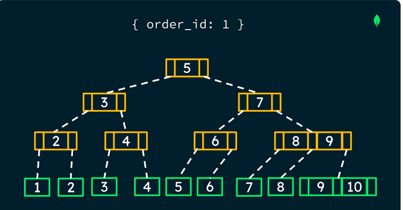
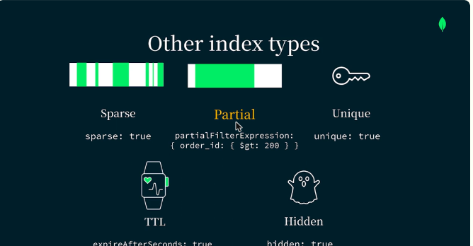
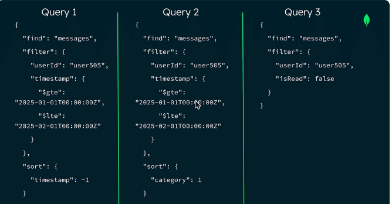
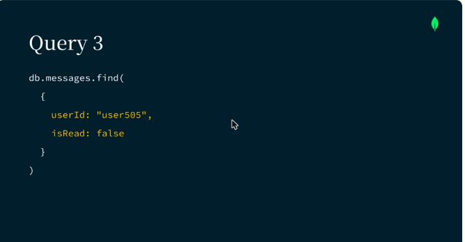

# 08.1 · Introducción a los índices e identificación de cargas clave

## Qué es un índice

- Un **índice** es una estructura de datos especial que guarda una pequeña parte de los datos de la colección **ordenada**, optimizada para buscar rápido.
- Sin índices, MongoDB hace un **collection scan**: revisa todos los documentos. Es lento y lleva toda la colección a memoria.
- Los índices de MongoDB usan un **árbol B+**. Los nodos internos guían la búsqueda y las **hojas** guardan el valor indexado y el **recordId**, un atajo al documento.
- Un índice sirve para **igualdades**, **rangos** y **ordenamientos**: los datos ya están ordenados y el índice se puede recorrer hacia adelante o hacia atrás. Así se evita el *sort* en memoria.

*Figura: índice `{ order_id: 1 }` como árbol B+. Las hojas (en verde) guardan el valor y el recordId.*

## Tipos y propiedades de índices

| Tipo | Uso |
|---|---|
| **Single field** | Un solo campo |
| **Compound** | Dos o más campos (hasta 32) |
| Multikey | Campos que son arreglos |
| Geoespacial, texto, hashed, wildcard | Datos y consultas especiales |

**Propiedades** (opciones al crear el índice): **sparse**, **partial** (`partialFilterExpression`), **unique**, **TTL** (`expireAfterSeconds`) y **hidden**.

*Figura: las propiedades sparse, partial, unique, TTL y hidden.*

## El costo de los índices

- Mejoran las **lecturas**, pero **encarecen las escrituras**: cada insert, update o delete tiene que actualizar los índices.
- Ocupan **disco y memoria**.
- Ciclo de gestión: **identificar** las consultas de las cargas clave → **crear el mínimo** de índices que las soporten → **monitorear y mantener**.

## Identificar las cargas clave (caso LeafyBank)

En la colección `messages` de una app de mensajería bancaria hay tres consultas para la bandeja de entrada:

| Consulta | Filtro | Orden |
|---|---|---|
| 1 | `userId` (igualdad) + `timestamp` (rango) | `timestamp: -1` |
| 2 | `userId` (igualdad) + `timestamp` (rango) | `category: 1` |
| 3 | `userId` + `isRead: false` (igualdades) | — |

- Para detectar consultas lentas se usa el **Query Profiler**.
- Al comparar patrones se ve que **dos índices compuestos alcanzan para las tres consultas**: `{userId, timestamp, category}` para la 1 y la 2, y `{isRead, userId}` para la 3.
- En un índice compuesto los valores se ordenan primero por el **primer campo (prefijo)** y después por el segundo.

*Figura: las tres consultas de la bandeja de entrada. Todas filtran por `userId`.*

*Figura: la consulta 3 filtra por `userId` e `isRead: false` para los mensajes no leídos.*

!!! tip "Para recordar"
    - Índice = estructura ordenada (árbol B+) que evita el **COLLSCAN**.
    - Sirve para igualdad, rango y orden. Evita los *sorts* en memoria.
    - **Costo:** escrituras más lentas, más disco y RAM. Crea **el mínimo** necesario.
    - Analiza patrones comunes entre consultas para reutilizar índices compuestos.

## Fuentes y aviso legal

- **Fuente:** cursos de MongoDB University. Sitios oficiales: [learn.mongodb.com](https://learn.mongodb.com) · [mongodb.com/docs](https://www.mongodb.com/docs).
- **Uso:** apuntes personales de estudio, sin fines comerciales y con redacción propia. Las imágenes del curso son fragmentos breves citados con fines educativos; sus derechos son de sus titulares.
- **Sin afiliación:** sitio no oficial, no afiliado ni respaldado por MongoDB. Las marcas pertenecen a sus dueños.
- Más detalles y cómo pedir el retiro de contenido en el [aviso legal](../../../aviso-legal.md).
